# 代码导读：A 股量化研究原型

> **适用范围**：ticket 01（骨架 + 双均线）、02（A 股撮合规则）落地后的代码。
> **配套文档**：目标设计与演进路线见 [`design.md`](design.md)；术语以 [`GLOSSARY.md`](../GLOSSARY.md) 为准；决策见 [`docs/adr/`](adr/)。
> 本文配合图表，逐个文件、逐个函数讲清楚**现有代码**怎么运转。代码演进后，请同步更新行号和「容易忽略的细节」一节。
>
> 文中的图使用 Mermaid，在 GitHub、VS Code（Markdown Preview Mermaid Support 插件）、Typora 中都能直接渲染。源码链接带行号，行号以写作时的工作区为准。

## 目录

- [1. 30 秒看懂项目](#1-30-秒看懂项目)
- [2. 推荐阅读顺序](#2-推荐阅读顺序)
- [3. 目录与模块依赖](#3-目录与模块依赖)
- [4. 核心数据结构（类图）](#4-核心数据结构类图)
- [5. 一次回测的完整调用链](#5-一次回测的完整调用链)
- [6. 数据层详解](#6-数据层详解)
- [7. 回测引擎详解](#7-回测引擎详解)
- [8. 撮合与账户](#8-撮合与账户)
- [9. 策略接口与双均线](#9-策略接口与双均线)
- [10. 绩效指标与报告](#10-绩效指标与报告)
- [11. 命令行与配置覆盖](#11-命令行与配置覆盖)
- [12. 测试接缝](#12-测试接缝)
- [13. 实例追踪：一次金叉死叉的逐日推演](#13-实例追踪一次金叉死叉的逐日推演)
- [14. 阅读时容易忽略的细节](#14-阅读时容易忽略的细节)

---

## 1. 30 秒看懂项目

一句话：**`backtest ma_cross` 从 baostock 拉一只 A 股的日线（带本地缓存），在每个交易日收盘调用策略拿到订单，下一交易日开盘撮合进统一账户，最后算指标、画净值图。**

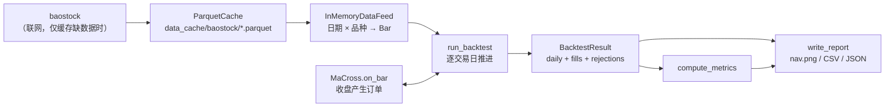

整个代码库约 700 行，没有框架魔法，所有调用都是显式的函数调用，可以从 `cli.main` 一路跟下去。

## 2. 推荐阅读顺序

按依赖从底向上读，每读一个文件，它依赖的东西都已经读过了：

| 顺序 | 文件 | 读什么 | 用时 |
| --- | --- | --- | --- |
| 1 | [`data/feed.py`](../src/quant/data/feed.py) | `Bar` 有哪些字段、`DataFeed` 协议只有两个方法 | 3 分钟 |
| 2 | [`strategy.py`](../src/quant/strategy.py) | `Order` / `Context` / `Strategy`，策略能看到什么 | 3 分钟 |
| 3 | [`portfolio.py`](../src/quant/portfolio.py) | `Fill` 怎么改变现金和持仓、`Rejection` 记录什么、可卖数量 | 3 分钟 |
| 4 | [`instruments/stock.py`](../src/quant/instruments/stock.py) | 订单如何变成成交或被拒（A 股规则） | 10 分钟 |
| 5 | [`engine.py`](../src/quant/engine.py) | **核心**：每日循环的四个步骤 | 10 分钟 |
| 6 | [`strategies/ma_cross.py`](../src/quant/strategies/ma_cross.py) | 一个具体策略 | 3 分钟 |
| 7 | [`tests/test_engine.py`](../tests/test_engine.py)、[`tests/test_stock_rules.py`](../tests/test_stock_rules.py) | 用测试反向理解引擎语义与撮合规则 | 15 分钟 |
| 8 | [`data/cache.py`](../src/quant/data/cache.py) | 缓存覆盖区间算法 | 10 分钟 |
| 9 | [`data/baostock_feed.py`](../src/quant/data/baostock_feed.py) | 外部数据怎么变成 `Bar` | 10 分钟 |
| 10 | [`metrics.py`](../src/quant/metrics.py)、[`report.py`](../src/quant/report.py)、[`cli.py`](../src/quant/cli.py) | 输出与入口 | 10 分钟 |

如果只有 15 分钟：读 `feed.py` → `engine.py` → `test_engine.py`。

## 3. 目录与模块依赖

```
src/quant/
├── cli.py                  命令行入口，串联全流程
├── engine.py               回测主循环、BacktestConfig、BacktestResult
├── strategy.py             Strategy / Context / Order / Side
├── portfolio.py            Portfolio 统一账户、Fill、Rejection / RejectReason
├── metrics.py              绩效指标、买入持有基准
├── report.py               指标文本、净值图、CSV/JSON 输出
├── data/
│   ├── feed.py             Bar、DataFeed 协议、InMemoryDataFeed
│   ├── cache.py            ParquetCache（覆盖区间 + 增量补拉）
│   └── baostock_feed.py    baostock 适配器
├── instruments/
│   └── stock.py            StockConfig、StockRules（A 股撮合规则）
└── strategies/
    └── ma_cross.py         双均线
tests/
├── conftest.py             make_bar / make_feed / stock_costs、--run-network 开关
├── test_engine.py          引擎语义：交易日、计息、成交时点、佣金
├── test_stock_rules.py     A 股撮合规则：T+1、整手、涨跌停、停牌、费用、滑点、资金
├── test_ma_cross.py        金叉买、死叉卖
├── test_metrics.py         指标手算校验
├── test_report.py          rejections.csv 与未成交汇总
├── test_cli.py             --set 覆盖嵌套配置
└── test_baostock_smoke.py  联网冒烟（默认跳过）
```

下图是**真实的 import 关系**（箭头表示「依赖于」）。注意 `data/feed.py` 位于最底层，不依赖任何业务模块，这正是它能当测试接缝的原因。

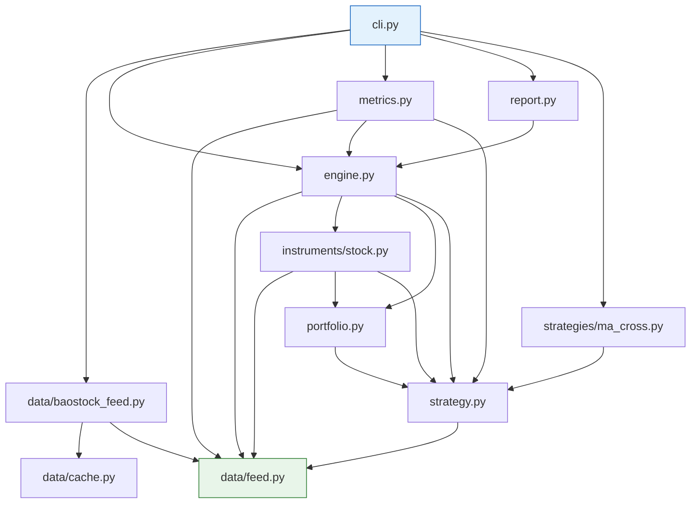

分层理解：

| 层 | 模块 | 说明 |
| --- | --- | --- |
| 入口 | `cli` | 唯一知道「真实数据源 + 具体策略 + 报告」三者存在的地方 |
| 输出 | `metrics`、`report` | 只读 `BacktestResult`，不参与回测 |
| 核心 | `engine` | 只依赖抽象：`DataFeed` 协议、`Strategy` 基类 |
| 规则与账户 | `instruments/stock`、`portfolio` | 订单 → 成交 → 账户变化 |
| 契约 | `strategy`、`data/feed` | 纯数据结构和接口，几乎无逻辑 |
| 外部适配 | `data/baostock_feed`、`data/cache` | 只有 `cli` 用到，引擎完全不知道它们 |

## 4. 核心数据结构（类图）

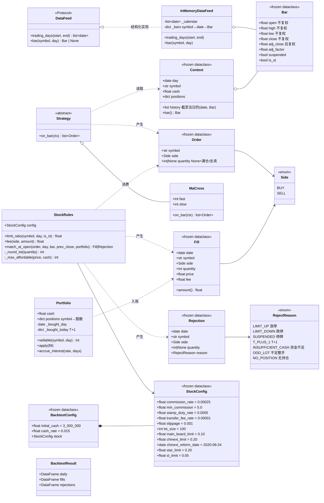

几个设计要点：

- **几乎全是不可变值对象**（`frozen=True`）：`Bar`、`Order`、`Fill`、`Rejection`、`Context`、所有 `Config`。唯一可变的状态是 `Portfolio`，而它只在引擎里被修改。读代码时只要盯住 `portfolio.apply(...)` 和 `portfolio.accrue_interest(...)` 两处调用，就知道钱是怎么变的。
- **`Order.quantity` 为 `None` 有特殊语义**：买入表示满仓，卖出表示全部卖出。具体股数要到成交日开盘、知道开盘价后才能算，所以推迟到 `StockRules.match_at_open` 决定。给出数量时必须为正数，否则构造 `Order` 就抛 `ValueError`。
- **`Context` 给策略的是快照副本**：`history=list(history)`、`positions=dict(portfolio.positions)`，策略即使修改也不会影响引擎（[engine.py:75](../src/quant/engine.py#L75)）。

## 5. 一次回测的完整调用链

`backtest ma_cross --symbol sh.600519` 从敲下回车到打印结果，可以拆成**四个阶段**。先看总览，再逐个阶段放大；每张时序图只保留该阶段真正交互的 3–4 个对象。

### 5.0 总览：四个阶段

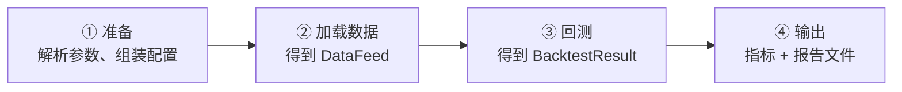

四个阶段都写在 [`cli.main`](../src/quant/cli.py#L21) 里，每个阶段只有一两行，对应关系如下：

| 阶段 | `cli.main` 中的代码 | 输入 | 输出 | 详见 |
| --- | --- | --- | --- | --- |
| ① 准备 | [L36-39](../src/quant/cli.py#L36) `parse_args`、`apply_overrides` | 命令行参数 | `args`、`BacktestConfig` | [§11](#11-命令行与配置覆盖) |
| ② 加载数据 | [L40-41](../src/quant/cli.py#L40) `load_baostock_feed` | symbol、区间、缓存目录 | `InMemoryDataFeed` | [§6](#6-数据层详解) |
| ③ 回测 | [L42-44](../src/quant/cli.py#L42) `MaCross(...)`、`run_backtest` | feed、策略、配置 | `BacktestResult` | [§7](#7-回测引擎详解)–[§9](#9-策略接口与双均线) |
| ④ 输出 | [L48-60](../src/quant/cli.py#L48) `compute_metrics`、`buy_and_hold_nav`、`write_report`、`print` | result、feed | 终端文本 + 5 个文件 | [§10](#10-绩效指标与报告) |

阶段之间只通过这几个值传递：`config`、`feed`、`result`。理解了这三个对象，就理解了模块之间怎么衔接。

### 5.1 阶段 ① 准备

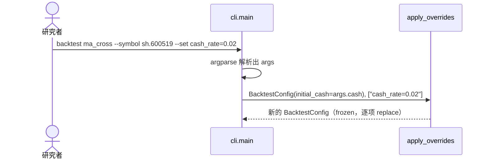

这一步没有 I/O，只是把命令行变成一个不可变的 `BacktestConfig`。

### 5.2 阶段 ② 加载数据

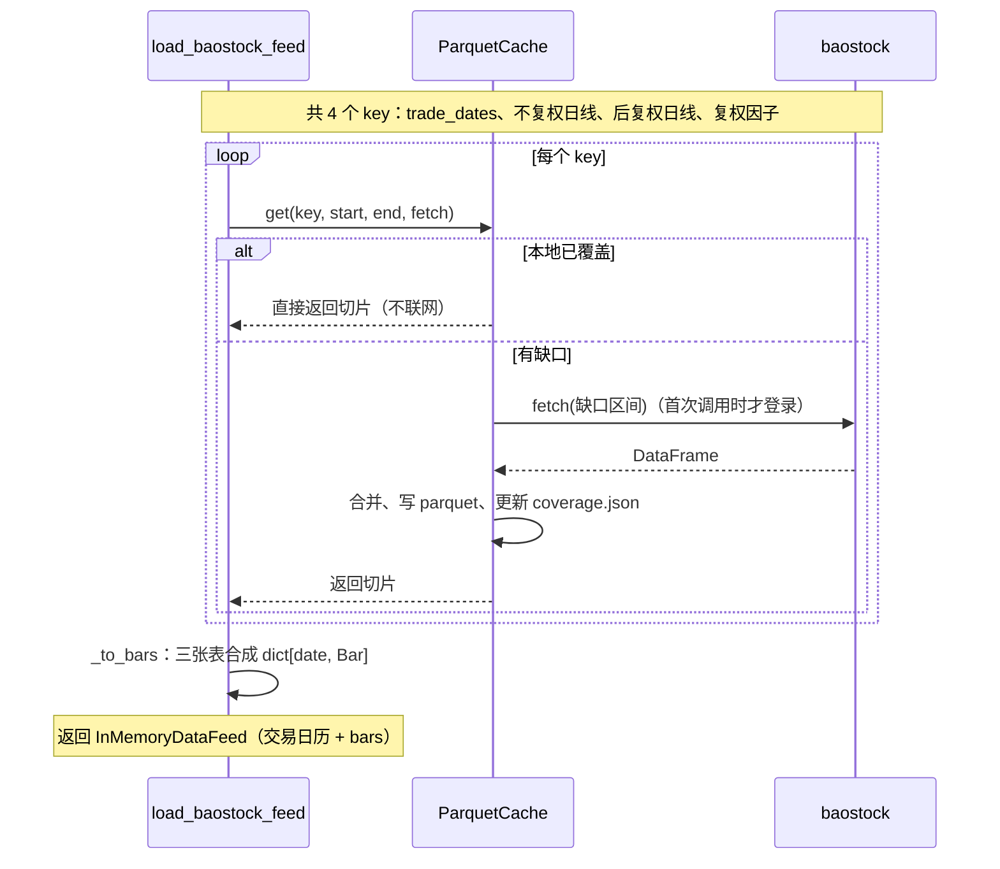

关键点：引擎拿到的 `InMemoryDataFeed` 里已经没有任何 baostock 或缓存的痕迹，后面的阶段完全不知道数据从哪来。

### 5.3 阶段 ③ 回测：一个交易日内发生了什么

`run_backtest` 对每个交易日重复同样的四步，这里只画**一天**：

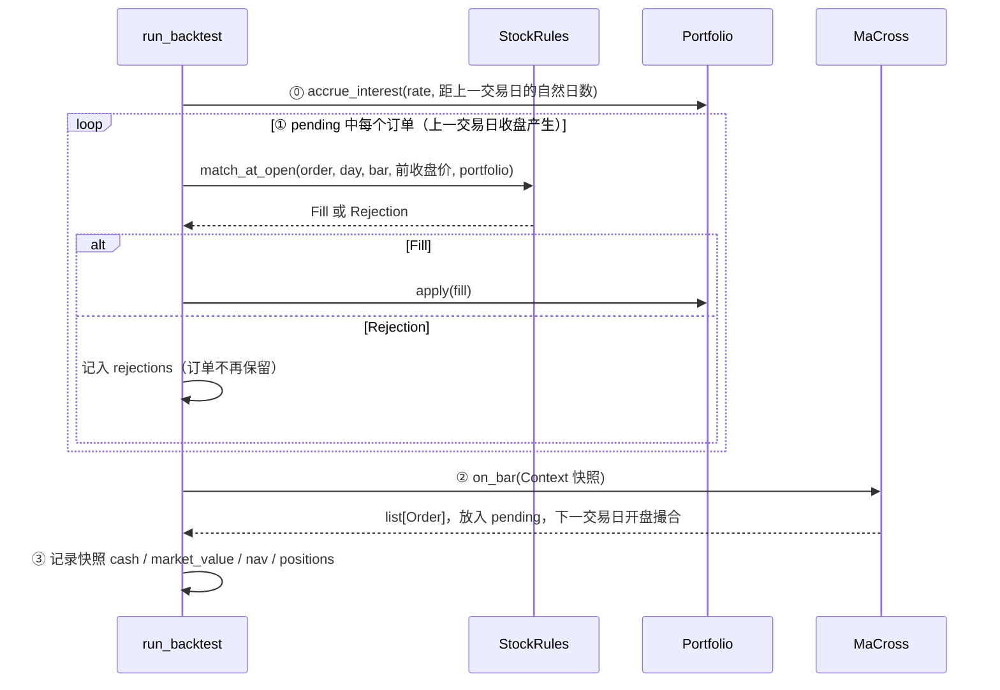

注意三点：

- 策略**不直接**调用 `StockRules` 或 `Portfolio`，它只返回订单；改变账户的只有引擎。
- 今天 ② 产生的订单，要到**下一个交易日**的 ① 才撮合，这就是「信号日收盘、成交日开盘」。
- 所有交易日跑完后，`rows`、`fills`、`rejections` 三个列表转成 DataFrame，包成 `BacktestResult(daily, fills, rejections)` 返回。

### 5.4 阶段 ④ 输出

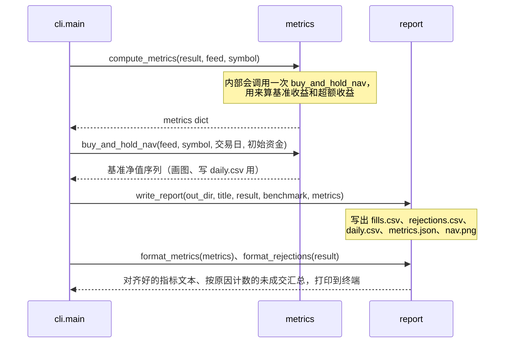

`metrics` 和 `report` 只读 `BacktestResult`，不会反过来影响回测。所以想改报告格式或加新指标，完全不用碰引擎。

## 6. 数据层详解

### 6.1 `Bar` 的价格口径

同一根 bar 里同时放了两套价格，**各有各的用途，不能混用**：

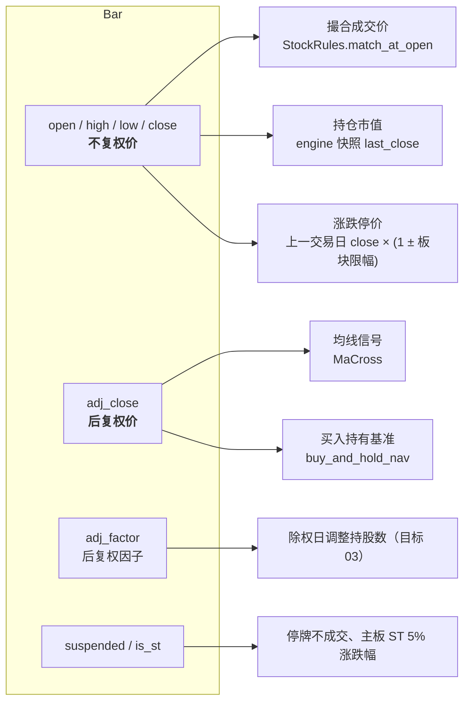

为什么这样设计：撮合必须用交易所当日真实挂牌价（不复权价），否则成交价、整手金额、涨跌停全都不对；而信号需要连续价格，否则除权缺口会被均线误认为暴跌。见 `GLOSSARY.md` 中「不复权价 / 后复权价」词条。

### 6.2 `load_baostock_feed`：外部数据如何变成 `Bar`

[`baostock_feed.py:25`](../src/quant/data/baostock_feed.py#L25)

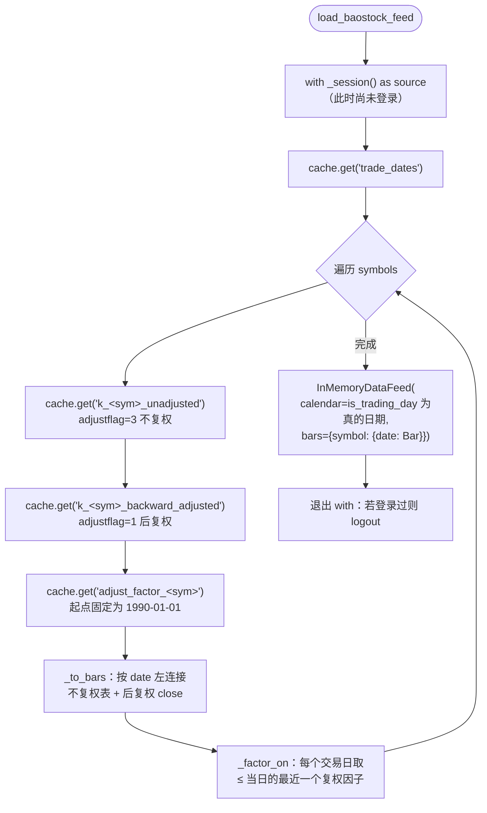

三个值得注意的实现细节：

1. **懒登录**（[`_BaostockSource._login`](../src/quant/data/baostock_feed.py#L109)）：`_session()` 只是创建对象，真正 `bs.login()` 发生在第一次 `_query` 时。缓存全部命中时一次都不登录，所以断网能跑。
2. **复权因子从 1990 年取**：baostock 的复权因子只在除权日有记录。如果从回测起点开始取，起点之前最近一次除权的因子就丢了，区间开头的因子会被错误地填成 1.0。
3. **字段映射集中在 `_BaostockSource`**：`tradestatus == "0"` → 停牌、`isST == "1"` → ST、`dividOperateDate` / `backAdjustFactor` 等 baostock 专有命名都只出现在这里，数据源改字段时只改这一个类。

### 6.3 `ParquetCache.get`：增量补拉算法

[`cache.py:34`](../src/quant/data/cache.py#L34)

每个 key 一个 Parquet 文件，`coverage.json` 记录每个 key 已覆盖的**连续区间** `[lo, hi]`。

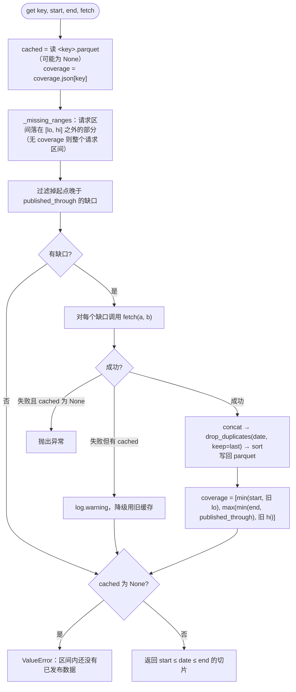

**`published_through` 的作用**（[`last_published_day`](../src/quant/data/cache.py#L21)）：北京时间 18 点前，今天的日线还没出，所以覆盖区间最多只记到昨天。这样今天请求「到今天」时虽然拿不到今天的数据，但明天再跑会自动补拉今天这一天，而不会因为覆盖区间已经包含今天而永远缺这一天。

一个时间线例子，key = `k_sh.600519_unadjusted`：

| 运行 | 请求区间 | 运行前 coverage | 缺口 | 运行后 coverage |
| --- | --- | --- | --- | --- |
| 第 1 次（10-14 20:00） | 2020-01-01 ~ 10-14 | 无 | 整个区间 | 2020-01-01 ~ 10-14 |
| 第 2 次（10-15 10:00） | 2016-01-01 ~ 10-15 | 2020-01-01 ~ 10-14 | 2016-01-01 ~ 2019-12-31；10-15 晚于 published_through(10-14)，跳过 | 2016-01-01 ~ 10-14 |
| 第 3 次（10-15 19:00） | 2016-01-01 ~ 10-15 | 2016-01-01 ~ 10-14 | 10-15 | 2016-01-01 ~ 10-15 |
| 第 4 次（断网） | 2018-01-01 ~ 2020-12-31 | 2016-01-01 ~ 10-15 | 无 | 不变，纯本地 |

缓存目录结构：

```
data_cache/baostock/
├── coverage.json                          {"k_sh.600519_unadjusted": ["2016-01-01", "2026-10-15"], ...}
├── trade_dates.parquet                    date, is_trading_day
├── k_sh.600519_unadjusted.parquet         date, open, high, low, close, suspended, is_st
├── k_sh.600519_backward_adjusted.parquet  同上（后复权）
└── adjust_factor_sh.600519.parquet        date, back_adjust_factor
```

## 7. 回测引擎详解

[`engine.run_backtest`](../src/quant/engine.py#L33) 是整个项目的心脏。它维护的局部状态：

| 变量 | 类型 | 含义 |
| --- | --- | --- |
| `portfolio` | `Portfolio` | 唯一可变的账户状态 |
| `rules` | `StockRules` | 撮合规则（目前写死为股票） |
| `history` | `list[(date, Bar)]` | 截至当日的全部 bar，传给策略 |
| `last_close` | `dict[symbol, float]` | 每个标的最近一个不复权收盘价，用于估值；开盘撮合时它还是上一交易日的值，即计算涨跌停价用的前收盘价 |
| `pending` | `list[Order]` | 信号日产生、等待下一交易日开盘撮合的订单 |
| `fills` | `list[Fill]` | 全部成交 |
| `rejections` | `list[Rejection]` | 全部未成交订单及原因 |
| `rows` | `list[dict]` | 每日快照，最后转成 `daily` DataFrame |
| `prev_day` | `date \| None` | 上一个交易日，用于计算计息天数 |

### 7.1 每日循环

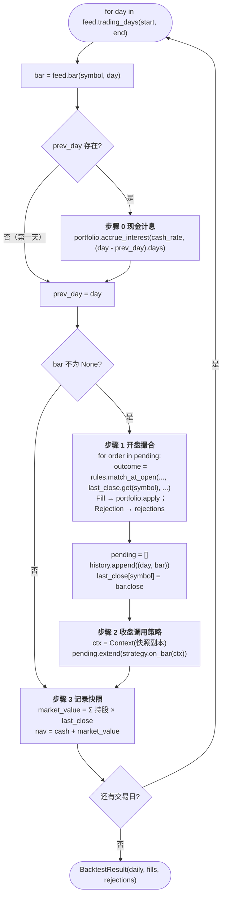

源码中四个步骤都有编号注释：[步骤 0](../src/quant/engine.py#L54)、[步骤 1](../src/quant/engine.py#L59)、[步骤 2](../src/quant/engine.py#L73)、[步骤 3](../src/quant/engine.py#L79)。

### 7.2 一天之内的时间轴

把交易日想象成一条时间线，代码里的步骤与真实市场时刻的对应关系是：

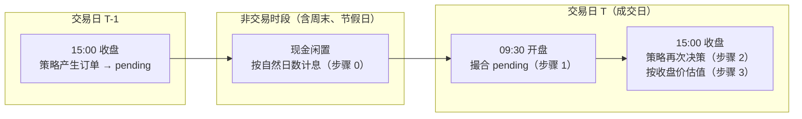

这解释了两个测试：
- [`test_idle_cash_earns_annual_rate_per_calendar_day`](../tests/test_engine.py#L35)：周五到周一跨 3 个自然日，利息按 3 天算。
- [`test_interest_for_the_gap_accrues_on_previous_close_cash_before_open_fills`](../tests/test_engine.py#L133)：周末利息按**周五收盘**的现金计算，即在周一开盘买入**之前**计息。

### 7.3 订单的生命周期

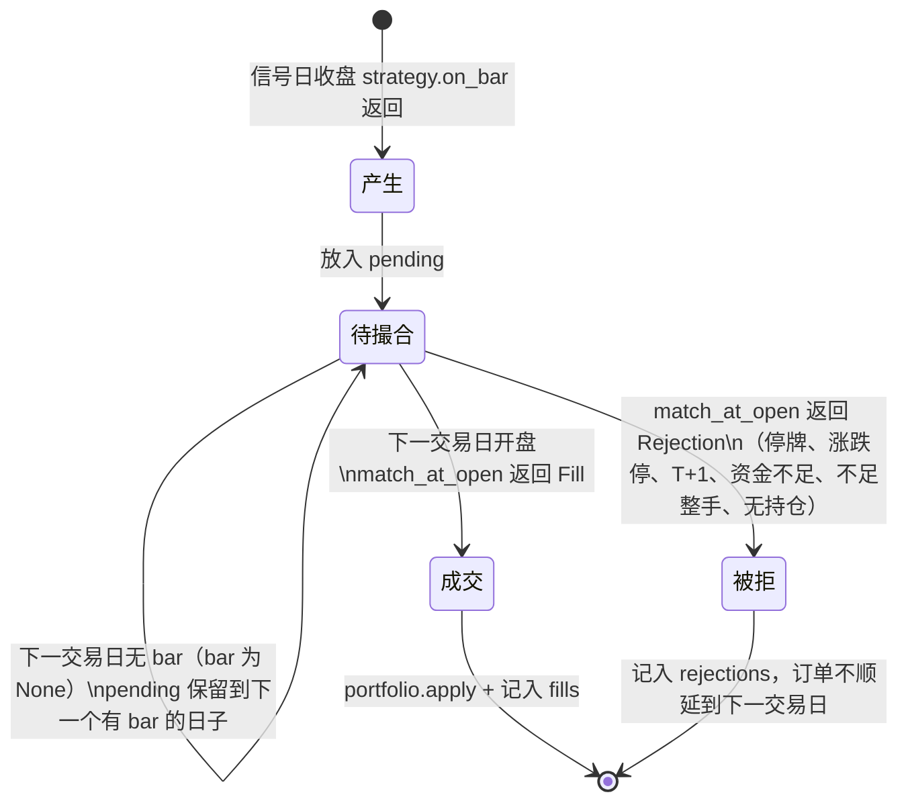

## 8. 撮合与账户

### 8.1 `StockRules.match_at_open`

[`stock.py:64`](../src/quant/instruments/stock.py#L64)。每个订单要么变成 `Fill`，要么变成带原因的 `Rejection`，不会静默消失。

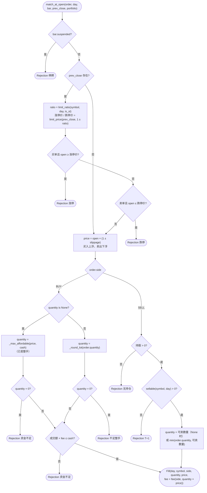

`prev_close` 为 `None` 只发生在回测区间第一个有 bar 的交易日之前没有收盘价时，此时不检查涨跌停。

**涨跌幅**（[`limit_ratio`](../src/quant/instruments/stock.py#L44)）按代码前缀判断板块：

| 板块 | 代码前缀 | 涨跌幅 | ST 股 |
| --- | --- | --- | --- |
| 科创板 | `688` / `689` | 20% | 20%（与板块相同） |
| 创业板，成交日 ≥ `chinext_reform_date`（2020-08-24） | `300` / `301` | 20% | 20%（与板块相同） |
| 改革前的创业板、主板 | 其余 | 10% | 5% |

涨跌停价（[`limit_price`](../src/quant/instruments/stock.py#L117)）用 `Decimal` 计算并四舍五入到分，避免 `9.5 × 1.1 = 10.450000000000001` 这类浮点误差让「开盘等于涨停价」判断失效。判断用 `≥` / `≤`，与「等于」等价（开盘价不会越过涨跌停价）。

**费用**（[`fee`](../src/quant/instruments/stock.py#L53)）：`max(成交额 × 佣金率, 最低佣金) + 成交额 × 过户费率`，卖出再加 `成交额 × 印花税率`。成交额按含滑点的成交价计算。

**满仓买入的股数**（[`_max_affordable`](../src/quant/instruments/stock.py#L108)）：先取不计费用时能买的整手上限 `_round_lot(floor(cash / price))`，再逐手递减，直到 `成交额 + fee ≤ cash`。费用只在 `fee()` 一处计算，新增费用项不用改这里。

例：现金 100,000、价格 10、只收万 2.5 佣金 → 上限 10,000 股需要 100,025，超出现金；退到 9,900 股，99,000 + 24.75 ≤ 100,000。见测试 [`test_full_position_buy_takes_as_many_whole_lots_as_cash_and_commission_allow`](../tests/test_engine.py#L91)。

**T+1 的可卖数量**（[`Portfolio.sellable`](../src/quant/portfolio.py#L55)）：`Portfolio` 记住最近一个有买入成交的日期及当日各标的买入股数，可卖数量 = 持股 − 当日买入（查询日期不是那一天时，当日买入视为 0）。这样引擎不必每天通知账户「新的一天」。

### 8.2 `Portfolio.apply`：钱和股票怎么变

[`portfolio.py:61`](../src/quant/portfolio.py#L61)

```
sign = +1（买） / −1（卖）
cash      -= sign × 成交额 + fee          # 买：付钱加付费；卖：收钱再扣费
positions[symbol] += sign × quantity       # 归零时从 dict 中删除
买入时另记入当日买入股数（T+1）
```

一笔交易引起的对象变化：

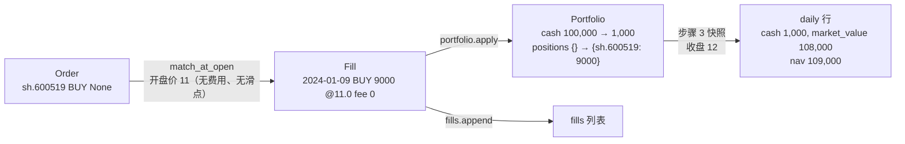

`accrue_interest` 是单利按段复利：每段 `cash *= 1 + rate × days / 365`，跨多段时自然形成复利。

## 9. 策略接口与双均线

### 9.1 策略能看到什么

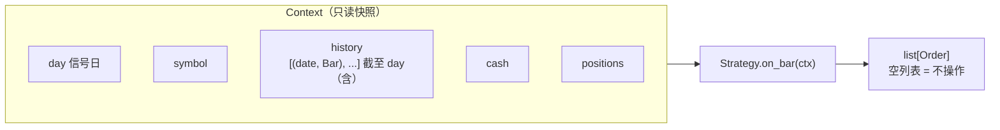

策略**拿不到未来数据**的保证来自引擎：`history` 只在 bar 到达后才 append，`Context` 是在 append 之后、下一天之前构造的。策略也拿不到 `feed`，只能看 `history`。

### 9.2 `MaCross.on_bar`

[`ma_cross.py:15`](../src/quant/strategies/ma_cross.py#L15)

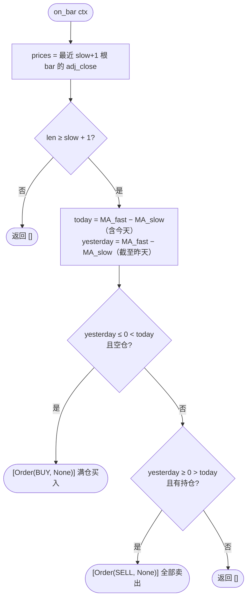

为什么要 `slow + 1` 根：判断「交叉」需要今天和昨天两个时点的均线差，昨天的慢线需要截至昨天的 `slow` 根，合起来是 `slow + 1` 根。

持仓状态机：

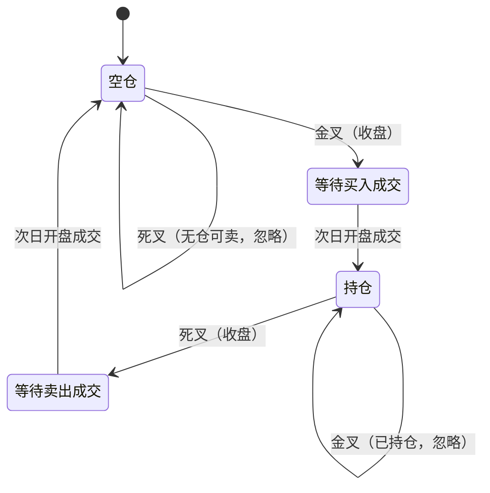

## 10. 绩效指标与报告

### 10.1 `compute_metrics`

[`metrics.py:24`](../src/quant/metrics.py#L24)，输入 `BacktestResult` 与 `feed`（用于算基准）。

| 指标 | 公式 | 函数 |
| --- | --- | --- |
| 总收益 | `nav[-1] / nav[0] − 1` | — |
| 年化收益 | `(nav[-1]/nav[0])^(1/years) − 1`，`years = 自然日数 / 365` | `_annualize` |
| 最大回撤 | `max(1 − nav / cummax(nav))` | `_max_drawdown` |
| 夏普 | 日收益减 `rf/252`，`mean / std × √252` | `_sharpe` |
| 胜率 / 交易次数 | 每笔卖出算一次交易，按平均成本（含买入费用）比较卖出净所得 | `_round_trip_wins` |
| 年化换手率 | `Σ(数量 × 价格) / 2 / 平均净值 / years` | — |
| 总费用 | `Σ fee` | — |
| 基准收益 | 首日按**后复权收盘价**全额持有到最后一日，不计费用 | `buy_and_hold_nav` |
| 年化超额 | 策略年化 − 基准年化 | — |

`_round_trip_wins` 维护每个标的的「持股数」和「总成本」两个累计量：买入时两者都加；卖出时按 `卖出股数 / 持股数` 比例结转成本，`卖出金额 − 卖出费用 − 结转成本 > 0` 记为盈利。

### 10.2 输出文件

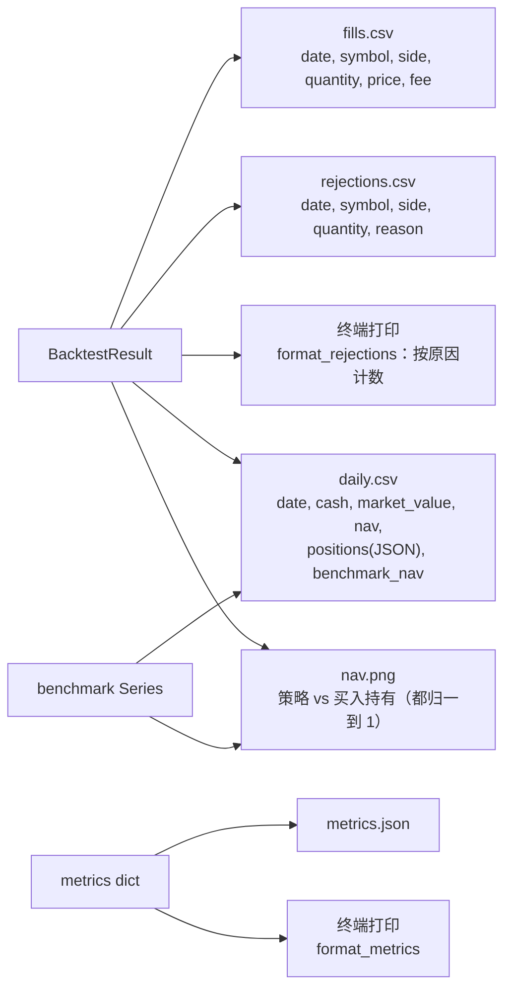

输出目录名：`output/<strategy>_<symbol>_<start:%Y%m%d>_<end:%Y%m%d>/`；CSV 用 `utf-8-sig` 编码，方便 Excel 直接打开中文。

## 11. 命令行与配置覆盖

```bash
backtest ma_cross --symbol sz.000001 --start 2018-01-01 --fast 10 --slow 60 --set cash_rate=0.02 --set stock.commission_rate=0.0003
```

| 参数 | 默认 | 说明 |
| --- | --- | --- |
| `strategy` | — | 目前只有 `ma_cross` |
| `--symbol` | `sh.600519` | baostock 代码格式 |
| `--start` / `--end` | 2016-01-01 / 今天 | |
| `--cash` | 3,000,000 | 初始资金 |
| `--fast` / `--slow` | 5 / 20 | 均线周期 |
| `--set KEY=VALUE` | — | 可重复，覆盖 `BacktestConfig` 任意嵌套字段 |
| `--cache-dir` | `data_cache` | |
| `--out` | `output` | |

`--set` 的实现（[`_replace_path`](../src/quant/cli.py#L71)）是沿点号路径递归 `dataclasses.replace`：

```mermaid
flowchart TD
    A["--set stock.commission_rate=0.0003"] --> B["path = ['stock', 'commission_rate']"]
    B --> C["_replace_path(BacktestConfig, path, '0.0003')"]
    C --> D{"'stock' 是 BacktestConfig 的字段?"}
    D -- 否 --> X[SystemExit 未知配置项]
    D -- 是 --> E["递归 _replace_path(StockConfig, ['commission_rate'], '0.0003')"]
    E --> F["type(0.00025)('0.0003') → float 0.0003<br/>replace(StockConfig, commission_rate=0.0003)"]
    F --> G["replace(BacktestConfig, stock=新 StockConfig)"]
```

因为所有配置都是 frozen dataclass，**新增配置项只要加一个带默认值的字段，CLI 自动支持覆盖**，不用改 `cli.py`。值按原字段类型转换，`date` 字段按 ISO 格式解析（如 `--set stock.chinext_reform_date=2020-08-24`）；布尔字段将来需要特殊处理（`bool("False")` 为真）。

## 12. 测试接缝

```mermaid
flowchart LR
    subgraph 生产
        B[(baostock)] --> BF[load_baostock_feed] --> IF1[InMemoryDataFeed]
    end
    subgraph 测试
        MK["make_feed(symbol, {date: (open, close) 或 Bar})<br/>tests/conftest.py"] --> IF2[InMemoryDataFeed]
    end
    IF1 --> E[run_backtest]
    IF2 --> E
    E --> RES["BacktestResult<br/>只断言 fills / rejections / daily"]
```

- [`make_bar`](../tests/conftest.py#L22)：给开盘价、收盘价即可，其余字段自动补齐（`high/low` 取二者极值、`adj_close = close`、`adj_factor = 1`）；`suspended`、`is_st` 可选，默认非停牌非 ST。
- [`stock_costs`](../tests/conftest.py#L38)：佣金、印花税、过户费、滑点全为 0 的 `StockConfig`，只打开需要的项，让金额可手算。
- [`make_feed`](../tests/conftest.py#L45)：字典的键就是交易日历，故意漏掉某天就等于该日休市；值可以是 `(开盘, 收盘)`，也可以是 `make_bar(...)` 构造的停牌、ST bar。
- 测试中的策略都是几行的「脚本策略」（如 `BuyOnceOnFirstDay`、`BuyThenSellAll`、`test_stock_rules.py` 的 `Script`），按 `len(ctx.history)` 决定第几天下单，让场景可手算。
- 联网测试打 `@pytest.mark.network`，默认跳过，`pytest --run-network` 启用。

现有测试覆盖的引擎语义：

| 测试 | 验证 |
| --- | --- |
| `test_backtest_advances_only_on_trading_days` | 只在日历中的交易日推进 |
| `test_idle_cash_earns_annual_rate_per_calendar_day` | 按自然日计息、分段复利 |
| `test_stock_order_signalled_at_close_fills_at_next_day_open` | 信号日收盘下单 → 成交日开盘成交，收盘估值 |
| `test_full_position_buy_takes_as_many_whole_lots_as_cash_and_commission_allow` | 满仓股数计算（含整手） |
| `test_small_trade_pays_minimum_commission` | 5 元最低佣金 |
| `test_sell_without_quantity_closes_whole_position_at_next_open` | 全部卖出语义 |
| `test_interest_for_the_gap_accrues_on_previous_close_cash_before_open_fills` | 计息先于开盘撮合 |
| `test_golden_cross_buys_and_death_cross_sells_on_next_day_open` | 双均线交叉与成交时点 |
| `test_metrics_and_buy_and_hold_benchmark` | 各项指标手算校验 |
| `test_stock_rules.py` 各测试 | T+1、整手、开盘涨跌停跳过、各板块 / ST / 创业板改革日的涨跌幅、停牌、默认费率、滑点方向、资金不足拒单、每笔未成交都有原因 |
| `test_report_lists_skipped_orders_with_reasons` | `rejections.csv` 内容与终端汇总 |

## 13. 实例追踪：一次金叉死叉的逐日推演

以 [`test_ma_cross.py`](../tests/test_ma_cross.py) 的场景为例（`MaCross(fast=2, slow=3)`，初始资金 100,000，无费用无利息），逐日看引擎每一步发生了什么。需要 `slow + 1 = 4` 根 bar 才开始判断。

| 交易日 | 开 / 收 | 步骤 1：开盘撮合 pending | 步骤 2：MA2 − MA3（昨 → 今） | 产生订单 | 收盘快照 cash / 持股 / nav |
| --- | --- | --- | --- | --- | --- |
| 01-02 | 10 / 10 | — | bar 不足 | — | 100,000 / 0 / 100,000 |
| 01-03 | 10 / 10 | — | bar 不足 | — | 100,000 / 0 / 100,000 |
| 01-04 | 10 / 10 | — | bar 不足 | — | 100,000 / 0 / 100,000 |
| 01-05 | 10 / 9 | — | 0 → −0.17（下穿，但空仓） | — | 100,000 / 0 / 100,000 |
| 01-08 | 9 / 12 | — | −0.17 → +0.17 **金叉** | BUY None | 100,000 / 0 / 100,000 |
| 01-09 | 11 / 12 | **买 9000 股 @ 11**（floor(100,000/11) = 9090，按整手取 9000） | +0.17 → +1.00 | — | 1,000 / 9000 / 109,000 |
| 01-10 | 12 / 8 | — | +1.00 → −0.67 **死叉** | SELL None | 1,000 / 9000 / 73,000 |
| 01-11 | 8.5 / 8.5 | **卖 9000 股 @ 8.5** | — | — | 77,500 / 0 / 77,500 |

（MA 差值：01-05 为 MA2(10, 9)=9.5 − MA3(10, 10, 9)=9.67；01-08 为 10.5 − 10.33；01-09 为 12 − 11；01-10 为 10 − 10.67。）

用时间线看信号日与成交日的错位：

```mermaid
sequenceDiagram
    participant D8 as 01-08
    participant D9 as 01-09
    participant D10 as 01-10
    participant D11 as 01-11
    Note over D8: 收盘 12，金叉<br/>pending = [BUY]
    D8->>D9: 订单隔夜
    Note over D9: 开盘 11 买入 9000 股<br/>收盘 12 估值
    Note over D10: 收盘 8，死叉<br/>pending = [SELL]
    D10->>D11: 订单隔夜
    Note over D11: 开盘 8.5 卖出 9000 股
```

## 14. 阅读时容易忽略的细节

1. **引擎目前是单标的**：`run_backtest(..., symbol=...)` 只取一个标的的 bar，`Context.symbol` 也只有一个。策略即使返回别的 symbol 的订单，也会用这个标的的 bar 撮合。这是 ticket 04 之前必须改的地方，目标形态见 [`design.md`](design.md) 中「从单标的到多标的」。
2. **撮合规则写死为股票**：`rules = StockRules(config.stock)`，还没有按品种分派（ADR-0001 的目标形态）。
3. **没有 bar 的交易日**：`feed.bar` 返回 `None` 时，不撮合、不调用策略，`pending` 保留到下一个有 bar 的日子；当日快照用 `last_close` 中的旧收盘价估值，并照常计息。
4. **估值用不复权收盘价，基准用后复权价**：在 ticket 03 实现除权调整持股数之前，持仓跨除权日时策略净值会因为除权缺口下跌，而基准不会，两者会出现系统性偏差。
5. **被拒的订单不顺延**：记一条 `Rejection` 后订单就结束了，不会挂到下一交易日再试。双均线只在交叉当天发信号，所以开盘涨停没买到的那次金叉就错过了，这符合「次日开盘一次性撮合」的设定。
6. **卖出数量超过可卖数量时部分成交**：只卖出可卖部分，剩余部分不记 `Rejection`。买入不做部分成交，资金不够时整单拒绝。
7. **涨跌停价以上一交易日不复权收盘价为基准**：除权日的真实基准是除权参考价，目前没有调整，除权日的涨跌停判断会偏松（留给 ticket 03）。新股上市初期不设涨跌幅、北交所 30% 等规则也没有建模。
8. **滑点后的买价可能略高于涨停价**：只有开盘价低于涨停价才会成交，但 `open × 1.001` 可能越过涨停价，没有截断，影响可忽略。
9. **`Context.history` 每天复制一次**：复杂度 O(n²)，10 年约 2,500 个交易日，可以接受；多标的化时建议改为只读视图。
10. **计息位置**：在交易日开头为上一段间隔计息，而 spec 写的是「当日末计息」。两者在净值上等价，只是周末利息记到下一交易日。
11. **`buy_and_hold_nav` 被调用两次**：`compute_metrics` 内部一次（算指标），`cli` 里一次（画图和写 `daily.csv`），结果相同。
