# 代码导读：A 股量化研究原型

> **适用范围**：ticket 01（骨架 + 双均线）、02（A 股撮合规则）、03（除权处理）、04（纯滚 IC）、05（ETF 期权与模型价）、06（滚 IC + put delta 中性）落地后的代码。
> **配套文档**：目标设计与演进路线见 [`design.md`](design.md)；术语以 [`GLOSSARY.md`](../GLOSSARY.md) 为准；决策见 [`docs/adr/`](adr/)。
> 本文配合图表，逐个文件、逐个函数讲清楚**现有代码**怎么运转。代码演进后，请同步更新行号和「容易忽略的细节」一节。
>
> 文中的图使用 Mermaid，在 GitHub、VS Code（Markdown Preview Mermaid Support 插件）、Typora 中都能直接渲染。源码链接带行号，行号以写作时的工作区为准。

## 目录

- [1. 30 秒看懂项目](#1-30-秒看懂项目)
- [2. 推荐阅读顺序](#2-推荐阅读顺序)
- [3. 目录与模块依赖](#3-目录与模块依赖)
- [4. 核心数据结构（类图）](#4-核心数据结构类图)
- [5. 一次回测的完整调用链](#5-一次回测的完整调用链)
- [6. 数据层详解](#6-数据层详解)
- [7. 回测引擎详解](#7-回测引擎详解)
- [8. 撮合与账户](#8-撮合与账户)
- [9. 策略接口与策略实现](#9-策略接口与策略实现)
- [10. 绩效指标与报告](#10-绩效指标与报告)
- [11. 命令行与配置覆盖](#11-命令行与配置覆盖)
- [12. 测试接缝](#12-测试接缝)
- [13. 实例追踪：一次金叉死叉的逐日推演](#13-实例追踪一次金叉死叉的逐日推演)
- [14. 阅读时容易忽略的细节](#14-阅读时容易忽略的细节)

---

## 1. 30 秒看懂项目

一句话：**`backtest ma_cross` 从 baostock 拉一只 A 股的日线（带本地缓存），在每个交易日收盘调用策略拿到订单，下一交易日开盘撮合进统一账户，最后算指标、画净值图。`backtest roll_ic` 走同一个引擎，数据换成中金所 IC 各合约、中证 500 与 510500：持有 IC 多头吃贴水收敛，期货订单当日收盘成交、按结算价盯市；同时买平值次月 500ETF put 把组合对冲到 delta 中性。期权没有自己的行情，按 510500 现算 BS 模型价成交与估值。`--no-hedge` 只滚 IC。**

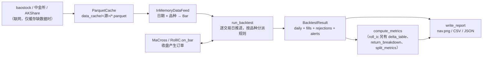

整个代码库约 1,700 行，没有框架魔法，所有调用都是显式的函数调用，可以从 `cli.main` 一路跟下去。

## 2. 推荐阅读顺序

按依赖从底向上读，每读一个文件，它依赖的东西都已经读过了：

| 顺序 | 文件 | 读什么 | 用时 |
| --- | --- | --- | --- |
| 1 | [`data/feed.py`](../src/quant/data/feed.py) | `Bar` 有哪些字段、`DataFeed` 协议只有两个方法 | 3 分钟 |
| 2 | [`strategy.py`](../src/quant/strategy.py) | `Order` / `Context` / `Strategy`，策略能看到什么、怎么声明 universe | 3 分钟 |
| 3 | [`portfolio.py`](../src/quant/portfolio.py) | `Fill` 怎么改变现金和持仓（现金交割 vs 逐日盯市）、`Rejection` / `Alert`、可卖数量 | 5 分钟 |
| 4 | [`instruments/__init__.py`](../src/quant/instruments/__init__.py) | `InstrumentRules` 协议：引擎对品种规则的全部要求 | 2 分钟 |
| 5 | [`instruments/stock.py`](../src/quant/instruments/stock.py) | 订单如何变成成交或被拒（A 股规则）、除权日的持股与涨跌停基准 | 10 分钟 |
| 6 | [`calendars.py`](../src/quant/calendars.py)、[`instruments/future.py`](../src/quant/instruments/future.py) | IC 到期日与季月合约；期货收盘成交、盯市、平今平昨、到期强平 | 10 分钟 |
| 6b | [`pricing.py`](../src/quant/pricing.py)、[`instruments/option.py`](../src/quant/instruments/option.py) | BS 模型价与 delta；期权现算行情、收盘成交、到期按内在价值结算 | 10 分钟 |
| 7 | [`engine.py`](../src/quant/engine.py) | **核心**：每日循环的六个步骤与品种分派 | 10 分钟 |
| 8 | [`strategies/ma_cross.py`](../src/quant/strategies/ma_cross.py)、[`strategies/roll_ic.py`](../src/quant/strategies/roll_ic.py) | 两个具体策略（滚 IC 含 put 对冲） | 10 分钟 |
| 9 | [`tests/test_engine.py`](../tests/test_engine.py)、[`tests/test_stock_rules.py`](../tests/test_stock_rules.py)、[`tests/test_future_rules.py`](../tests/test_future_rules.py)、[`tests/test_roll_ic.py`](../tests/test_roll_ic.py)、[`tests/test_option_rules.py`](../tests/test_option_rules.py)、[`tests/test_roll_ic_hedge.py`](../tests/test_roll_ic_hedge.py) | 用测试反向理解引擎语义、撮合规则与对冲逻辑 | 25 分钟 |
| 10 | [`data/cache.py`](../src/quant/data/cache.py) | 缓存覆盖区间算法、按月断点续拉 | 10 分钟 |
| 11 | [`data/baostock_feed.py`](../src/quant/data/baostock_feed.py)、[`data/cffex_feed.py`](../src/quant/data/cffex_feed.py)、[`data/akshare_feed.py`](../src/quant/data/akshare_feed.py) | 外部数据怎么变成 `Bar` | 10 分钟 |
| 12 | [`metrics.py`](../src/quant/metrics.py)、[`report.py`](../src/quant/report.py)、[`cli.py`](../src/quant/cli.py) | 输出与入口 | 10 分钟 |

如果只有 15 分钟：读 `feed.py` → `engine.py` → `test_engine.py`。

## 3. 目录与模块依赖

```
src/quant/
├── cli.py                  命令行入口，串联全流程；load_roll_ic_feed 组装 IC + 中证 500 + 510500 + 日历；run_roll_ic 同时跑对冲与纯滚 IC
├── engine.py               回测主循环、按品种分派、BacktestConfig、BacktestResult
├── strategy.py             Strategy（universe + on_bar）/ Context / Order / Side
├── portfolio.py            Portfolio 统一账户、Fill、Rejection / RejectReason、Alert
├── calendars.py            IC 到期日、季月合约、工作日延伸日历；期权到期日、行权价网格
├── pricing.py              BS 模型价与 delta、由价格反推波动率、已实现波动率
├── metrics.py              绩效指标（可按区间分段）、买入持有基准、基差与年化贴水率、每日净 delta、收益拆解
├── report.py               指标 / 收益拆解文本、净值图（对照曲线 + 净 delta 栏）、CSV/JSON 输出
├── data/
│   ├── feed.py             Bar、DataFeed 协议、InMemoryDataFeed
│   ├── cache.py            ParquetCache（覆盖区间 + 增量补拉 + 按月断点续拉）
│   ├── baostock_feed.py    baostock 适配器（股票、交易日历）
│   ├── cffex_feed.py       中金所适配器（股指期货分合约日线与结算价）
│   └── akshare_feed.py     AKShare 适配器（指数日线、ETF 日线与分红推算的后复权因子）
├── instruments/
│   ├── __init__.py         InstrumentRules 协议
│   ├── stock.py            StockConfig、StockRules（A 股撮合规则）
│   ├── future.py           FutureConfig、FutureRules（期货规则）、合约代码与到期日
│   └── option.py           OptionConfig、OptionRules（ETF 期权规则）、合约代码解析与生成、每张 delta 敞口
└── strategies/
    ├── ma_cross.py         双均线
    └── roll_ic.py          滚 IC（可选 PutHedge：put 对冲到 delta 中性）、组合净 delta
tests/
├── conftest.py             make_bar / make_feed / stock_costs / make_future_bar / future_costs / make_multi_feed、--run-network 开关
├── test_engine.py          引擎语义：交易日、计息、成交时点、佣金
├── test_stock_rules.py     A 股撮合规则：T+1、整手、涨跌停、停牌、费用、滑点、资金
├── test_future_rules.py    期货规则：盯市、保证金、平今平昨、到期强平与节假日顺延、资金不足、保证金不计息
├── test_roll_ic.py         纯滚 IC：手数、展期、展期天数、基差与年化贴水率、报告列
├── test_option_rules.py    期权规则：到期按内在价值结算、到期日顺延、每日模型价估值、资金不足、无报价
├── test_roll_ic_hedge.py   put 对冲：建仓净 delta、阈值再平衡与重选平值、put 换月、IC 展期、收益拆解、分段指标、报告列
├── test_pricing.py         纯函数：行权价网格、BS 无套利边界与手算值、零波动率、delta 范围、反推波动率
├── test_ma_cross.py        金叉买、死叉卖
├── test_metrics.py         指标手算校验（含期货按名义本金）
├── test_report.py          rejections.csv 与未成交汇总
├── test_cache.py           按月补拉的断点续拉
├── test_cli.py             --set 覆盖嵌套配置
├── test_baostock_smoke.py  联网冒烟（默认跳过）
└── test_ic_data_smoke.py   中金所 IC、AKShare 指数与 510500 联网冒烟（默认跳过）
```

下图是**真实的 import 关系**（箭头表示「依赖于」）。注意 `data/feed.py` 位于最底层，不依赖任何业务模块，这正是它能当测试接缝的原因。

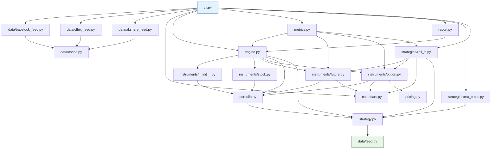

为了图面清楚，省略了几乎所有模块都有的 `--> feed`（取 `Bar` 类型）和规则模块对 `strategy` 的依赖（取 `Order` / `Side`）。

分层理解：

| 层 | 模块 | 说明 |
| --- | --- | --- |
| 入口 | `cli` | 唯一知道「真实数据源 + 具体策略 + 报告」三者存在的地方 |
| 输出 | `metrics`、`report` | 只读 `BacktestResult`，不参与回测 |
| 核心 | `engine` | 只依赖抽象：`DataFeed` 协议、`Strategy` 基类、`InstrumentRules` 协议；唯一知道具体规则类的是 `_Dispatcher` |
| 规则与账户 | `instruments/*`、`calendars`、`pricing`、`portfolio` | 订单 → 成交 → 账户变化；品种特有逻辑都在这里（ADR-0001） |
| 契约 | `strategy`、`data/feed`、`instruments/__init__` | 纯数据结构和接口，几乎无逻辑 |
| 外部适配 | `data/baostock_feed`、`data/cffex_feed`、`data/akshare_feed`、`data/cache` | 只有 `cli` 用到，引擎完全不知道它们 |

## 4. 核心数据结构（类图）

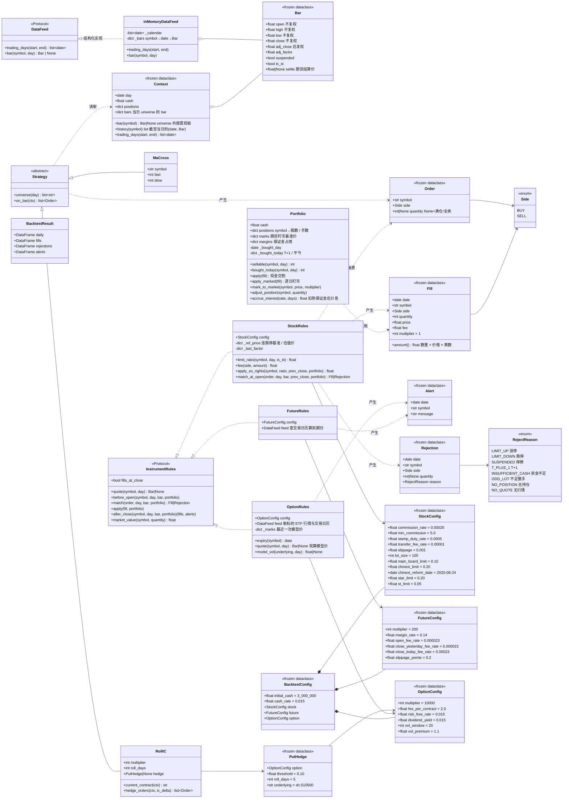

几个设计要点：

- **几乎全是不可变值对象**（`frozen=True`）：`Bar`、`Order`、`Fill`、`Rejection`、`Alert`、`Context`、所有 `Config`。可变的状态只有 `Portfolio` 和规则对象里按品种记的状态（股票的涨跌停基准价、复权因子，期权最近一次模型价），都只在一次回测内由引擎驱动修改。读代码时盯住 `apply` / `apply_marked`（成交）、`mark_to_market`（盯市）、`adjust_position`（除权）和 `accrue_interest`（计息）几处，就知道钱和持仓是怎么变的。
- **`Order.quantity` 为 `None` 有特殊语义**：股票买入表示满仓，卖出表示全部卖出（期货卖出同样表示全部平仓；期货买入必须给出手数）。具体股数要到成交日开盘、知道开盘价后才能算，所以推迟到 `StockRules.match_at_open` 决定。给出数量时必须为正数，否则构造 `Order` 就抛 `ValueError`。
- **`Context` 给策略的是快照副本**：`positions`、`bars` 是副本；`history(symbol)` 每次调用返回新列表，策略即使修改也不会影响引擎（[engine.py:116](../src/quant/engine.py#L116)）。`bar(symbol)` 对 universe 之外的品种经 `_quote` 按需取当日行情（`_Dispatcher.quote`），用于收盘时才知道行权价的 put，同样不含未来数据。

## 5. 一次回测的完整调用链

`backtest ma_cross --symbol sh.600519` 从敲下回车到打印结果，可以拆成**四个阶段**。先看总览，再逐个阶段放大；每张时序图只保留该阶段真正交互的 3–4 个对象。

### 5.0 总览：四个阶段

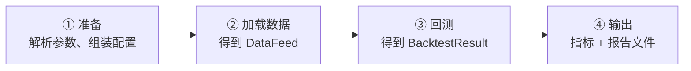

[`cli.main`](../src/quant/cli.py#L35) 完成阶段 ①，再按策略交给 [`run_ma_cross`](../src/quant/cli.py#L72) 或 [`run_roll_ic`](../src/quant/cli.py#L93) 完成 ②–④：

| 阶段 | `cli.main` 中的代码 | 输入 | 输出 | 详见 |
| --- | --- | --- | --- | --- |
| ① 准备 | [L58-61](../src/quant/cli.py#L58) `parse_args`、`apply_overrides` | 命令行参数 | `args`、`BacktestConfig` | [§11](#11-命令行与配置覆盖) |
| ② 加载数据 | [L74](../src/quant/cli.py#L74) `load_baostock_feed`；[L99](../src/quant/cli.py#L99) `load_roll_ic_feed` | 区间、缓存目录 | `InMemoryDataFeed` | [§6](#6-数据层详解) |
| ③ 回测 | [L76](../src/quant/cli.py#L76) `run_backtest(MaCross(...))`；[L101](../src/quant/cli.py#L101) 纯滚 IC、[L117](../src/quant/cli.py#L117) 对冲版各跑一次 `run_backtest` | feed、策略、配置 | `BacktestResult` | [§7](#7-回测引擎详解)–[§9](#9-策略接口与策略实现) |
| ④ 输出 | [L105-146](../src/quant/cli.py#L105) `basis_table`、`delta_table`、`return_breakdown`、`split_metrics`（roll_ic）、`compute_metrics`、`buy_and_hold_nav`、`write_report`、`print` | result、feed | 终端文本 + 6 个文件 | [§10](#10-绩效指标与报告) |

阶段之间只通过这几个值传递：`config`、`feed`、`result`。理解了这三个对象，就理解了模块之间怎么衔接。

### 5.1 阶段 ① 准备

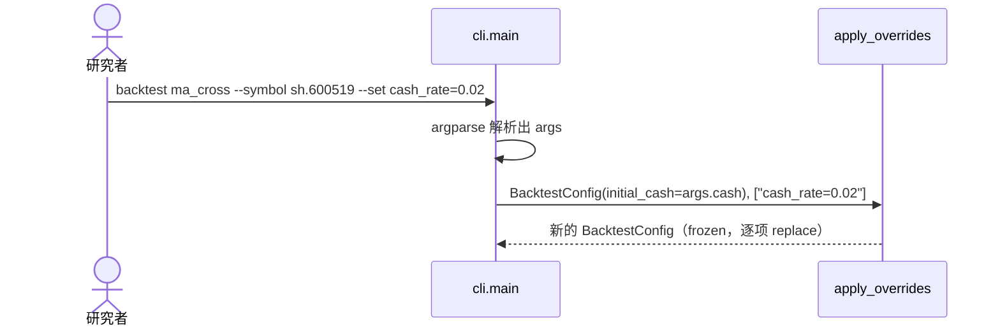

这一步没有 I/O，只是把命令行变成一个不可变的 `BacktestConfig`。

### 5.2 阶段 ② 加载数据

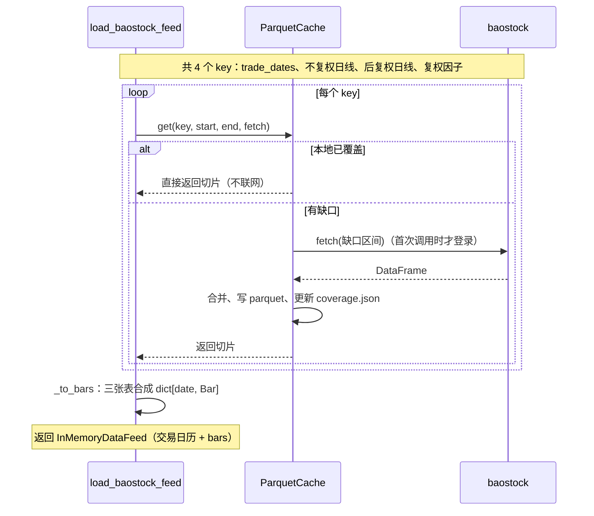

`roll_ic` 走 [`load_roll_ic_feed`](../src/quant/cli.py#L149)：baostock 交易日历 → 中金所 IC 各合约（`get_by_month` 按月补拉）→ AKShare 中证 500 →（对冲时）510500，合成一个 `InMemoryDataFeed`。对冲时交易日历与 510500 从回测起点往前多取 3 × 波动率窗口 + 10 个自然日，期权模型价在回测首日就有完整的波动率窗口，并把已公布日历之后的工作日追加进日历（见 [§14](#14-阅读时容易忽略的细节)）。

关键点：引擎拿到的 `InMemoryDataFeed` 里已经没有任何 baostock、中金所、AKShare 或缓存的痕迹，后面的阶段完全不知道数据从哪来。

### 5.3 阶段 ③ 回测：一个交易日内发生了什么

`run_backtest` 对每个交易日重复同样的六步，这里只画**一天**。`R` 是 `rules_for(symbol)` 按品种选出的规则对象（股票 → `StockRules`，`IC2412` 这类代码 → `FutureRules`，`510500P2412M05500` 这类代码 → `OptionRules`）：

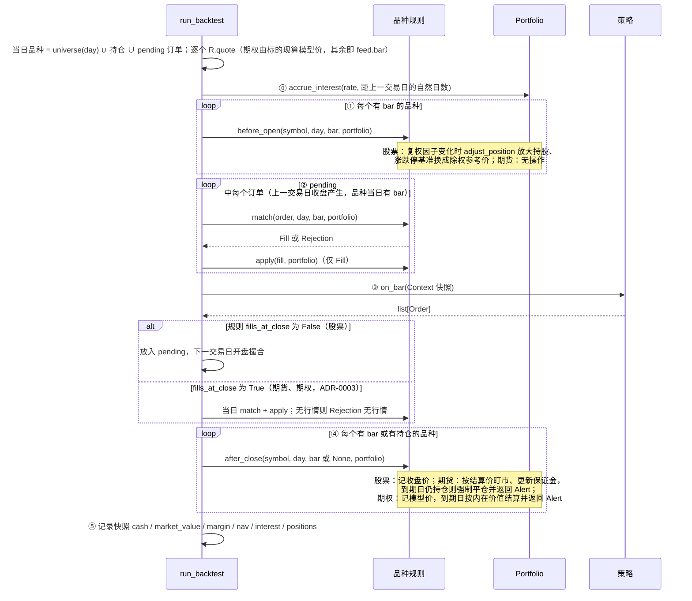

注意几点：

- 策略**不直接**调用规则或 `Portfolio`，它只返回订单；改变账户的只有引擎（经由规则对象）。
- 股票今天 ③ 产生的订单，要到**下一个交易日**的 ② 才撮合，这就是「信号日收盘、成交日开盘」；期货订单在 ③ 之后立即按当日收盘价成交。
- 除权调整在开盘撮合**之前**：除权日开盘卖出时，卖的已是放大后的持股。
- 引擎里没有任何 `if 股票 / if 期货`：差异全部落在 `InstrumentRules` 的六个成员上（ADR-0001）。
- 所有交易日跑完后，`rows`、`fills`、`rejections`、`alerts` 四个列表转成 DataFrame，包成 `BacktestResult` 返回。

### 5.4 阶段 ④ 输出

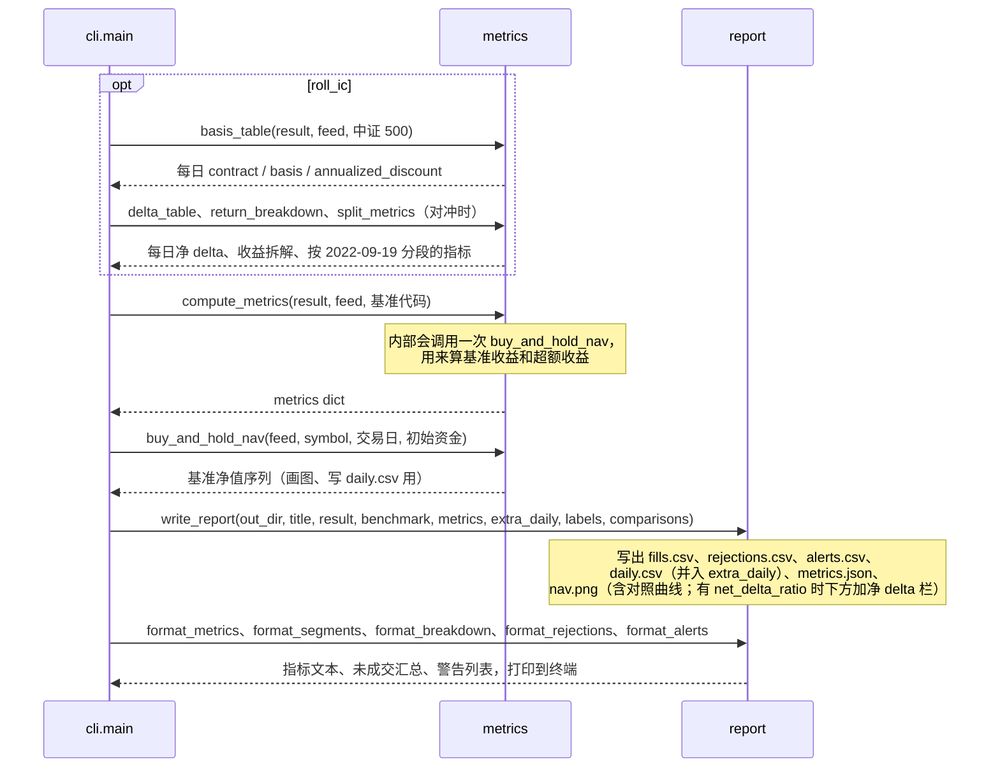

`metrics` 和 `report` 只读 `BacktestResult`，不会反过来影响回测。所以想改报告格式或加新指标，完全不用碰引擎。

## 6. 数据层详解

### 6.1 `Bar` 的价格口径

同一根 bar 里同时放了两套价格，**各有各的用途，不能混用**：

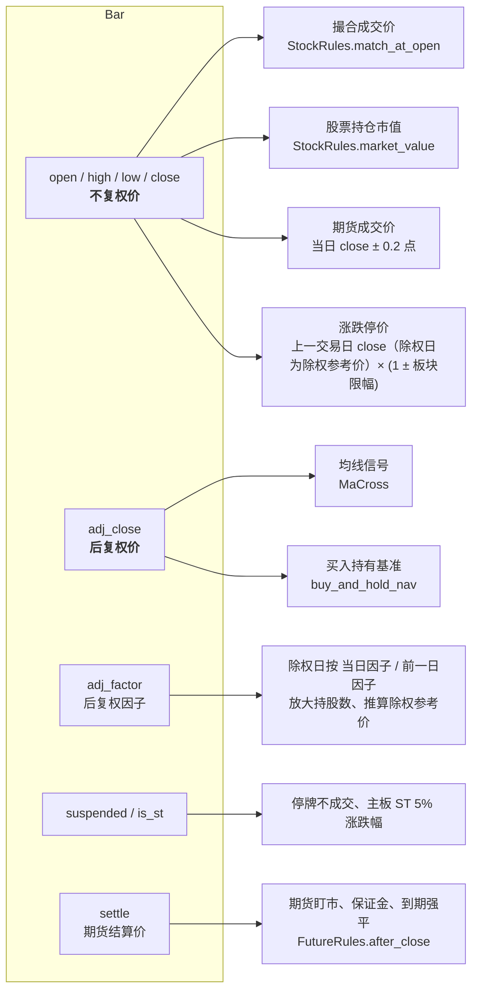

为什么这样设计：撮合必须用交易所当日真实挂牌价（不复权价），否则成交价、整手金额、涨跌停全都不对；而信号需要连续价格，否则除权缺口会被均线误认为暴跌。见 `GLOSSARY.md` 中「不复权价 / 后复权价」词条。期货和指数没有复权，`adj_close = close`、`adj_factor = 1`；期货的**结算价**不等于收盘价，盯市只用结算价。

### 6.2 `load_baostock_feed`：外部数据如何变成 `Bar`

[`baostock_feed.py:33`](../src/quant/data/baostock_feed.py#L33)（只要交易日历时用 [`load_trade_calendar`](../src/quant/data/baostock_feed.py#L25)）


三个值得注意的实现细节：

1. **懒登录**（[`_BaostockSource._login`](../src/quant/data/baostock_feed.py#L117)）：`_session()` 只是创建对象，真正 `bs.login()` 发生在第一次 `_query` 时。缓存全部命中时一次都不登录，所以断网能跑。
2. **复权因子从 1990 年取**：baostock 的复权因子只在除权日有记录。如果从回测起点开始取，起点之前最近一次除权的因子就丢了，区间开头的因子会被错误地填成 1.0。
3. **字段映射集中在 `_BaostockSource`**：`tradestatus == "0"` → 停牌、`isST == "1"` → ST、`dividOperateDate` / `backAdjustFactor` 等 baostock 专有命名都只出现在这里，数据源改字段时只改这一个类。

### 6.3 `ParquetCache.get`：增量补拉算法

[`cache.py:34`](../src/quant/data/cache.py#L34)。一天多行的表（多个期货合约）合并时按 `unique_by=("date", "symbol")` 去重

每个 key 一个 Parquet 文件，`coverage.json` 记录每个 key 已覆盖的**连续区间** `[lo, hi]`。

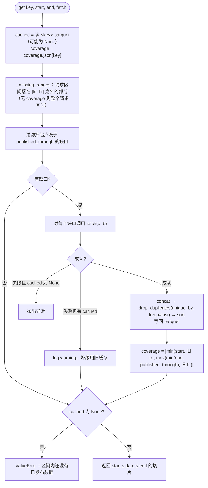

**`published_through` 的作用**（[`last_published_day`](../src/quant/data/cache.py#L21)）：北京时间 18 点前，今天的日线还没出，所以覆盖区间最多只记到昨天。这样今天请求「到今天」时虽然拿不到今天的数据，但明天再跑会自动补拉今天这一天，而不会因为覆盖区间已经包含今天而永远缺这一天。

一个时间线例子，key = `k_sh.600519_unadjusted`：

| 运行 | 请求区间 | 运行前 coverage | 缺口 | 运行后 coverage |
| --- | --- | --- | --- | --- |
| 第 1 次（10-14 20:00） | 2020-01-01 ~ 10-14 | 无 | 整个区间 | 2020-01-01 ~ 10-14 |
| 第 2 次（10-15 10:00） | 2016-01-01 ~ 10-15 | 2020-01-01 ~ 10-14 | 2016-01-01 ~ 2019-12-31；10-15 晚于 published_through(10-14)，跳过 | 2016-01-01 ~ 10-14 |
| 第 3 次（10-15 19:00） | 2016-01-01 ~ 10-15 | 2016-01-01 ~ 10-14 | 10-15 | 2016-01-01 ~ 10-15 |
| 第 4 次（断网） | 2018-01-01 ~ 2020-12-31 | 2016-01-01 ~ 10-15 | 无 | 不变，纯本地 |

**按月断点续拉**（[`get_by_month`](../src/quant/data/cache.py#L68)）：中金所数据首次要拉 2016 年至今 130 多个月。`get_by_month` 把区间切成自然月，逐月调用 `get`，每个月拉完就写盘、把覆盖区间推进到月末，并打印「拉取 daily_IC 2016-03-01 至 2016-03-31（3/130）」这样的进度。中途 Ctrl+C 后再跑，已完成的月份都在覆盖区间内，从下一个月继续（见 [`test_cache.py`](../tests/test_cache.py)）。网络异常（`Exception`）仍按 `get` 的规则降级用旧缓存；`KeyboardInterrupt` 不被捕获，直接中断。

### 6.4 中金所与 AKShare 适配器

- [`load_cffex_bars`](../src/quant/data/cffex_feed.py#L27)：直接下载中金所官网的月度数据包 `historysj/<YYYYMM>/zip/<YYYYMM>.zip`，里面每个交易日一个 GBK 编码的 CSV。只保留 `IC\d{4}` 形式的期货合约（排除同前缀的期权和小计行），取「合约代码、今开盘、最高价、最低价、今收盘、今结算」。无成交合约的开高低为空，用收盘价补齐；结算价缺失记为 `None`，当日不盯市。spec 原定走 AKShare，但 AKShare 读的是同一个数据包，却逐日请求、每次重下整月 zip，且写死的浏览器 User-Agent 在部分网络下会被安全网关拦截后静默返回空表，所以改为直接读取（见 `design.md` 第 10 节）。
- [`load_index_bars`](../src/quant/data/akshare_feed.py#L14)：AKShare `stock_zh_index_daily`（新浪）一次返回全部历史，按区间截取。代码用 baostock 风格的 `sh.000905`。
- [`load_etf_bars`](../src/quant/data/akshare_feed.py#L37)：AKShare `fund_etf_hist_sina` 取不复权日线，`fund_etf_dividend_sina` 取累计分红，按「除息日因子 × 前收 / (前收 − 每份分红)」从上市起累乘出后复权因子（期权的已实现波动率用后复权价，避免除息缺口）。baostock 也有 510500，但它给的复权因子在 2024-05 无故跳到 0.326，不可用。份额折算（510500 在 2015-04 的折算）不在分红表里，未处理。`roll_ic` 对冲时经 `load_roll_ic_feed` 调用它。

缓存目录结构：

```
data_cache/cffex/
├── coverage.json
└── daily_IC.parquet                       date, symbol, open, high, low, close, settle
data_cache/akshare/
├── index_sh.000905.parquet                date, open, high, low, close
└── etf_sh.510500.parquet                  date, open, high, low, close, adj_factor
data_cache/baostock/
├── coverage.json                          {"k_sh.600519_unadjusted": ["2016-01-01", "2026-10-15"], ...}
├── trade_dates.parquet                    date, is_trading_day
├── k_sh.600519_unadjusted.parquet         date, open, high, low, close, suspended, is_st
├── k_sh.600519_backward_adjusted.parquet  同上（后复权）
└── adjust_factor_sh.600519.parquet        date, back_adjust_factor
```

## 7. 回测引擎详解

[`engine.run_backtest`](../src/quant/engine.py#L62) 是整个项目的心脏。它维护的局部状态：

| 变量 | 类型 | 含义 |
| --- | --- | --- |
| `portfolio` | `Portfolio` | 账户状态 |
| `rules_for` | `_Dispatcher` | 按代码选规则对象：[`is_future`](../src/quant/instruments/future.py#L22) 为真 → `FutureRules`，[`is_option`](../src/quant/instruments/option.py#L24) 为真 → `OptionRules`，否则 `StockRules`；每次回测新建，规则对象里按品种记的状态不会跨回测残留。`rules_for.quote(day, symbol)` 供 `Context.bar` 按需取 universe 外的行情 |
| `history` | `dict[symbol, list[(date, Bar)]]` | 每个品种截至当日的 bar，`Context.history(symbol)` 返回其副本 |
| `pending` | `list[Order]` | 开盘成交品种（股票）在信号日产生、等待下一交易日开盘撮合的订单 |
| `fills` / `rejections` / `alerts` | `list` | 全部成交（含到期强平）、未成交订单及原因、警告 |
| `rows` | `list[dict]` | 每日快照，最后转成 `daily` DataFrame |
| `prev_day` | `date \| None` | 上一个交易日，用于计算计息天数 |

原来放在引擎里的 `last_close`、`last_factor` 已挪进 `StockRules`（`_ref_price`、`_last_factor`），引擎不再知道「除权」「涨跌停基准」这些股票概念。

### 7.1 每日循环

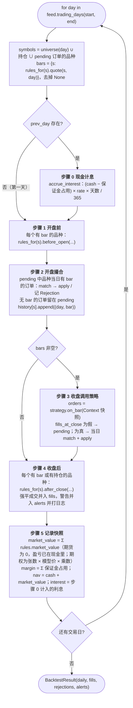

源码中六个步骤都有编号注释：[步骤 0](../src/quant/engine.py#L93)、[步骤 1](../src/quant/engine.py#L99)、[步骤 2](../src/quant/engine.py#L103)、[步骤 3](../src/quant/engine.py#L114)、[步骤 4](../src/quant/engine.py#L128)、[步骤 5](../src/quant/engine.py#L138)。

### 7.2 一天之内的时间轴

把交易日想象成一条时间线，代码里的步骤与真实市场时刻的对应关系是：

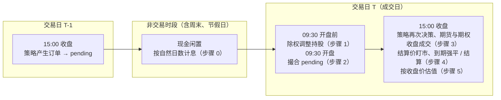

这解释了两个测试：
- [`test_idle_cash_earns_annual_rate_per_calendar_day`](../tests/test_engine.py#L38)：周五到周一跨 3 个自然日，利息按 3 天算。
- [`test_interest_for_the_gap_accrues_on_previous_close_cash_before_open_fills`](../tests/test_engine.py#L138)：周末利息按**周五收盘**的现金计算，即在周一开盘买入**之前**计息。
- [`test_cash_occupied_as_margin_earns_no_interest`](../tests/test_future_rules.py)：被保证金占用的现金不算闲置，不计息。

### 7.3 订单的生命周期

股票订单：

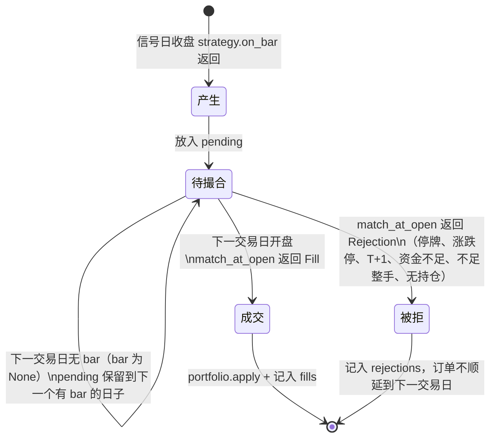

期货订单没有「待撮合」状态：策略返回后当日按收盘价 `match`，成交即 `apply`，被拒（无持仓、资金不足、当日无行情）即记入 `rejections`。

## 8. 撮合与账户

### 8.1 `StockRules.match_at_open`

[`stock.py:112`](../src/quant/instruments/stock.py#L112)，由协议方法 [`StockRules.match`](../src/quant/instruments/stock.py#L95) 传入自己记的涨跌停基准后调用。每个订单要么变成 `Fill`，要么变成带原因的 `Rejection`，不会静默消失。


`prev_close` 为 `None` 只发生在回测区间第一个有 bar 的交易日之前没有收盘价时，此时不检查涨跌停。除权日传入的是除权参考价（见下文「除权」）。

**涨跌幅**（[`limit_ratio`](../src/quant/instruments/stock.py#L52)）按代码前缀判断板块：

| 板块 | 代码前缀 | 涨跌幅 | ST 股 |
| --- | --- | --- | --- |
| 科创板 | `688` / `689` | 20% | 20%（与板块相同） |
| 创业板，成交日 ≥ `chinext_reform_date`（2020-08-24） | `300` / `301` | 20% | 20%（与板块相同） |
| 改革前的创业板、主板 | 其余 | 10% | 5% |

涨跌停价（[`limit_price`](../src/quant/instruments/stock.py#L165)）用 `Decimal` 计算并四舍五入到分，避免 `9.5 × 1.1 = 10.450000000000001` 这类浮点误差让「开盘等于涨停价」判断失效。判断用 `≥` / `≤`，与「等于」等价（开盘价不会越过涨跌停价）。

**费用**（[`fee`](../src/quant/instruments/stock.py#L61)）：`max(成交额 × 佣金率, 最低佣金) + 成交额 × 过户费率`，卖出再加 `成交额 × 印花税率`。成交额按含滑点的成交价计算。

**满仓买入的股数**（[`_max_affordable`](../src/quant/instruments/stock.py#L156)）：先取不计费用时能买的整手上限 `_round_lot(floor(cash / price))`，再逐手递减，直到 `成交额 + fee ≤ cash`。费用只在 `fee()` 一处计算，新增费用项不用改这里。

例：现金 100,000、价格 10、只收万 2.5 佣金 → 上限 10,000 股需要 100,025，超出现金；退到 9,900 股，99,000 + 24.75 ≤ 100,000。见测试 [`test_full_position_buy_takes_as_many_whole_lots_as_cash_and_commission_allow`](../tests/test_engine.py#L96)。

**T+1 的可卖数量**（[`Portfolio.sellable`](../src/quant/portfolio.py#L71)）：`Portfolio` 记住最近一个有买入成交的日期及当日各标的买入数量，可卖数量 = 持股 − 当日买入（查询日期不是那一天时，当日买入视为 0）。这样引擎不必每天通知账户「新的一天」。

**除权**（[`before_open`](../src/quant/instruments/stock.py#L75) → [`apply_ex_rights`](../src/quant/instruments/stock.py#L83)）：后复权因子只在除权日跳变，`StockRules` 在开盘前发现因子变化就把 `ratio = 当日因子 / 前一日因子` 交给品种规则，它就是一股变成几股的比例（送转是真实的股数变化，现金分红则近似为按除权价再投资）。

- 持股数 = `round(持股 × ratio)`，取最近的整股、不要求整手，由 [`Portfolio.adjust_position`](../src/quant/portfolio.py#L125) 写回，不产生成交、不动现金。例：每 10 股送 1 股，因子 1.0 → 1.1，1000 股 → 1100 股，不复权价 11 → 10，市值不变。
- 除权参考价 = `前收盘价 / ratio`，四舍五入到分，写回 `StockRules._ref_price`，当日涨跌停以它为基准。例：前收盘 10、因子 1 → 2，参考价 5，主板涨停价 5.5（若仍按 10 算是 11，判断会偏松）。
- 撮合价、整手、涨跌停全部仍是不复权价口径；后复权价只给信号和基准用。

### 8.2 `Portfolio.apply`：钱和股票怎么变

[`portfolio.py:78`](../src/quant/portfolio.py#L78)（现金交割，股票用）

```
sign = +1（买） / −1（卖）
cash      -= sign × 成交额 + fee          # 买：付钱加付费；卖：收钱再扣费
positions[symbol] += sign × quantity       # 归零时从 dict 中删除
买入时另记入当日买入数量（T+1）
```

一笔交易引起的对象变化：

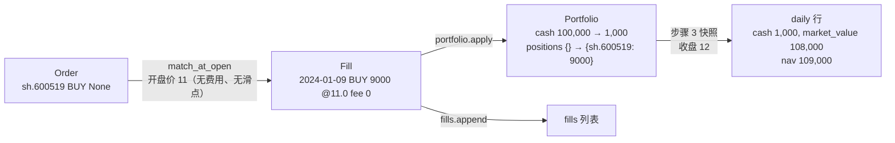

`accrue_interest` 是单利按段复利：每段 `cash += (cash − 保证金占用) × rate × days / 365`，跨多段时自然形成复利；没有期货持仓时与 `cash *= 1 + rate × days / 365` 相同。它返回当段利息，引擎记进快照的 `interest` 列，收益拆解里的「现金利息」就是这一列之和。

### 8.3 期货：`FutureRules` 与逐日盯市

[`future.py`](../src/quant/instruments/future.py)。期货与股票的根本区别是**不交割名义本金**：开仓只扣费用，盈亏每天按结算价划进现金。

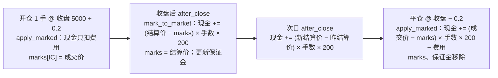

- **撮合**（[`match`](../src/quant/instruments/future.py#L59)）：价格 = 当日收盘价 ± `slippage_points`，买入上浮、卖出下浮（ADR-0003）。买入必须指定手数；开仓前检查 `已占用保证金 + 新增保证金 + 费用 ≤ 现金`，否则「资金不足」。卖出无持仓记「无持仓」，超过持仓只平掉持仓。
- **费用**（[`_fill`](../src/quant/instruments/future.py#L83)）：按成交金额（名义本金）计。开仓 `open_fee_rate`；平仓时先平昨仓（`Portfolio.sellable`，即持仓减去当日开仓）按 `close_yesterday_fee_rate`，余下的平今仓按 `close_today_fee_rate`。例：昨仓 3 手、今开 1 手、平 4 手 @ 5000 → 3 × 1,000,000 × 万 0.23 + 1 × 1,000,000 × 万 2.3 = 69 + 230。
- **开仓加权**：同一合约多次开仓时，`marks` 按手数加权平均，盯市公式依然成立（盈亏对价格是线性的）。
- **盯市与保证金**（[`after_close`](../src/quant/instruments/future.py#L108)）：有结算价才盯市；保证金占用 = 手数 × 乘数 × `marks` × `margin_rate`，只记录在 `Portfolio.margins`，不扣现金，进入快照的 `margin` 列。
- **到期**：`day ≥ expiry_of(symbol)` 时按结算价（盯市后的 `marks`）强制平仓，费用按平昨/平今计，返回 `Alert`。到期日 = [`future_expiry`](../src/quant/calendars.py#L19)：到期月份第三个周五，不是交易日则顺延到之后第一个交易日（例：2018-02-16 春节 → IC1802 于 02-22 到期）。
- **估值**：`market_value` 恒为 0，未实现盈亏已在每天收盘后计入现金。

一笔开仓到平仓的现金流见测试 [`test_futures_fill_at_close_and_mark_to_market_at_settle_into_cash`](../tests/test_future_rules.py)。

### 8.4 期权：`OptionRules` 与模型价

期权和股票、期货最大的不同是**没有自己的行情**。`DataFeed` 里只有标的 510500 的 bar，期权的当日 bar 由 [`OptionRules.quote`](../src/quant/instruments/option.py#L96) 现算：开高低收都等于 BS 模型价（ADR-0002）。引擎因此把取行情也交给规则对象（协议成员 `quote`），股票、期货的 `quote` 就是 `feed.bar`。

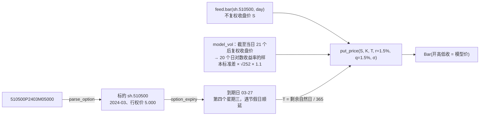

- **合约代码**（[`parse_option`](../src/quant/instruments/option.py#L36)，逆操作 [`option_symbol`](../src/quant/instruments/option.py#L45)）：沿用上交所合约交易代码的格式，标的代码 + `P` + 年月 + `M` + 行权价（厘，5 位）。只认 put；标的映射到 `sh.` + 标的代码。
- **撮合**（[`match`](../src/quant/instruments/option.py#L126)）：按当日模型价成交，无滑点；每张收 `fee_per_contract`（2 元），买卖都收。只支持买方：买入必须给出张数，要求 `权利金 + 费用 ≤ 现金 − 保证金占用`；卖出平仓，无持仓记「无持仓」。权利金现金交割（`Portfolio.apply`，乘数 10000），不交保证金。
- **无报价**：已过到期日、标的当日无 bar，或到期前截至当日的标的历史不足 21 个收盘价（波动率窗口 + 1），`quote` 返回 `None`，当日订单记「无行情」。
- **估值**（[`after_close`](../src/quant/instruments/option.py#L152)、`market_value`）：每天收盘记下模型价，`market_value` = 张数 × 模型价 × 10000。标的某天缺数据时沿用上一次的模型价。
- **到期**：`day ≥ expiry(symbol)` 时剩余期限为 0，模型价就是内在价值 max(K − S, 0)；按它卖出结算，**不收费用**，返回 `Alert`（到期日标的缺行情时只能沿用最近一次模型价，警告里注明）。虚值到期即以 0 结算，账户的总成本就是权利金加买入费用。
- **纯函数**：[`put_price`](../src/quant/pricing.py#L22)、[`put_delta`](../src/quant/pricing.py#L34)（波动率为 0 时按贴现后的远期内在价值处理，标的连续 21 天不变也不会除零）、[`implied_vol`](../src/quant/pricing.py#L46)（由价格二分反推波动率）、[`strike_at_or_below`](../src/quant/calendars.py#L62)（行权价网格向下取最近一档：3 元以下间距 0.05，3–5 元 0.1，5–10 元 0.25，10–20 元 0.5，20–50 元 1，50–100 元 2.5，100 元以上 5）是对冲策略直接调用的公开函数，单独有测试（`test_pricing.py`）。
- **每张 delta 敞口**（[`delta_exposure`](../src/quant/instruments/option.py#L65)）：乘数 × 标的价 × put delta（元，≤ 0）。波动率由当日模型价经 `implied_vol` 反推，所以策略不用知道模型价用的是哪个波动率；剩余期限与 `quote` 一致按自然日 / 365。

## 9. 策略接口与策略实现

### 9.1 策略能看到什么

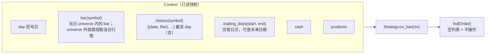

策略每天先由 `universe(day)` 声明需要哪些品种的行情（双均线是自己的股票，滚 IC 是最近两个季月合约，对冲时再加 510500），引擎再加上持仓和待撮合订单里的品种。收盘时才能确定的品种（如按当日 ETF 收盘价选出的平值 put）不必提前声明，`ctx.bar(symbol)` 会经引擎的品种规则按需取当日行情。

策略**拿不到未来数据**的保证来自引擎：`history` 只在 bar 到达后才 append，`Context` 是在 append 之后、下一天之前构造的；`bars` 只有当日的。策略拿不到 `feed`，唯一能看到「未来」的是交易日历——它是事先公布的公开信息，滚 IC 要用它数到期前还剩几个交易日。

### 9.2 `MaCross.on_bar`

[`ma_cross.py:21`](../src/quant/strategies/ma_cross.py#L21)


为什么要 `slow + 1` 根：判断「交叉」需要今天和昨天两个时点的均线差，昨天的慢线需要截至昨天的 `slow` 根，合起来是 `slow + 1` 根。

持仓状态机：

```mermaid
stateDiagram-v2
    [*] --> 空仓
    空仓 --> 等待买入成交: 金叉（收盘）
    等待买入成交 --> 持仓: 次日开盘成交
    持仓 --> 等待卖出成交: 死叉（收盘）
    等待卖出成交 --> 空仓: 次日开盘成交
    空仓 --> 空仓: 死叉（无仓可卖，忽略）
    持仓 --> 持仓: 金叉（已持仓，忽略）
```

### 9.3 `RollIC.on_bar`：滚 IC

[`roll_ic.py:50`](../src/quant/strategies/roll_ic.py#L50)

```mermaid
flowchart TD
    In([on_bar ctx]) --> T["target = current_contract(ctx)<br/>最近两个季月合约中，第一个<br/>距到期交易日数 > roll_days 的"]
    T --> Bar{"target 当日有 bar?"}
    Bar -- 否 --> E1(["返回 []，下一交易日再试"])
    Bar -- 是 --> Lots["lots = 已持有手数之和<br/>（空仓时 floor(现金 / (收盘价 × 乘数))）"]
    Lots --> Same{"持有的 IC 恰好只有 target?"}
    Same -- 否 --> Roll["IC 订单：SELL 每个旧合约（全部）、BUY target 补足 lots"]
    Same -- 是 --> H
    Roll --> H{"hedge 不为 None?"}
    H -- 否 --> Out(["返回 IC 订单"])
    H -- 是 --> HO(["IC 订单 + hedge_orders(ctx, lots × 乘数 × target 收盘价)<br/>见 §9.4"])
```

- 「距到期交易日数」= `len(ctx.trading_days(day + 1 天, 到期日))`，即 (day, 到期日] 内的交易日。`roll_days = 5` 时，2024-12-20 到期的 IC2412 在 12-13 展期；回测起点已在展期窗口内时直接开下一个季月合约。
- 展期在同一天先平后开，期货当日收盘成交，平仓释放的保证金正好够开新仓。
- 手数只在首次建仓时按 1 倍名义本金计算，之后展期保持不变（ticket 04 的约定）。净值增长后名义敞口占净值的比例会下降。

### 9.4 `RollIC.hedge_orders`：put 对冲到 delta 中性

[`roll_ic.py:78`](../src/quant/strategies/roll_ic.py#L78)。参数在 [`PutHedge`](../src/quant/strategies/roll_ic.py#L30)：`option`（取 `BacktestConfig.option`，算 delta 用）、`threshold`（默认 10%）、`roll_days`（put 换月，默认 5）、`underlying`（`sh.510500`）。

```mermaid
flowchart TD
    In(["hedge_orders(ctx, ic_delta)<br/>ic_delta = IC 名义本金（IC 订单成交后）"]) --> E{"510500 当日有 bar?"}
    E -- 否 --> N0(["[]"])
    E -- 是 --> Held{"恰好持有一个 put，<br/>且距到期 > roll_days 个交易日?"}
    Held -- "否（建仓 / 换月）" --> K
    Held -- 是 --> Th{"|ic_delta + 张数 × 每张 delta 敞口|<br/>> threshold × ic_delta?"}
    Th -- 否 --> N1(["[]"])
    Th -- 是 --> K["put = option_symbol(510500, 当日的次月, strike_at_or_below(ETF 收盘价))<br/>每张敞口 = delta_exposure(put, ctx.bar(put).close, ...)"]
    K --> Q["SELL 其余持有的 put（全部）<br/>put 张数调到 round(ic_delta / −每张敞口)"]
```

- **净 delta** 都按名义本金折算（元）：IC 为手数 × 200 × IC 收盘价；put 为张数 × 10000 × ETF 收盘价 × delta。模块级的 [`net_delta`](../src/quant/strategies/roll_ic.py#L124) 用同一套算法，`metrics.delta_table` 用它算每日实际持仓的净 delta。
- **再平衡按同一规则重选 put**（ADR-0004）：建仓、换月、再平衡都选「当日的次月、平值」put，选出的就是持有的 put 时只调张数，否则平掉旧 put、买入新 put。若只调张数，ETF 大涨后旧 put 深度虚值、或临近到期向下取一档的 put 偏虚值时 delta 趋近 0，`ic_delta / 每张敞口` 会算出几百万张（2016-07 真实数据中出现过），见测试 `test_rebalance_after_a_large_move_switches_to_the_next_month_at_the_money_put`、`test_rebalance_in_the_expiry_month_moves_to_the_next_month_put_instead_of_a_short_dated_one`。
- **取整误差在一张以内**：张数四舍五入，阈值为 0 时只要张数有变化就每日调整。
- **订单顺序**：先 IC（展期），再卖旧 put、买新 put，引擎按顺序撮合，卖出释放的现金可用于买入。IC 展期当天手数不变，IC 名义本金只随合约价格变化（贴水使下一季月合约略便宜），通常不触发再平衡。
- 2022-09-19（500ETF 期权上市）之前的 put 是假设品种，按同一个模型价交易。

## 10. 绩效指标与报告

### 10.1 `compute_metrics`

[`metrics.py:114`](../src/quant/metrics.py#L114)，输入 `BacktestResult` 与 `feed`（用于算基准）。给出 `start` / `end` 时只统计该区间：净值与基准以区间前一个交易日的收盘为起点（所以分段收益能连乘回全区间收益），成交额、费用按成交日归属，往返交易按卖出日归属。[`split_metrics`](../src/quant/metrics.py#L152) 以某一天为界分两段调用它，CLI 用 500ETF 期权上市日 2022-09-19 分段。

| 指标 | 公式 | 函数 |
| --- | --- | --- |
| 总收益 | `nav[-1] / nav[0] − 1` | — |
| 年化收益 | `(nav[-1]/nav[0])^(1/years) − 1`，`years = 自然日数 / 365` | `_annualize` |
| 最大回撤 | `max(1 − nav / cummax(nav))` | `_max_drawdown` |
| 夏普 | 日收益减 `rf/252`，`mean / std × √252` | `_sharpe` |
| 胜率 / 交易次数 | 每笔卖出算一次交易，按平均成本（含买入费用）比较卖出净所得 | `_round_trips` |
| 年化换手率 | `Σ(数量 × 价格 × 乘数) / 2 / 平均净值 / years`，期货按名义本金 | — |
| 总费用 | `Σ fee` | — |
| 基准收益 | 首日按**后复权收盘价**全额持有到最后一日，不计费用 | `buy_and_hold_nav` |
| 年化超额 | 策略年化 − 基准年化 | — |

`_round_trips` 维护每个标的的「持仓数量」和「总成本」两个累计量（金额都含合约乘数）：买入时两者都加；卖出时按 `卖出股数 / 持股数` 比例结转成本，`卖出金额 − 卖出费用 − 结转成本 > 0` 记为盈利。

**基差与年化贴水率**（[`basis_table`](../src/quant/metrics.py#L29)）：每天取收盘后持有的期货合约，基差 = 期货收盘价 − 指数收盘价，年化贴水率 = −基差 / 指数收盘价 × 365 / 距到期自然日数（贴水为正）。未持仓或缺行情的日子为 NaN。CLI 只在 `roll_ic` 时计算，经 `write_report(extra_daily=...)` 并入 `daily.csv`。

**每日净 delta**（[`delta_table`](../src/quant/metrics.py#L50)）：按每天收盘后的实际持仓（不是策略的计划）算 `net_delta`（元）与 `net_delta_ratio`（÷ IC 名义本金），put 行情由一个新建的 `OptionRules` 现算。

**收益拆解**（[`return_breakdown`](../src/quant/metrics.py#L67)），假设组合只含期货与期权，各项都是对总盈亏的贡献（元）：

| 项 | 算法 |
| --- | --- |
| 总盈亏 `total_pnl` | 期末净值 − 初始资金 |
| 交易费用 `fees` | −Σ fee |
| 现金利息 `interest` | Σ `daily.interest` |
| put 盈亏 `put_pnl` | Σ 卖出权利金 − Σ 买入权利金 + 期末 put 市值（不含费用） |
| IC 随指数涨跌 `ic_index_pnl` | Σ 前一交易日收盘的 IC 手数 × 乘数 × 当日中证 500 收盘价变化 |
| 贴水收敛 `discount_convergence` | IC 盈亏（= 总盈亏 − put 盈亏 − 费用 − 利息）− `ic_index_pnl`，即基差变化的贡献；期货滑点也在这一项 |
| 指数涨跌与 put `hedge_cost` | `put_pnl + ic_index_pnl`：delta 中性时两者大体相抵，剩下的就是 put 的对冲成本（时间价值流失与对冲误差） |

贴水收敛 + 指数涨跌与 put + 交易费用 + 现金利息 = 总盈亏。贴水收敛按残差算，所以这个等式恒成立；测试另外独立核对了贴水收敛与指数涨跌的数值。纯滚 IC 也用同一张表（put 盈亏为 0，这一项就是 IC 的指数敞口）。

### 10.2 输出文件

```mermaid
flowchart LR
    R[BacktestResult] --> FC["fills.csv<br/>date, symbol, side, quantity, price, fee, multiplier"]
    R --> RC["rejections.csv<br/>date, symbol, side, quantity, reason"]
    R --> AC["alerts.csv<br/>date, symbol, message"]
    R --> RT["终端打印<br/>format_rejections：按原因计数<br/>format_alerts：逐条警告"]
    R --> DC["daily.csv<br/>date, cash, market_value, margin, nav, interest,<br/>positions(JSON), benchmark_nav<br/>（roll_ic 另有 contract, basis, annualized_discount；<br/>对冲时再加 net_delta, net_delta_ratio, unhedged_nav）"]
    BT[basis_table / delta_table] --> DC
    M[metrics dict] --> MJ[metrics.json]
    R --> NP["nav.png<br/>策略 + 对照曲线 + 基准（都归一到 1）；<br/>roll_ic 对冲时为本策略、纯滚 IC、中证 500 三条，<br/>下方一栏净 delta / IC 名义本金，标题标注期权价格为模型价"]
    B[benchmark Series] --> NP
    B --> DC
    M --> TXT["终端打印<br/>format_metrics、format_segments（分段指标）、<br/>format_breakdown（收益拆解）"]
```

输出目录名：`output/ma_cross_<symbol>_<start:%Y%m%d>_<end:%Y%m%d>/`、`output/roll_ic_hedge_<start>_<end>/`、`output/roll_ic_nohedge_<start>_<end>/`；CSV 用 `utf-8-sig` 编码，方便 Excel 直接打开中文。对冲时 `metrics.json` 另有 `note`（期权价格为模型价、2022-09-19 前的 put 是假设品种）、`segments`（分段指标）、`breakdown`（本策略与纯滚 IC 的收益拆解）。

## 11. 命令行与配置覆盖

```bash
backtest ma_cross --symbol sz.000001 --start 2018-01-01 --fast 10 --slow 60 --set cash_rate=0.02 --set stock.commission_rate=0.0003
backtest roll_ic --hedge-threshold 0 --put-roll-days 3 --set option.vol_premium=1.2
backtest roll_ic --no-hedge --roll-days 3 --set future.margin_rate=0.12
```

| 参数 | 默认 | 说明 |
| --- | --- | --- |
| `strategy` | — | `ma_cross` 或 `roll_ic` |
| `--symbol` | `sh.600519` | `ma_cross` 的标的，baostock 代码格式 |
| `--start` / `--end` | 2016-01-01 / 今天 | |
| `--cash` | 3,000,000 | 初始资金 |
| `--fast` / `--slow` | 5 / 20 | `ma_cross` 均线周期 |
| `--no-hedge` | — | `roll_ic` 只滚 IC，不用 put 对冲（默认对冲，并同时跑纯滚 IC 作对照） |
| `--roll-days` | 5 | `roll_ic` 在到期前多少个交易日展期 |
| `--hedge-threshold` | 0.10 | `roll_ic` 净 delta 超过 IC 名义本金的这个比例时再平衡，0 即每日再平衡 |
| `--put-roll-days` | 5 | `roll_ic` put 到期前多少个交易日换月 |
| `--set KEY=VALUE` | — | 可重复，覆盖 `BacktestConfig` 任意嵌套字段 |
| `--cache-dir` | `data_cache` | |
| `--out` | `output` | |

`--set` 的实现（[`_replace_path`](../src/quant/cli.py#L178)）是沿点号路径递归 `dataclasses.replace`：

```mermaid
flowchart TD
    A["--set stock.commission_rate=0.0003"] --> B["path = ['stock', 'commission_rate']"]
    B --> C["_replace_path(BacktestConfig, path, '0.0003')"]
    C --> D{"'stock' 是 BacktestConfig 的字段?"}
    D -- 否 --> X[SystemExit 未知配置项]
    D -- 是 --> E["递归 _replace_path(StockConfig, ['commission_rate'], '0.0003')"]
    E --> F["type(0.00025)('0.0003') → float 0.0003<br/>replace(StockConfig, commission_rate=0.0003)"]
    F --> G["replace(BacktestConfig, stock=新 StockConfig)"]
```

因为所有配置都是 frozen dataclass，**新增配置项只要加一个带默认值的字段，CLI 自动支持覆盖**，不用改 `cli.py`。值按原字段类型转换，`date` 字段按 ISO 格式解析（如 `--set stock.chinext_reform_date=2020-08-24`）；布尔字段将来需要特殊处理（`bool("False")` 为真）。

## 12. 测试接缝

```mermaid
flowchart LR
    subgraph 生产
        B[(baostock / 中金所 / AKShare)] --> BF["load_baostock_feed<br/>load_roll_ic_feed"] --> IF1[InMemoryDataFeed]
    end
    subgraph 测试
        MK["make_feed / make_multi_feed<br/>tests/conftest.py"] --> IF2[InMemoryDataFeed]
    end
    IF1 --> E[run_backtest]
    IF2 --> E
    E --> RES["BacktestResult<br/>只断言 fills / rejections / alerts / daily"]
```

- [`make_bar`](../tests/conftest.py#L23)：给开盘价、收盘价即可，其余字段自动补齐（`high/low` 取二者极值、`adj_factor` 默认 1、`adj_close = close × adj_factor`）；给出 `adj_factor` 即可构造除权日；`suspended`、`is_st` 可选，默认非停牌非 ST。
- [`stock_costs`](../tests/conftest.py#L39)：佣金、印花税、过户费、滑点全为 0 的 `StockConfig`，只打开需要的项，让金额可手算。
- [`make_feed`](../tests/conftest.py#L46)：字典的键就是交易日历，故意漏掉某天就等于该日休市；值可以是 `(开盘, 收盘)`，也可以是 `make_bar(...)` 构造的停牌、ST、除权日 bar。
- [`make_future_bar`](../tests/conftest.py#L53) / [`future_costs`](../tests/conftest.py#L59) / [`make_multi_feed`](../tests/conftest.py#L66)：期货 bar（开高低收相同，结算价默认等于收盘价）、手续费与滑点全为 0 的 `FutureConfig`、多品种 feed（日历默认为各品种日期的并集，也可显式给出——滚 IC 测试要让日历覆盖到合约到期日）。
- 测试中的策略都是几行的「脚本策略」（如 `BuyOnceOnFirstDay`、`BuyThenSellAll`、`test_stock_rules.py` 的 `Script`），按 `len(ctx.history(SYMBOL))` 或 `ctx.day` 决定哪天下单，让场景可手算；每个测试策略都要实现 `universe`。
- 联网测试打 `@pytest.mark.network`，默认跳过，`pytest --run-network` 启用。
- 例外：[`test_cache.py`](../tests/test_cache.py) 直接用假数据源驱动 `ParquetCache`，验证断点续拉——这是数据层自己的行为，经 `DataFeed` 观察不到。
- 例外：[`test_pricing.py`](../tests/test_pricing.py) 直接测 BS 模型价、delta、反推波动率和行权价网格——它们是对冲策略直接调用的公开纯函数。期权的成交、估值、到期结算仍经引擎测（`test_option_rules.py`），对冲逻辑经引擎 + `metrics.delta_table` / `return_breakdown` 测（`test_roll_ic_hedge.py`，期望的 delta 由测试按已知波动率独立算出）。

现有测试覆盖的引擎语义：

| 测试 | 验证 |
| --- | --- |
| `test_backtest_advances_only_on_trading_days` | 只在日历中的交易日推进 |
| `test_idle_cash_earns_annual_rate_per_calendar_day` | 按自然日计息、分段复利 |
| `test_stock_order_signalled_at_close_fills_at_next_day_open` | 信号日收盘下单 → 成交日开盘成交，收盘估值 |
| `test_full_position_buy_takes_as_many_whole_lots_as_cash_and_commission_allow` | 满仓股数计算（含整手） |
| `test_small_trade_pays_minimum_commission` | 5 元最低佣金 |
| `test_sell_without_quantity_closes_whole_position_at_next_open` | 全部卖出语义 |
| `test_interest_for_the_gap_accrues_on_previous_close_cash_before_open_fills` | 计息先于开盘撮合 |
| `test_position_scales_by_factor_ratio_on_ex_rights_day_so_nav_does_not_drop` | 除权日持股按因子比例放大，净值不跳水 |
| `test_ex_rights_adjusted_position_rounds_to_whole_shares_and_can_all_be_sold` | 除权后取整到整股，零股可全部卖出 |
| `test_golden_cross_buys_and_death_cross_sells_on_next_day_open` | 双均线交叉与成交时点 |
| `test_ex_rights_gap_does_not_trigger_death_cross_because_signal_uses_adjusted_price` | 除权缺口不产生假死叉（信号用后复权价） |
| `test_metrics_and_buy_and_hold_benchmark` | 各项指标手算校验 |
| `test_stock_rules.py` 各测试 | T+1、整手、开盘涨跌停跳过、各板块 / ST / 创业板改革日的涨跌幅、停牌、默认费率、滑点方向、资金不足拒单、每笔未成交都有原因；除权日按不复权价撮合与取整、涨跌停以除权参考价为基准 |
| `test_moutai_buy_and_hold_tracks_backward_adjusted_return_across_ex_rights_days`（联网） | 茅台 2016–2024 持有期市值涨幅与后复权价涨幅一致 |
| `test_report_lists_skipped_orders_with_reasons` | `rejections.csv` 内容与终端汇总 |
| `test_future_rules.py` 各测试 | 当日收盘成交与结算价盯市、名义本金按乘数 200、保证金 14%、平今万 2.3 / 平昨万 0.23、到期强平与警告、第三个周五遇节假日顺延、资金不足拒绝开仓、保证金不计息 |
| `test_roll_ic.py` 各测试 | 按 1 倍名义本金建仓当季合约、到期前 5 个交易日展期且手数不变、展期天数可配置、起点在展期窗口内、基差与年化贴水率、`daily.csv` 的 margin / basis 列 |
| `test_option_rules.py` 各测试 | 虚值到期归零、现金变化 = 权利金 + 费用；实值到期按 ETF 收盘价的内在价值结算；第四个星期三遇春节顺延；持仓每日按模型价估值，随时间衰减、随 ETF 下跌升值；资金不足拒单；标的历史不足波动率窗口时无行情 |
| `test_pricing.py` 各测试 | 行权价网格各档；put 模型价满足无套利边界、与手算值一致、到期等于内在价值、零波动率等于远期内在价值；delta 在 −1 到 0 之间、平值接近 −0.5；由模型价反推回波动率 |
| `test_roll_ic_hedge.py` 各测试 | 建仓买次月平值 put、净 delta 误差在一张以内；超过阈值才再平衡、阈值 0 每日再平衡；选出的 put 不变时只调张数、大幅波动后与到期月内再平衡时重选次月平值 put；put 到期前 5 个交易日换到新的次月平值合约；IC 展期当天 put 不动、净 delta 在阈值内；收益拆解之和等于总盈亏并分开贴水收敛与指数涨跌；分段指标连乘等于全区间；`daily.csv` 的净 delta 列 |
| `test_futures_round_trip_is_judged_on_notional_including_multiplier` | 期货胜率与换手率按名义本金计 |
| `test_interrupted_first_fetch_resumes_from_unfinished_month` | 首次按月拉取中断后从未完成的月份继续 |
| `test_ic_data_smoke.py`（联网） | 中金所 IC 分合约 bar 带结算价、AKShare 中证 500 日线 |

## 13. 实例追踪：一次金叉死叉的逐日推演

以 [`test_ma_cross.py`](../tests/test_ma_cross.py) 的场景为例（`MaCross(SYMBOL, fast=2, slow=3)`，初始资金 100,000，无费用无利息），逐日看引擎每一步发生了什么。需要 `slow + 1 = 4` 根 bar 才开始判断。

| 交易日 | 开 / 收 | 步骤 2：开盘撮合 pending | 步骤 3：MA2 − MA3（昨 → 今） | 产生订单 | 收盘快照 cash / 持股 / nav |
| --- | --- | --- | --- | --- | --- |
| 01-02 | 10 / 10 | — | bar 不足 | — | 100,000 / 0 / 100,000 |
| 01-03 | 10 / 10 | — | bar 不足 | — | 100,000 / 0 / 100,000 |
| 01-04 | 10 / 10 | — | bar 不足 | — | 100,000 / 0 / 100,000 |
| 01-05 | 10 / 9 | — | 0 → −0.17（下穿，但空仓） | — | 100,000 / 0 / 100,000 |
| 01-08 | 9 / 12 | — | −0.17 → +0.17 **金叉** | BUY None | 100,000 / 0 / 100,000 |
| 01-09 | 11 / 12 | **买 9000 股 @ 11**（floor(100,000/11) = 9090，按整手取 9000） | +0.17 → +1.00 | — | 1,000 / 9000 / 109,000 |
| 01-10 | 12 / 8 | — | +1.00 → −0.67 **死叉** | SELL None | 1,000 / 9000 / 73,000 |
| 01-11 | 8.5 / 8.5 | **卖 9000 股 @ 8.5** | — | — | 77,500 / 0 / 77,500 |

（MA 差值：01-05 为 MA2(10, 9)=9.5 − MA3(10, 10, 9)=9.67；01-08 为 10.5 − 10.33；01-09 为 12 − 11；01-10 为 10 − 10.67。）

用时间线看信号日与成交日的错位：

```mermaid
sequenceDiagram
    participant D8 as 01-08
    participant D9 as 01-09
    participant D10 as 01-10
    participant D11 as 01-11
    Note over D8: 收盘 12，金叉<br/>pending = [BUY]
    D8->>D9: 订单隔夜
    Note over D9: 开盘 11 买入 9000 股<br/>收盘 12 估值
    Note over D10: 收盘 8，死叉<br/>pending = [SELL]
    D10->>D11: 订单隔夜
    Note over D11: 开盘 8.5 卖出 9000 股
```

## 14. 阅读时容易忽略的细节

1. **品种按代码分派**：只认 `IC` + 四位数字为期货、`510500P2412M05500` 这种上交所交易代码为期权（只认 put），其余一律按股票处理（指数 `sh.000905` 也走 `StockRules`，但策略从不对它下单）。IF / IH 乘数是 300，要等 `FutureConfig` 按品种区分后才能加。
2. **交易日历要覆盖到期日**：滚 IC 数「到期前还剩几个交易日」（put 换月同理）、`FutureRules` 判断到期，都查 `feed.trading_days` 的未来日期。CLI 在已公布的日历之后追加 200 天的工作日（忽略未来节假日）；回测本身只推进到最后一个已公布的交易日。测试里同样要把日历延伸出去，否则下一个季月合约的到期日超出日历，会按未顺延的第三个周五计、交易日也数不够。
3. **没有 bar 的交易日**：品种当日无 bar 时，它的股票 `pending` 订单保留到下一个有 bar 的日子；期货、期权订单记「无行情」；所有品种都无 bar 时不调用策略——只把期权放进 universe、而它当日无报价时，策略当天不会被调用，要把标的 ETF 也放进 universe。估值用规则对象里记的旧收盘价，并照常计息。
4. **估值用不复权收盘价，基准用后复权价**：两者能对上，靠的是除权日按因子比例放大持股数。这是分红再投资的近似：不计红利税、取整到整股；且基准从首日收盘起算，策略要到次日开盘才买入、还剩不足整手的现金，所以净值与基准不会完全重合。
5. **被拒的订单不顺延**：记一条 `Rejection` 后订单就结束了，不会挂到下一交易日再试。双均线只在交叉当天发信号，所以开盘涨停没买到的那次金叉就错过了，这符合「次日开盘一次性撮合」的设定。
6. **卖出数量超过可卖数量时部分成交**：只卖出可卖部分，剩余部分不记 `Rejection`。买入不做部分成交，资金不够时整单拒绝。
7. **涨跌停价以上一交易日不复权收盘价为基准，除权日改用除权参考价**：参考价由复权因子比例推算，不是交易所公布值，分红金额很小时可能差一分钱。新股上市初期不设涨跌幅、北交所 30% 等规则也没有建模。
8. **零股只在全部卖出时才能卖干净**：除权取整后持股常带零股（如 1012 股）。A 股要求零股一次性卖出，但按指定数量卖出时引擎不检查这条，可能留下零股；双均线总是全部卖出，不受影响。
9. **滑点后的买价可能略高于涨停价**：只有开盘价低于涨停价才会成交，但 `open × 1.001` 可能越过涨停价，没有截断，影响可忽略。
10. **`Context.history(symbol)` 每次调用复制一次**：双均线每天调用一次，复杂度 O(n²)，10 年约 2,500 个交易日，可以接受。
11. **计息位置**：在交易日开头为上一段间隔计息，而 spec 写的是「当日末计息」。两者在净值上等价，只是周末利息记到下一交易日。
12. **`buy_and_hold_nav` 被调用两次**：`compute_metrics` 内部一次（算指标），`cli` 里一次（画图和写 `daily.csv`），结果相同。
13. **期货平仓先平昨、后平今**：同一天既有昨仓又有今仓时，卖出先消耗昨仓（费率低），这一点由 `Portfolio._update_position` 维护当日开仓数量实现。
14. **滚 IC 手数不随净值调整**：只在首次建仓时按 1 倍名义本金定手数，之后展期保持不变。2016–2026 的真实回测里净值翻倍，到期末名义敞口只剩净值的一半左右。
15. **基差用收盘价**：`basis_table` 用期货与指数的收盘价，不用结算价；年化贴水率按距到期的**自然日**折算。
16. **期权的已实现波动率用到「当日」收盘价**：模型价在收盘时计算，波动率窗口包含当日收益率，这和期权当日收盘成交（ADR-0003）一致，不是未来函数。
17. **510500 与交易日历往前多取一段**：`load_roll_ic_feed` 对冲时从起点往前多取 3 × 波动率窗口 + 10 个自然日，否则开头几周没有期权报价、无法建仓对冲。
18. **对冲成本受模型价假设左右**：模型波动率 = 已实现波动率 × 1.1，put 的 theta 与对冲中赚到的 gamma 收益大体相当，所以真实回测里对冲成本不大；真实市场的隐含波动率溢价可能更高，`--set option.vol_premium=...` 可做敏感性分析（ADR-0002）。
19. **收益拆解的 IC 指数部分用中证 500、put 对冲的是 510500**：两者的跟踪误差、ETF 分红都落在「指数涨跌与 put」里；期货滑点落在「贴水收敛」里。
20. **对冲版要跑两次回测**：`run_roll_ic` 先跑纯滚 IC 再跑对冲版，两者共用同一个 feed，纯滚 IC 的净值进图（第三条曲线）和 `daily.csv` 的 `unhedged_nav` 列。
