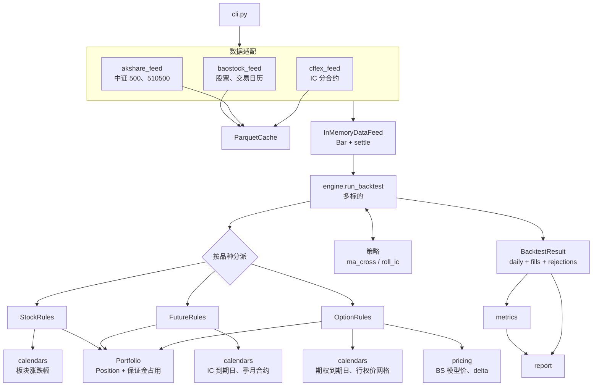
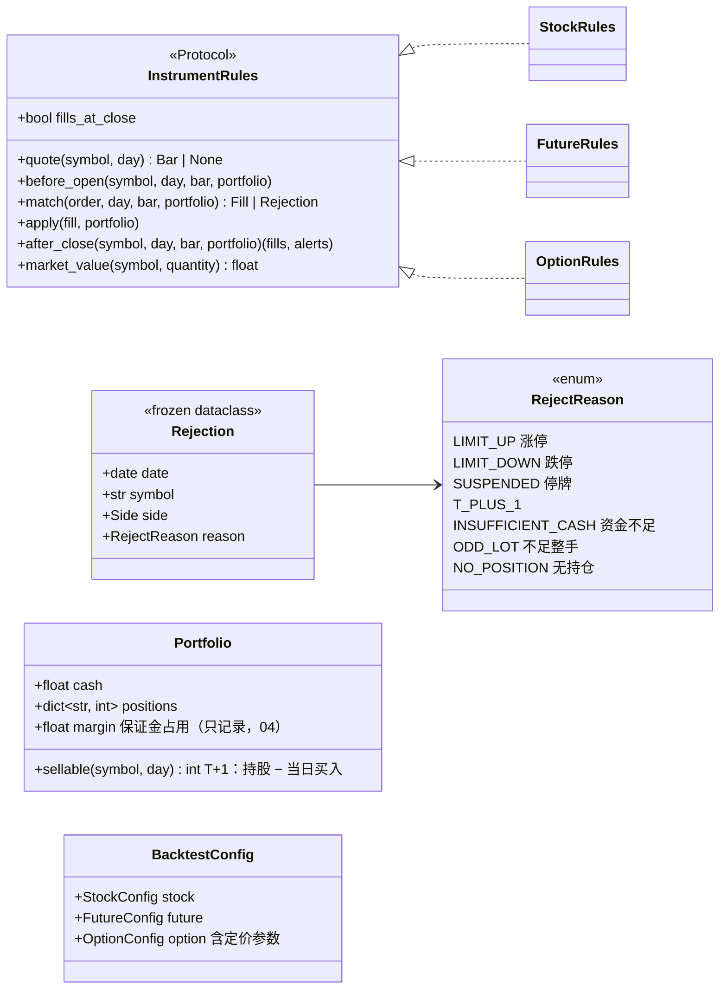
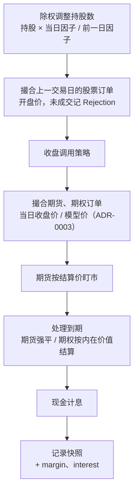
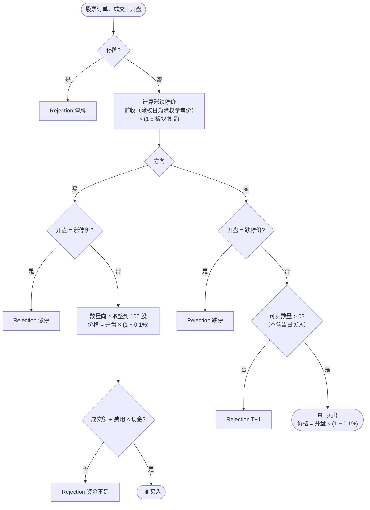
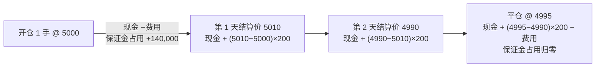
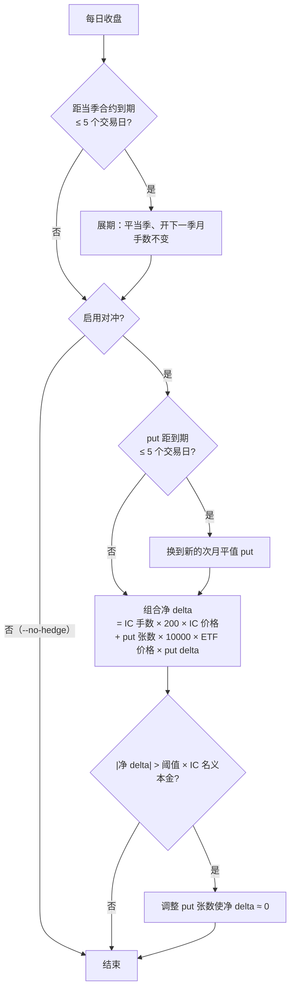
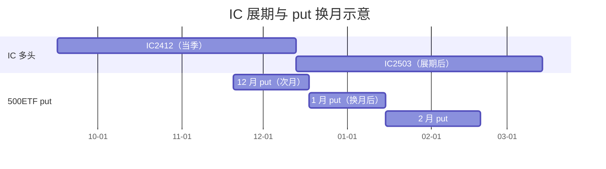
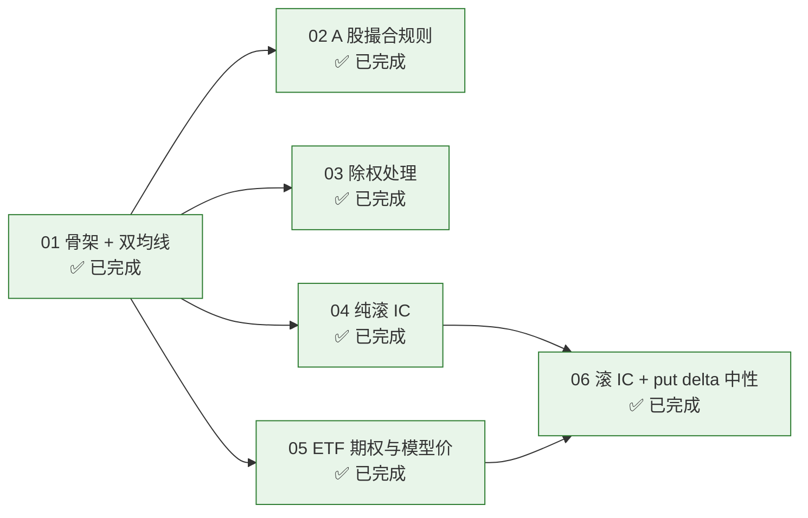

# 设计文档：A 股量化研究原型

> **状态**：ticket 01（骨架 + 双均线）、02（A 股撮合规则）、03（除权处理）、04（纯滚 IC）、05（ETF 期权与模型价）、06（滚 IC + put delta 中性）均已落地。
> **需求来源**：`.scratch/a-share-quant-prototype/spec.md`；**术语**以 [`GLOSSARY.md`](../GLOSSARY.md) 为准；**决策**见 [`docs/adr/`](adr/)。
> **现有代码导读**：[`code-walkthrough.md`](code-walkthrough.md)。
> 本文说明系统的设计原则与目标形态，以及各 ticket 把代码演进成了什么样。
>
> 文中的图使用 Mermaid，在 GitHub、VS Code（Markdown Preview Mermaid Support 插件）、Typora 中都能直接渲染。

## 目录

- [1. 目标与边界](#1-目标与边界)
- [2. 现状与差距](#2-现状与差距)
- [3. 设计原则](#3-设计原则)
- [4. 目标架构](#4-目标架构)
- [5. 目标每日事件顺序](#5-目标每日事件顺序)
- [6. 品种规则](#6-品种规则)
- [7. 滚 IC 策略](#7-滚-ic-策略)
- [8. 报告扩展](#8-报告扩展)
- [9. 演进路线](#9-演进路线)
- [10. 已知限制与风险](#10-已知限制与风险)

---

## 1. 目标与边界

一个本地运行、命令行驱动的**日频回测**原型，回答两个问题：

1. 在符合 A 股真实规则（T+1、整手、涨跌停、停牌、除权、完整费用）的前提下，简单的股票策略表现如何——以双均线为验证载体。
2. **滚 IC** + 平值次月 500ETF put 动态对冲到 **Delta 中性**，贴水收敛的收益能否覆盖 put 成本。

不做：实盘/模拟盘执行、分钟线、期权真实市场价与波动率曲面、追保与强平、参数优化、多策略组合、Web 界面（详见 spec 的 Out of Scope）。

## 2. 现状与差距

ticket 01 已经搭好骨架：数据加载与缓存、统一账户、按交易日推进的引擎、策略接口、双均线、指标与报告、命令行入口；ticket 02 补上了 A 股撮合规则（T+1、整手、涨跌停、停牌、完整费用、滑点、资金检查）和未成交记录；ticket 03 补上了除权处理（持股按复权因子放大、除权日涨跌停以除权参考价为基准）；ticket 04 把引擎改成多标的、按品种分派，加上期货规则、IC 到期日历、中金所与 AKShare 数据适配器和纯滚 IC 策略；ticket 05 加上 ETF 期权品种（BS 模型价、到期按内在价值结算）、期权到期日、行权价网格和 510500 数据适配器；ticket 06 在滚 IC 上叠加平值次月 500ETF put 的 delta 中性对冲，报告给出三条净值曲线、每日净 delta、收益拆解和按 2022-09 分段的指标。代码如何运转见 [`code-walkthrough.md`](code-walkthrough.md)。

| 模块 | 现状 | 目标 |
| --- | --- | --- |
| `data/feed.py`、`data/cache.py`、`data/baostock_feed.py` | 已实现；`Bar.settle`；缓存按月分段补拉（断点续拉） | — |
| `data/cffex_feed.py`、`data/akshare_feed.py` | IC 分合约日线与结算价（中金所月度数据包）、中证 500 与 510500（AKShare） | — |
| `portfolio.py` | 现金 + 持仓 + 当日买入（可卖数量 / 平昨数量）；期货盯市基准价与保证金占用；`Rejection`、`Alert` | — |
| `instruments/stock.py`、`instruments/future.py` | A 股撮合规则；期货收盘成交、盯市、平今平昨、保证金、到期强平 | — |
| `instruments/option.py` | 期权现算模型价行情、收盘成交、每张 2 元、到期按内在价值结算 | — |
| `calendars.py` | IC 到期日、季月合约、工作日延伸日历、期权到期日、行权价网格 | — |
| `pricing.py` | BS put 模型价与 delta、由价格反推波动率、已实现波动率 | — |
| `engine.py` | 多标的、按品种分派（`InstrumentRules`，行情也经规则的 `quote` 取）、完整每日事件顺序；快照记录当日利息 | — |
| `strategy.py` | 多标的 `Context`（universe 外的品种按需现取当日行情）、`Strategy.universe` | — |
| `strategies/roll_ic.py` | 滚 IC；`PutHedge` 时用 put 对冲到 delta 中性（06） | — |
| `metrics.py`、`report.py` | 策略 vs 基准；基差与年化贴水率；`rejections.csv`、`alerts.csv`；三条曲线、每日净 delta、收益拆解、分段指标（06） | — |

spec 中的 ticket 01–06 均已实现，目标架构与现状一致。

## 3. 设计原则

| 原则 | 体现 |
| --- | --- |
| 一个引擎、一个账户 | 股票、期货、期权共用 `Portfolio` 现金账户，规则按品种类型分派，引擎不含品种特有逻辑（ADR-0001） |
| 不引入未来函数 | 策略只看截至信号日的数据；股票次日开盘成交；衍生品当日收盘成交只因其决策不依赖未来行情（ADR-0003） |
| 唯一测试接缝 | 引擎只通过 `DataFeed` 取数；测试手工构造 bar，只断言回测结果（例外：缓存断点续拉、策略直接调用的定价纯函数） |
| 外部依赖集中 | 数据源字段名只出现在对应适配器中 |
| 参数全部可配置 | 费率、滑点、保证金率、利率都在 frozen dataclass 配置中，`--set` 覆盖 |
| 离线可重复 | Parquet 缓存，命中时不联网 |

## 4. 目标架构

目标类图（新增部分）：

### 4.1 从单标的到多标的（04 已实现）

- `run_backtest(feed, strategy, start, end, config)`：去掉了 `symbol` 参数，标的由策略声明（`strategy.universe(day)`），引擎另外带上持仓和待撮合订单中的品种。
- `Context` 提供 `bar(symbol)`（当日）、`history(symbol)`（截至当日）和 `trading_days(start, end)`（交易日历是事先公布的公开信息，可查未来日期）。
- `MaCross` 构造时接收 symbol。
- `DataFeed` 协议不变。
- 品种规则实现 `InstrumentRules` 协议（`instruments/__init__.py`）：`fills_at_close`、`quote`（05 新增）、`before_open`、`match`、`apply`、`after_close`、`market_value`；引擎按代码分派（`IC2412` 这类代码 → `FutureRules`，`510500P2412M05500` 这类代码 → `OptionRules`，其余 → `StockRules`）。涨跌停基准价、复权因子等按品种的状态放在规则对象里，每次回测新建。

## 5. 每日事件顺序

股票订单进入 `pending` 隔日撮合；衍生品订单在策略返回后当日立即撮合。引擎按订单的品种类型决定路径，策略无需关心。

04 的实现与上图的差别只有一处：现金计息放在每个交易日开头，为上一段间隔（含周末）计息，与「当日末计息」在净值上等价。期权（05）在 F 步（`after_close`）按内在价值结算。net_delta、basis 不在引擎快照里，由 `metrics.delta_table`、`basis_table` 按每日持仓事后计算（06）。

## 6. 品种规则

### 6.1 股票（ticket 02、03）

| 规则 | 参数 |
| --- | --- |
| 板块涨跌幅 | 主板 10%；创业板 2020-08-24 起 20%、之前 10%；科创板 20%；ST 5%，只作用于主板和改革前的创业板，改革后的创业板与科创板 ST 股与板块相同（按代码前缀判断板块） |
| 整手 | 买入向下取整到 100 股；卖出不取整（可卖出零股） |
| 费用 | 佣金万 2.5（最低 5 元）+ 卖出印花税 0.05% + 过户费 0.001% |
| 滑点 | 0.1%，方向对交易者不利 |
| 除权 | 除权日开盘前持股 × (当日因子 / 前一日因子)，取最近的整股，近似分红再投资；当日涨跌停以除权参考价 = 前收 × 前一日因子 / 当日因子（四舍五入到分）为基准（03） |

02、03 已按上图实现（`instruments/stock.py`），所有参数在 `StockConfig` 中可配置。图外补充的两种拒单原因：显式数量不足 100 股（不足整手）、卖出时没有持仓（无持仓），保证每笔未成交订单都有原因。被拒的订单不顺延到下一交易日。

### 6.2 期货（ticket 04）

- 合约乘数 200，**名义本金** = 价格 × 200。
- 当日收盘价 ± 0.2 点滑点成交。
- 开仓与平昨万 0.23，平今万 2.3；同时有昨仓和今仓时**先平昨、后平今**。
- 每日按**结算价**盯市，盈亏计入现金；开仓不扣名义本金，只扣费用。
- 保证金占用 = 持仓 × 乘数 × 结算价（当日开仓时为成交价）× 14%，只展示，不追保不强平；开仓时要求现金覆盖全部保证金和费用，否则记「资金不足」（spec 用户故事 17）。被保证金占用的现金不算闲置，不计息。
- 只支持多头：买入开仓、卖出平仓；卖出超过持仓时只平掉持仓。
- 到期日（每月第三个周五，遇节假日顺延）仍持仓 → 按结算价强制平仓，记入 `alerts`（`alerts.csv`、终端、日志警告）。
- 所有参数在 `FutureConfig` 中可配置（`--set future.margin_rate=0.12`）。

期货账户的现金变化与股票不同：

### 6.3 期权（ticket 05）

- 合约代码沿用上交所交易代码：`510500P2412M05500` = 510500、put、2024-12 到期、行权价 5.500。只支持 put 的买方（买入开仓、卖出平仓）。
- 合约乘数 10000，每张 2 元（买卖都收，到期结算不收），买方不交保证金，权利金现金交割。
- 期权没有自己的行情：`OptionRules.quote` 由标的当日 bar 现算 **模型价**——BS，无风险利率 1.5%、股息率 1.5%、波动率 = 510500 截至当日的 20 日已实现波动率（后复权价对数收益率，样本标准差 × √252）× 1.1（ADR-0002），剩余期限按自然日 / 365。成交与估值都用它，无滑点。
- 标的历史不足一个波动率窗口或当日无数据时无报价，订单记「无行情」。
- 行权价网格：3 元以下间距 0.05，3–5 元 0.1，5–10 元 0.25，10–20 元 0.5，20–50 元 1，50–100 元 2.5，100 元以上 5；`strike_at_or_below` 向下取最近一档。到期日 = 到期月份第四个星期三（遇节假日顺延）。
- 到期日仍持仓 → 剩余期限为 0，模型价即到期日 ETF 收盘价的内在价值，按它卖出结算并记 `Alert`。
- 所有参数在 `OptionConfig` 中可配置（`--set option.vol_premium=1.2`）。
- 报告标注「期权价格为模型价」（06：净值图标题、终端、`metrics.json` 的 `note`）。
- 510500 数据：新浪日线（不复权）+ 累计分红推算后复权因子（`load_etf_bars`）；baostock 给这只 ETF 的复权因子有误，不用。

## 7. 滚 IC 策略

「当季合约」在本项目中指尚未进入展期窗口的最近一个季月合约（可能同时是交易所口径的当月或下月合约），见甘特图。展期日 = 距到期还剩 `roll_days` 个交易日的那天（如 2024-12-20 到期、展期 5 日 → 12-13 展期）。04 实现了「否（--no-hedge）」一支，06 实现了对冲一支（`strategies/roll_ic.py` 的 `PutHedge`、`hedge_orders`）。

06 的几处具体约定：

- **次月**：当日所在月份的下一个月。
- **再平衡按同一规则重选 put**（ADR-0004）：图中「调整 put 张数」在实现里是先按建仓、换月时的规则（当日的次月、平值）重选 put，选出的就是持有的 put 时只调张数，否则平掉旧 put、买入新 put。只调张数在 ETF 大涨后（旧 put 深度虚值）或临近到期（向下取一档的 put 偏虚值）时 delta 趋近 0，张数会失控：2016-07 真实数据中一次要买 600 多万张，资金耗尽后对冲失效、净值跌掉 90%。
- **delta 的波动率**：策略由当日 put 模型价反推波动率再算 delta（`implied_vol`），与模型价自洽，也不需要知道模型价用的波动率窗口与溢价系数。
- **收盘才确定的 put**：平值行权价取决于当日 ETF 收盘价，策略无法在 `universe` 里提前声明，经 `Context.bar` 按需取当日模型价（同一交易日的行情，不是未来数据）。

| 参数 | 默认 |
| --- | --- |
| 建仓手数 | floor(可用资金 / IC 名义本金)，1 倍名义本金；按建仓日收盘价计算 |
| IC 到期日 | 每月第三个周五，遇节假日顺延 |
| 展期 / put 换月 | 到期前 5 个交易日 |
| put 选择 | 平值（行权价网格向下取最近一档）、次月 |
| 再平衡阈值 | 10%，设为 0 即每日再平衡 |

合约时间线示意（季月合约与 put 次月合约各自独立滚动）：

## 8. 报告扩展

| 输出 | 内容 | Ticket |
| --- | --- | --- |
| `rejections.csv` | 未成交订单及原因（已实现，终端同时打印按原因计数） | 02 |
| `daily.csv` 新列 | margin、contract、basis、annualized_discount（04）；interest、net_delta、net_delta_ratio、unhedged_nav（06） | 04、06 |
| `alerts.csv` | 到期强制平仓等警告（04 已实现，终端同时打印） | 04 |
| 净值图 | 纯滚 IC vs 中证 500 买入持有（04）；06 加上本策略成三条曲线，下方加净 delta / IC 名义本金一栏 | 04、06 |
| 收益拆解 | 贴水收敛（IC 盈亏中基差变化的部分）、指数涨跌与 put（put 盈亏 + IC 随中证 500 涨跌的盈亏，对冲时即 put 的对冲成本）、交易费用、现金利息，之和 = 总盈亏；本策略与纯滚 IC 并列 | 06 |
| 分段指标 | 以 500ETF 期权上市日 2022-09-19 为界分两段，并标注模型价 | 06 |

## 9. 演进路线

| Ticket | 主要改动模块 | 接口变化 |
| --- | --- | --- |
| 02 ✅ | `instruments/stock.py`、`portfolio.py`、`engine.py`、`report.py` | 新增 `Rejection`、`BacktestResult.rejections`；`Portfolio.sellable` 给出可卖数量 |
| 03 ✅ | `engine.py`（除权步骤）、`instruments/stock.py`、`portfolio.py` | 新增 `Portfolio.adjust_position`、`StockRules.apply_ex_rights` |
| 04 ✅ | `cffex_feed.py`、`akshare_feed.py`、`instruments/future.py`、`calendars.py`、`strategies/roll_ic.py`、`engine.py`、`report.py` | `Bar.settle`；`Strategy.universe`、多标的 `Context`；`InstrumentRules` 与品种分派；`BacktestResult.alerts`；`daily` 增加 margin，报告增加 basis、annualized_discount |
| 05 ✅ | `pricing.py`、`instruments/option.py`、`calendars.py`、`akshare_feed.py`、`engine.py` | `InstrumentRules.quote`；`BacktestConfig.option`；期权估值接入净值 |
| 06 ✅ | `strategies/roll_ic.py`、`pricing.py`、`instruments/option.py`、`strategy.py`、`engine.py`、`metrics.py`、`report.py`、`cli.py` | `PutHedge`；`Context.bar` 按需取 universe 外行情；`daily.interest`；`delta_table`、`return_breakdown`、`split_metrics`（`compute_metrics` 可按区间统计）；`write_report(comparisons=...)` |

04 是结构性改动最大的一步，已完成。

## 10. 已知限制与风险

- 衍生品按当日收盘成交带来少量日内乐观偏差，已接受；不要改成次日开盘，除非同时引入日内数据（ADR-0003）。
- 期权模型价不含波动率曲面和买卖价差，对冲成本可能被高估或低估；2022-09 之前的 put 完全是假设品种（ADR-0002）。
- 510500 的后复权因子只处理现金分红，2015-04 的份额折算没有处理；回测从 2016 年起、波动率窗口不跨过折算日，不受影响。
- 只记录保证金占用，不模拟追保与强平。
- 除权处理是分红再投资的近似：现金红利按复权因子折成股数，不计红利税，零股取整到最近的整股。
- 除权日的除权参考价由复权因子比例推算，不是交易所公布值；新股上市初期无涨跌幅、北交所 30% 等规则未建模。
- 缓存覆盖区间是单一连续区间，数据源中间缺失的日期不会被自动发现。按月分段补拉只对向后延伸生效；把起点往前提时缺口仍一次拉完。
- 已公布的交易日历之后用工作日延伸（忽略未来节假日），只用于数到期前的交易日；回测本身只推进到最后一个已公布的交易日。
- IC 分合约数据直接取自中金所官网月度数据包，而不是 spec 写的 AKShare：AKShare 读的是同一个数据包，但逐日请求、每次重新下载整月 zip，且写死的浏览器 User-Agent 在部分网络环境下被安全网关拦截后静默返回空表。中证 500 仍走 AKShare。
- 基差用期货与指数的**收盘价**计算（不是结算价）；年化贴水率按距到期的自然日折算。
- 预期 delta 中性方案的结果可能为负——这是原型要回答的问题，不是缺陷。
- 模型波动率 = 已实现波动率 × 1.1，put 的时间价值流失与对冲中赚到的 gamma 收益大体相当，所以对冲成本偏小；真实隐含波动率溢价更高时成本会更大，可用 `--set option.vol_premium=...` 做敏感性分析。
- 收益拆解的指数部分用中证 500，put 对冲的是 510500：两者的跟踪误差与 ETF 分红落在「指数涨跌与 put」里，期货滑点落在「贴水收敛」里。贴水收敛按残差计算，所以四项之和恒等于总盈亏。
- 对冲再平衡每次重选 put，换手较高（2016–2026 期权约 16 万张、费用约 32 万元，每张 2 元）。行权价间距 0.25 元时「向下取一档」的 put 可能虚值 4% 左右，低波动时期张数偏多（单笔最多约 550 张），见 ADR-0004。
