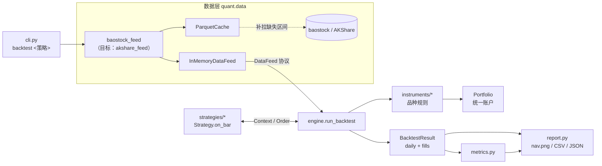
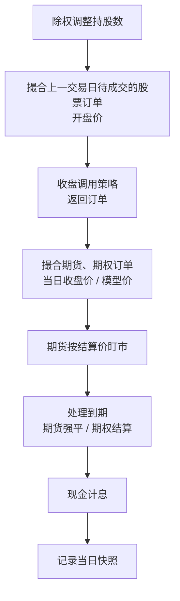

# 设计文档：A 股量化研究原型

> 状态：ticket 01（骨架 + 双均线）已落地，02–06 待实现。
> 需求来源：`.scratch/a-share-quant-prototype/spec.md`；术语以 `GLOSSARY.md` 为准；关键决策见 `docs/adr/`。
> 本文描述**现状**与**目标形态**，凡是尚未实现的部分都会标注「目标」。

## 1. 目标与边界

一个本地运行、命令行驱动的**日频回测**原型，回答两个问题：

1. 在符合 A 股真实规则（T+1、整手、涨跌停、停牌、除权、完整费用）的前提下，简单的股票策略表现如何——以双均线为验证载体。
2. **滚 IC** + 平值次月 500ETF put 动态对冲到 **Delta 中性**，贴水收敛的收益能否覆盖 put 成本。

不做：实盘/模拟盘执行、分钟线、期权真实市场价与波动率曲面、追保与强平、参数优化、多策略组合、Web 界面（详见 spec 的 Out of Scope）。

## 2. 设计原则

| 原则 | 体现 |
| --- | --- |
| 一个引擎、一个账户 | 股票、期货、期权共用 `Portfolio` 现金账户，规则按品种类型分派，引擎本身不含品种特有逻辑（ADR-0001） |
| 不引入未来函数 | 策略只能看到截至信号日（含）的数据；股票在成交日（次日）开盘成交；衍生品按当日收盘成交只因其决策不依赖未来行情（ADR-0003） |
| 唯一测试接缝 | 引擎只通过 `DataFeed` 获取数据；测试手工构造 bar，只断言回测结果，不测内部状态 |
| 外部依赖集中 | 数据源字段名与取值约定只出现在对应适配器模块中（如 `baostock_feed.py`） |
| 参数全部可配置 | 费率、滑点、保证金率、利率等放在 frozen dataclass 配置中，命令行 `--set a.b=v` 覆盖，不改代码 |
| 离线可重复 | 数据经 Parquet 缓存，命中缓存时不登录数据源，断网也能回测 |

## 3. 架构总览



依赖方向自上而下单向：`cli → data / engine / metrics / report`，`engine → instruments → portfolio → strategy(类型)`，`data.feed` 不依赖任何上层模块。

### 模块清单

| 模块 | 职责 | 现状 |
| --- | --- | --- |
| `data/feed.py` | `Bar` 数据结构、`DataFeed` 协议、`InMemoryDataFeed` | 已实现 |
| `data/cache.py` | 按 key 缓存一张以 `date` 为列的表，记录覆盖区间，只补拉缺口 | 已实现 |
| `data/baostock_feed.py` | baostock 适配：不复权/后复权日线、复权因子、停牌、ST、交易日历 | 已实现 |
| `data/akshare_feed.py` | IC 分合约日线与结算价、中证 500、500ETF | 目标（04、05） |
| `portfolio.py` | 现金、持仓、成交入账、现金计息 | 已实现（仅股票） |
| `instruments/stock.py` | 股票撮合与费用 | 基础版（仅佣金），完整规则见 02、03 |
| `instruments/future.py` | 合约乘数、保证金、结算价盯市、平今费率、到期强平 | 目标（04） |
| `instruments/option.py` | 合约乘数、模型价成交、每张费用、到期内在价值结算 | 目标（05） |
| `calendars.py` | IC / ETF 期权到期日、季月合约选取、行权价网格、板块涨跌幅 | 目标（02、04、05） |
| `pricing.py` | BS 模型价与 delta、已实现波动率 | 目标（05，ADR-0002） |
| `engine.py` | 按交易日推进的主循环 | 已实现（单标的） |
| `strategy.py` | `Strategy` / `Context` / `Order` / `Side` | 已实现（单标的） |
| `strategies/ma_cross.py` | 双均线 | 已实现 |
| `strategies/roll_ic.py` | 滚 IC（可选 put 对冲） | 目标（04、06） |
| `metrics.py` | 绩效指标、买入持有基准 | 已实现 |
| `report.py` | 指标文本、净值图、成交/每日表、metrics.json | 已实现 |
| `cli.py` | 参数解析、配置覆盖、串联全流程 | 已实现 |

## 4. 数据层

### 4.1 Bar 与 DataFeed

`Bar` 是「一个品种一个交易日」的行情，当前字段：

| 字段 | 口径 | 用途 |
| --- | --- | --- |
| `open/high/low/close` | **不复权价** | 撮合、涨跌停价计算 |
| `adj_close` | **后复权价** | 股票信号、买入持有基准 |
| `adj_factor` | 后复权因子（前向填充） | 除权日调整持股数 |
| `suspended` | 是否停牌 | 撮合判断 |
| `is_st` | 是否 ST | 涨跌幅限制 |

目标新增：`settle`（**结算价**，期货盯市用）。期权没有行情 bar，价格由定价模块从 500ETF 的 bar 推出。

`DataFeed` 协议只有两个方法：`trading_days(start, end)` 与 `bar(symbol, day) -> Bar | None`。引擎只认这个协议，因此测试与真实数据走同一条路径。

### 4.2 Parquet 缓存

`ParquetCache.get(key, start, end, fetch)`：

1. 读取 `<key>.parquet` 与 `coverage.json` 中该 key 已覆盖的 `[lo, hi]`。
2. 计算缺口：请求区间在覆盖区间之前/之后的部分；晚于 `last_published_day()`（北京时间 18 点前取前一日）的日期不补拉，也不计入覆盖，以便日后补齐。
3. 补拉成功则合并去重、写回并扩展覆盖区间；补拉失败但已有缓存时**降级使用缓存**并记录 warning。
4. 返回请求区间内的切片。

覆盖区间是一个连续 `[lo, hi]`，因此只支持在两端扩展；这与回测「从某日到最新」的使用方式匹配。

### 4.3 baostock 适配器

- **懒登录**：`_BaostockSource` 只在缓存缺数据、真正发起查询时登录，完全命中缓存的回测不需要网络。
- 每个标的缓存三张表：`k_<sym>_unadjusted`、`k_<sym>_backward_adjusted`、`adjust_factor_<sym>`。复权因子只在除权日有记录，所以总是从 1990-01-01 开始取，再前向填充到每个交易日。
- 交易日历 `trade_dates` 也走缓存，回测只在 `is_trading_day` 为真的日期推进。

### 4.4 AKShare 适配器（目标）

- 按**具体合约**（如 IC2412）而非主力连续拉取日线与结算价；中金所接口可能逐日请求，需要显示进度、支持断点续拉（可复用 `ParquetCache` 的按 key 覆盖区间：一个合约一个 key）。
- 中证 500 指数（基差、基准）、510500 日线（期权定价）。
- AKShare 接口变动频繁，字段映射集中在一个模块。

## 5. 账户：Portfolio

现状：

```python
Portfolio(cash: float, positions: dict[str, int])
apply(fill)                       # 现金 -= ±成交额 + 费用；持仓归零时移除
accrue_interest(rate, days)       # 现金 *= 1 + rate * days / 365
```

目标扩展（04–06）：

- 持仓需要区分品种类型与开仓日期：期货平今/平昨费率不同，股票 T+1 需要**可卖数量**。建议持仓记录为 `{symbol: Position(quantity, opened_today_qty, ...)}`，品种规则读取，`Portfolio` 不解释其含义。
- 期货不按成交额扣现金，而是：开仓只扣费用、每日按结算价把盯市盈亏计入现金；**保证金占用**单独记录（名义本金 × 14%），只展示不强平。
- 净值 = 现金 + 股票市值 + 期权市值（模型价 × 乘数）；期货的价值已经通过盯市进入现金，不重复计入。

## 6. 品种规则

ADR-0001 要求「规则放在品种类型上，新增品种不改引擎」。目标接口（示意）：

```python
class InstrumentRules(Protocol):
    def match(self, order, day, feed, portfolio) -> Fill | Rejection: ...
    def mark_to_market(self, day, feed, portfolio) -> None: ...     # 期货：结算价盯市
    def handle_expiry(self, day, feed, portfolio) -> list[Fill]: ...  # 到期强平 / 结算
    def market_value(self, symbol, qty, day, feed) -> float: ...
```

引擎按 symbol 解析出品种类型（股票代码前缀 `sh.`/`sz.`、期货 `IC`、期权自定义代码），分派到对应规则。

### 6.1 股票（02、03）

| 规则 | 设计 |
| --- | --- |
| 成交价 | 成交日开盘价（不复权）× (1 ± 0.1% 滑点)，方向对交易者不利 |
| T+1 | 卖出数量上限为可卖数量（不含当日买入） |
| 整手 | 买入数量向下取整到 100 股的整数倍；满仓买入时在现金约束下取最大整手 |
| 涨跌停 | 按前收盘价与板块计算：主板 10%；创业板 2020-08-24 起 20%、之前 10%；科创板 20%；ST 5%。开盘价 = 涨停价时买单跳过，= 跌停价时卖单跳过 |
| 停牌 | `suspended` 为真时不成交 |
| 费用 | 佣金万 2.5（最低 5 元）+ 卖出印花税 0.05% + 过户费 0.001% |
| 资金不足 | 拒单，现金永不为负 |
| 除权 | 除权日持股数 × (当日因子 / 前一日因子)，近似分红再投资 |

每个未成交订单产生一条 **Rejection(date, symbol, side, reason)**，原因枚举：涨停、跌停、停牌、T+1、资金不足。`BacktestResult` 目标新增 `rejections` 表并在报告中导出。

### 6.2 期货（04）

- 合约乘数 200；**名义本金** = 价格 × 200。
- 按当日收盘价 ± 0.2 点滑点成交（ADR-0003）。
- 费用：开仓与平昨万 0.23，平今万 2.3。
- 每日按**结算价**盯市，盈亏计入现金；保证金占用 = 名义本金 × 14%。
- 到期保护：到期日仍持仓 → 按结算价强制平仓并记录 warning，便于发现策略漏掉**展期**。

### 6.3 期权（05）

- 合约乘数 10000，每张 2 元，买方不交保证金。
- 成交与估值均用 **模型价**（BS；无风险利率 1.5%、股息率 1.5%、波动率 = 510500 的 20 日已实现波动率 × 1.1），报告必须标注「期权价格为模型价」（ADR-0002）。
- 合约由（到期月、行权价、类型）确定，行权价必须落在上交所行权价网格上；到期日为到期月份第四个星期三（遇节假日顺延）。
- 到期按到期日 ETF 收盘价的内在价值结算。

## 7. 回测引擎

### 7.1 每日事件顺序

现状（ticket 01）：

```
现金计息 → 撮合上一交易日的股票订单（开盘价）→ 调用策略（收盘）→ 记录快照
```

目标（spec 定义）：



关于计息位置：现状是在每个交易日开头，按「上一交易日到今天」的自然日数对上一交易日收盘后的现金计息，结果与 spec 中「当日末计息」等价，只是把周末/节假日的利息归到下一交易日。实现 04 时统一到一种写法即可，测试断言的是净值，不受影响。

股票订单由策略在信号日返回，进入 `pending`，下一交易日开盘撮合；衍生品订单在策略返回后当日立即撮合。引擎通过订单的品种类型决定走哪条路径，策略无需关心。

### 7.2 从单标的到多标的

现状 `run_backtest(feed, strategy, symbol, ...)` 与 `Context.symbol` 都是单标的，足以支撑双均线。滚 IC 需要同时看 IC 当季/下季合约、中证 500、510500，因此目标改为：

- `run_backtest(feed, strategy, start, end, config)`，标的由策略自己声明（如 `strategy.universe(day)`）或由策略通过 `Context` 按需读取。
- `Context` 提供 `bar(symbol)` / `history(symbol, n)`，只返回截至当日（含）的数据，保持不可见未来。
- `MaCross` 改为构造时接收 symbol。

这一改动只影响引擎与策略接口，`DataFeed` 协议不需要变。

### 7.3 输出

`BacktestResult`：

| 表 | 列 | 状态 |
| --- | --- | --- |
| `daily` | date, cash, market_value, nav, positions | 已实现；目标加 margin、net_delta、basis、annualized_discount |
| `fills` | date, symbol, side, quantity, price, fee | 已实现 |
| `rejections` | date, symbol, side, reason | 目标（02） |

## 8. 策略

### 8.1 接口

```python
class Strategy(ABC):
    def on_bar(self, ctx: Context) -> list[Order]: ...

Order(symbol, side, quantity: int | None)  # None：买入=满仓，卖出=全部
```

新增策略只实现 `Strategy`，并在 `cli.STRATEGIES` 注册，不改引擎。

### 8.2 双均线 `ma_cross`

- 后复权价计算 MA(fast) 与 MA(slow)，默认 5/20、标的 sh.600519。
- 昨日 `快 - 慢 ≤ 0` 且今日 `> 0`、空仓 → 满仓买入；反向且有持仓 → 全部卖出。
- 需要 `slow + 1` 根 bar 才产生信号。

### 8.3 滚 IC `roll_ic`（04、06，目标）

```mermaid
flowchart TD
    S[每日收盘] --> R{距当季合约到期<br/>≤ 5 个交易日?}
    R -- 是 --> Roll[平当季、开下一季月<br/>手数不变]
    R -- 否 --> H
    Roll --> H{启用对冲?}
    H -- 否 --> End[结束]
    H -- 是 --> P{put 距到期<br/>≤ 5 个交易日?}
    P -- 是 --> Switch[换到新的次月平值 put]
    P -- 否 --> D
    Switch --> D[计算组合净 delta<br/>期货 + put，按名义本金折算]
    D --> T{|净 delta| > 阈值 × IC 名义本金?}
    T -- 是 --> Rebal[调整 put 张数使净 delta ≈ 0]
    T -- 否 --> End
    Rebal --> End
```

- 建仓手数 = floor(可用资金 / IC 名义本金)，1 倍名义本金、不加杠杆。
- IC 到期日：每月第三个周五，遇节假日顺延；当季 = 下一个季月合约。
- put：平值（行权价网格向下取最近一档）、次月合约；再平衡阈值默认 10%，设为 0 即每日再平衡。
- `--no-hedge` 即纯滚 IC，同时作为对冲版本报告里的对照曲线。

## 9. 绩效与报告

指标（`metrics.compute_metrics`）：总收益、年化收益、最大回撤、夏普（按日超额收益、252 日年化）、胜率（每笔卖出按平均成本计盈亏）、交易次数、年化换手率、总费用、基准收益与年化超额。

输出目录 `output/<策略>_<标的>_<起>_<止>/`：`nav.png`、`fills.csv`、`daily.csv`（含 `benchmark_nav`）、`metrics.json`。

目标扩展：

- 滚 IC 报告三条曲线：本策略、纯滚 IC、中证 500 买入持有。
- 每日基差、**年化贴水率**、组合净 delta。
- 收益拆解：贴水收敛、put 成本、交易费用、现金利息，各项之和等于总盈亏。
- 按 500ETF 期权上市（2022-09）前后分段给出指标，并标注模型价。
- `rejections.csv`。

## 10. 配置

```python
@dataclass(frozen=True)
class BacktestConfig:
    initial_cash: float = 3_000_000.0
    cash_rate: float = 0.015
    stock: StockConfig            # 目标：+ future: FutureConfig, option: OptionConfig, pricing: PricingConfig
```

命令行 `--set stock.commission_rate=0.0003` 沿点号路径递归 `dataclasses.replace`，值按原字段类型转换，未知字段直接报错。新增配置项只需加 dataclass 字段，CLI 自动支持。

## 11. 测试策略

- **唯一接缝**：用 `InMemoryDataFeed` 手工构造少量 bar 注入 `run_backtest`，只断言 `fills`、`rejections`、`daily`（持仓、现金、净值）。不测私有函数；BS 定价、到期日历、涨跌停价等纯函数通过引擎场景间接覆盖。
- 每个用例描述一个可手算的交易场景，如「第 1 天买入，同日卖出被拒（T+1）」「第 N 天是展期日，当季平仓、下季开仓」。
- 数据源适配器不写单元测试，只保留默认跳过的联网冒烟测试（`pytest --run-network`）。

## 12. 演进路线

| Ticket | 主要改动模块 | 接口变化 |
| --- | --- | --- |
| 02 A 股撮合规则 | `instruments/stock.py`、`calendars.py`（板块涨跌幅）、`portfolio.py`（可卖数量） | 新增 `Rejection` 与 `BacktestResult.rejections` |
| 03 除权处理 | `engine.py`（除权步骤）、`instruments/stock.py` | 无 |
| 04 纯滚 IC | `akshare_feed.py`、`instruments/future.py`、`calendars.py`、`strategies/roll_ic.py`、`report.py` | `Bar.settle`；引擎多标的化与品种分派；`daily` 增加 margin、basis |
| 05 期权与模型价 | `pricing.py`、`instruments/option.py`、`calendars.py` | 期权估值接入净值 |
| 06 delta 中性 | `strategies/roll_ic.py`、`report.py` | `daily.net_delta`、收益拆解 |

04 是结构性改动最大的一步（多标的、品种分派、期货账户语义），建议先在不改行为的前提下完成引擎多标的化并让现有测试保持绿色，再加入期货规则。

## 13. 已知限制与风险

- 衍生品按当日收盘成交带来少量日内乐观偏差，已接受；不要改成次日开盘，除非同时引入日内数据（ADR-0003）。
- 期权模型价不含波动率曲面和买卖价差，对冲成本可能被高估或低估；2022-09 之前的 put 完全是假设品种（ADR-0002）。
- 只记录保证金占用，不模拟追保与强平。
- 除权处理是分红再投资的近似。
- 缓存覆盖区间只支持两端扩展，中间若有数据源缺失不会被自动发现。
- 预期 delta 中性方案的结果可能为负——这是原型要回答的问题，不是缺陷。
