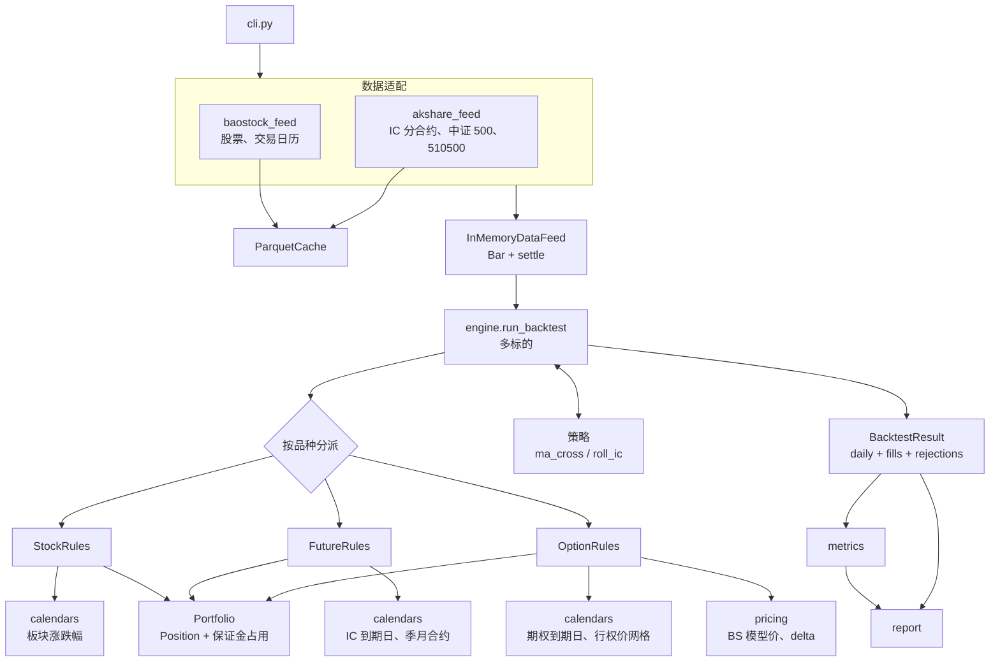
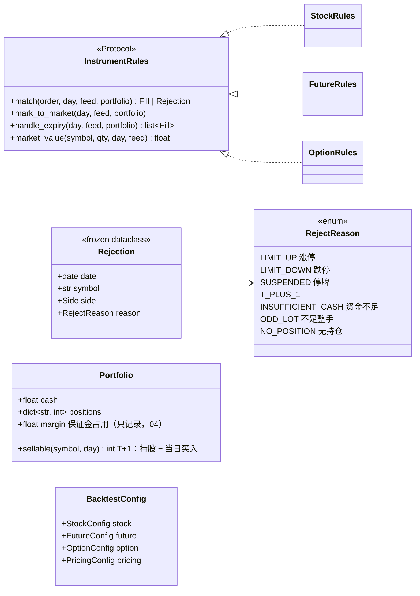
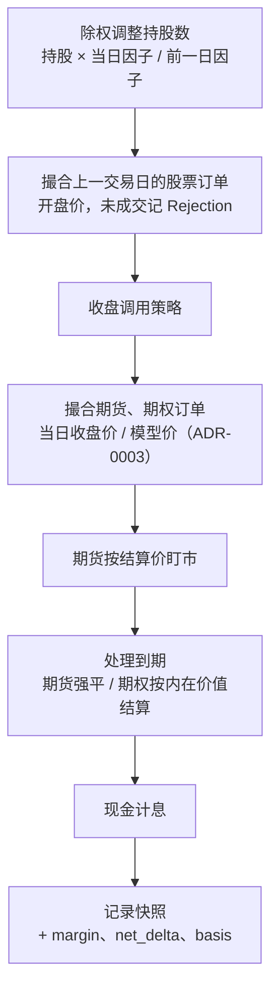
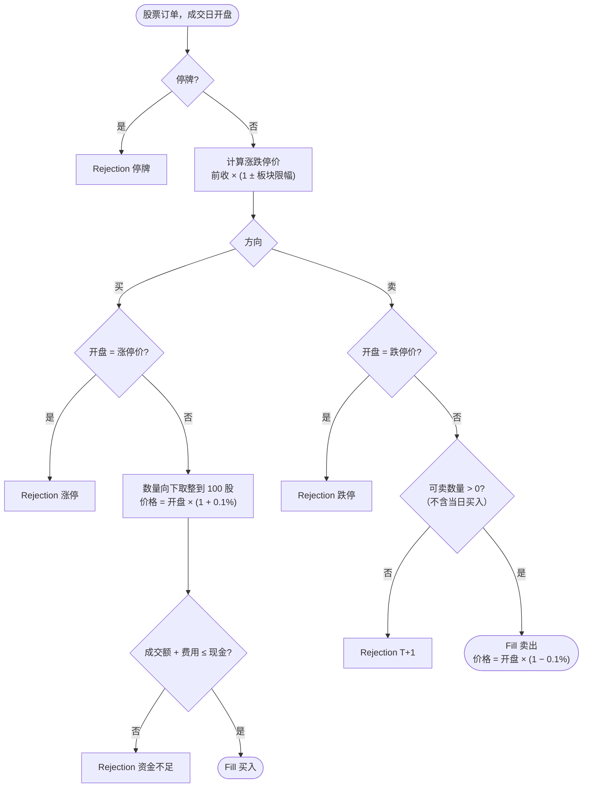
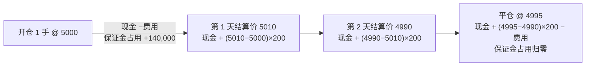
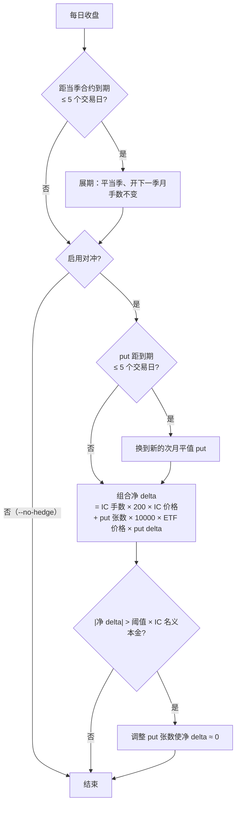
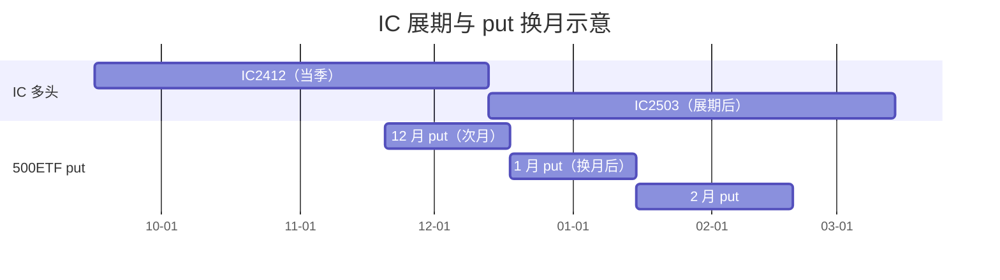
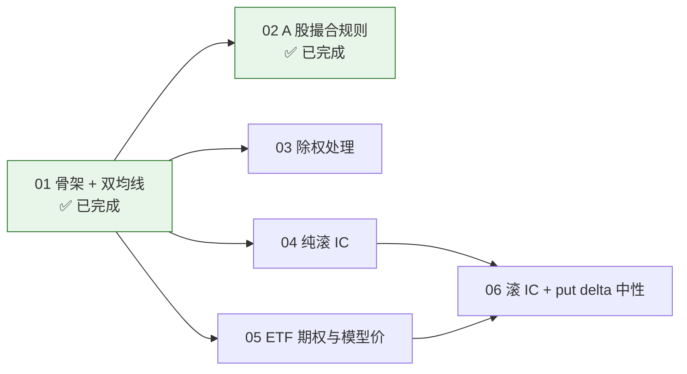

# 设计文档：A 股量化研究原型

> **状态**：ticket 01（骨架 + 双均线）、02（A 股撮合规则）已落地；03–06 待实现。
> **需求来源**：`.scratch/a-share-quant-prototype/spec.md`；**术语**以 [`GLOSSARY.md`](../GLOSSARY.md) 为准；**决策**见 [`docs/adr/`](adr/)。
> **现有代码导读**：[`code-walkthrough.md`](code-walkthrough.md)。
> 本文说明系统的设计原则与目标形态，以及 03–06 要把代码演进成什么样。凡是尚未实现的内容都标注「目标」。
>
> 文中的图使用 Mermaid，在 GitHub、VS Code（Markdown Preview Mermaid Support 插件）、Typora 中都能直接渲染。

## 目录

- [1. 目标与边界](#1-目标与边界)
- [2. 现状与差距](#2-现状与差距)
- [3. 设计原则](#3-设计原则)
- [4. 目标架构](#4-目标架构)
- [5. 目标每日事件顺序](#5-目标每日事件顺序)
- [6. 品种规则](#6-品种规则)
- [7. 滚 IC 策略](#7-滚-ic-策略)
- [8. 报告扩展](#8-报告扩展)
- [9. 演进路线](#9-演进路线)
- [10. 已知限制与风险](#10-已知限制与风险)

---

## 1. 目标与边界

一个本地运行、命令行驱动的**日频回测**原型，回答两个问题：

1. 在符合 A 股真实规则（T+1、整手、涨跌停、停牌、除权、完整费用）的前提下，简单的股票策略表现如何——以双均线为验证载体。
2. **滚 IC** + 平值次月 500ETF put 动态对冲到 **Delta 中性**，贴水收敛的收益能否覆盖 put 成本。

不做：实盘/模拟盘执行、分钟线、期权真实市场价与波动率曲面、追保与强平、参数优化、多策略组合、Web 界面（详见 spec 的 Out of Scope）。

## 2. 现状与差距

ticket 01 已经搭好骨架：数据加载与缓存、统一账户、按交易日推进的引擎、策略接口、双均线、指标与报告、命令行入口；ticket 02 补上了 A 股撮合规则（T+1、整手、涨跌停、停牌、完整费用、滑点、资金检查）和未成交记录。代码如何运转见 [`code-walkthrough.md`](code-walkthrough.md)。

| 模块 | 现状 | 目标 |
| --- | --- | --- |
| `data/feed.py`、`data/cache.py`、`data/baostock_feed.py` | 已实现 | `Bar` 增加 `settle`（04） |
| `data/akshare_feed.py` | — | IC 分合约、中证 500、510500（04、05） |
| `portfolio.py` | 现金 + 股数 + 当日买入（可卖数量）；`Rejection` | 保证金占用、平今（04） |
| `instruments/stock.py` | 完整 A 股撮合规则（含板块涨跌幅） | 除权调整（03） |
| `instruments/future.py`、`instruments/option.py` | — | 04、05 |
| `calendars.py`、`pricing.py` | — | 到期日、行权价网格；BS 模型价与 delta（04、05） |
| `engine.py` | 单标的、撮合规则写死为股票 | 多标的、按品种分派、完整每日事件顺序（03、04） |
| `strategy.py` | 单标的 `Context` | 多标的 `Context`（04） |
| `strategies/roll_ic.py` | — | 04、06 |
| `metrics.py`、`report.py` | 单策略 vs 买入持有；`rejections.csv` | 三条曲线、收益拆解、分段指标（04、06） |

与目标相比最关键的差距：

- 引擎只能处理一个标的，撮合规则写死为 `StockRules`，尚未达到 ADR-0001 的「按品种分派」。
- 没有除权调整，持仓跨除权日时策略净值与后复权基准会出现偏差。

## 3. 设计原则

| 原则 | 体现 |
| --- | --- |
| 一个引擎、一个账户 | 股票、期货、期权共用 `Portfolio` 现金账户，规则按品种类型分派，引擎不含品种特有逻辑（ADR-0001） |
| 不引入未来函数 | 策略只看截至信号日的数据；股票次日开盘成交；衍生品当日收盘成交只因其决策不依赖未来行情（ADR-0003） |
| 唯一测试接缝 | 引擎只通过 `DataFeed` 取数；测试手工构造 bar，只断言回测结果 |
| 外部依赖集中 | 数据源字段名只出现在对应适配器中 |
| 参数全部可配置 | 费率、滑点、保证金率、利率都在 frozen dataclass 配置中，`--set` 覆盖 |
| 离线可重复 | Parquet 缓存，命中时不联网 |

## 4. 目标架构

目标类图（新增部分）：

### 4.1 从单标的到多标的

- `run_backtest(feed, strategy, start, end, config)`：去掉 `symbol` 参数，标的由策略声明（如 `strategy.universe(day)`）。
- `Context` 提供 `bar(symbol)` / `history(symbol, n)`，仍只返回截至当日的数据。
- `MaCross` 改为构造时接收 symbol。
- `DataFeed` 协议不变。

建议先做一次**不改变行为**的重构完成多标的化，让现有测试保持通过，再加期货规则。

## 5. 目标每日事件顺序

股票订单进入 `pending` 隔日撮合；衍生品订单在策略返回后当日立即撮合。引擎按订单的品种类型决定路径，策略无需关心。

## 6. 品种规则

### 6.1 股票（ticket 02、03）

| 规则 | 参数 |
| --- | --- |
| 板块涨跌幅 | 主板 10%；创业板 2020-08-24 起 20%、之前 10%；科创板 20%；ST 5%，只作用于主板和改革前的创业板，改革后的创业板与科创板 ST 股与板块相同（按代码前缀判断板块） |
| 整手 | 买入向下取整到 100 股；卖出不取整（可卖出零股） |
| 费用 | 佣金万 2.5（最低 5 元）+ 卖出印花税 0.05% + 过户费 0.001% |
| 滑点 | 0.1%，方向对交易者不利 |
| 除权 | 除权日持股 × (当日因子 / 前一日因子)，近似分红再投资（03） |

02 已按上图实现（`instruments/stock.py`），所有参数在 `StockConfig` 中可配置。图外补充的两种拒单原因：显式数量不足 100 股（不足整手）、卖出时没有持仓（无持仓），保证每笔未成交订单都有原因。被拒的订单不顺延到下一交易日。

### 6.2 期货（ticket 04）

- 合约乘数 200，**名义本金** = 价格 × 200。
- 当日收盘价 ± 0.2 点滑点成交。
- 开仓与平昨万 0.23，平今万 2.3。
- 每日按**结算价**盯市，盈亏计入现金；开仓不扣名义本金，只扣费用。
- 保证金占用 = 名义本金 × 14%，只展示，不追保不强平。
- 到期日仍持仓 → 按结算价强制平仓并记 warning。

期货账户的现金变化与股票不同：

### 6.3 期权（ticket 05）

- 合约乘数 10000，每张 2 元，买方不交保证金。
- 成交与估值均用 **模型价**：BS，无风险利率 1.5%、股息率 1.5%、波动率 = 510500 的 20 日已实现波动率 × 1.1（ADR-0002）。
- 行权价落在上交所行权价网格；到期日 = 到期月份第四个星期三（遇节假日顺延）。
- 到期按到期日 ETF 收盘价的内在价值结算。
- 报告必须标注「期权价格为模型价」。

## 7. 滚 IC 策略

| 参数 | 默认 |
| --- | --- |
| 建仓手数 | floor(可用资金 / IC 名义本金)，1 倍名义本金 |
| IC 到期日 | 每月第三个周五，遇节假日顺延 |
| 展期 / put 换月 | 到期前 5 个交易日 |
| put 选择 | 平值（行权价网格向下取最近一档）、次月 |
| 再平衡阈值 | 10%，设为 0 即每日再平衡 |

合约时间线示意（季月合约与 put 次月合约各自独立滚动）：

## 8. 报告扩展

| 输出 | 内容 | Ticket |
| --- | --- | --- |
| `rejections.csv` | 未成交订单及原因（已实现，终端同时打印按原因计数） | 02 |
| `daily.csv` 新列 | margin、basis、annualized_discount、net_delta | 04、06 |
| 净值图 | 滚 IC：本策略、纯滚 IC、中证 500 三条曲线 | 04、06 |
| 收益拆解 | 贴水收敛、put 成本、交易费用、现金利息，之和 = 总盈亏 | 06 |
| 分段指标 | 500ETF 期权上市（2022-09）前后分别给出，并标注模型价 | 06 |

## 9. 演进路线

| Ticket | 主要改动模块 | 接口变化 |
| --- | --- | --- |
| 02 ✅ | `instruments/stock.py`、`portfolio.py`、`engine.py`、`report.py` | 新增 `Rejection`、`BacktestResult.rejections`；`Portfolio.sellable` 给出可卖数量 |
| 03 | `engine.py`（除权步骤）、`instruments/stock.py` | 无 |
| 04 | `akshare_feed.py`、`instruments/future.py`、`calendars.py`、`strategies/roll_ic.py`、`report.py` | `Bar.settle`；引擎多标的化与品种分派；`daily` 增加 margin、basis |
| 05 | `pricing.py`、`instruments/option.py`、`calendars.py` | 期权估值接入净值 |
| 06 | `strategies/roll_ic.py`、`report.py` | `daily.net_delta`、收益拆解 |

04 是结构性改动最大的一步。

## 10. 已知限制与风险

- 衍生品按当日收盘成交带来少量日内乐观偏差，已接受；不要改成次日开盘，除非同时引入日内数据（ADR-0003）。
- 期权模型价不含波动率曲面和买卖价差，对冲成本可能被高估或低估；2022-09 之前的 put 完全是假设品种（ADR-0002）。
- 只记录保证金占用，不模拟追保与强平。
- 除权处理是分红再投资的近似。
- 涨跌停价以前一交易日不复权收盘价为基准，除权日未改用除权参考价；新股上市初期无涨跌幅、北交所 30% 等规则未建模。
- 缓存覆盖区间是单一连续区间，数据源中间缺失的日期不会被自动发现。
- 预期 delta 中性方案的结果可能为负——这是原型要回答的问题，不是缺陷。
