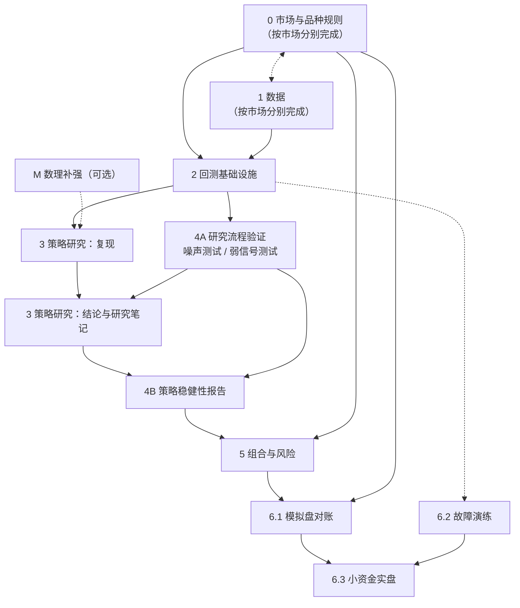

# 量化投资学习路线：阶段、阻塞关系与验收任务

适用对象：个人投资者，编程和数理基础扎实；品种覆盖股票、期货、期权；市场为 A 股，以及计划中的港股、美股。

> 本文是学习方法和资料清单，不构成投资建议。书籍版次、交易规则、监管和税务规定会变化，引用前以官方最新版本为准。文中的验收阈值是建议的经验值，不是行业标准，可按需调整。

## 目录

1. [核心结论](#1-核心结论)
2. [阶段阻塞关系](#2-阶段阻塞关系)
3. [当前进度（基于本项目）](#3-当前进度基于本项目)
4. [各阶段内容、参考资料与验收任务](#4-各阶段内容参考资料与验收任务)
5. [持续信息渠道](#5-持续信息渠道)
6. [建议的近期行动](#6-建议的近期行动)

---

## 1. 核心结论

- 按「研究流水线」推进，而不是按学科顺序（数学 → 金融 → 编程）学习。每个阶段都要有可运行、可检验的产出。
- 对有编程和数理基础的人来说，真正需要补的是三件事：
  1. **市场规则与交易成本**：决定回测和实盘之间差多少。
  2. **过拟合控制**：决定回测结果是否可信。
  3. **风险与仓位管理**：决定能否长期存活。
- 每个阶段配一个**有已知正确答案或可量化标准**的验收任务。验收任务尽量写成 pytest 测试或可重跑的研究脚本，便于回归。
- **最关键的阻塞点是阶段 4A（研究流程验证）**：在研究流程能被证明不会在纯噪声里「发现」策略之前，阶段 3 的任何策略结论都不应被采信。

| 阶段 | 目标 | 产出 | 建议时长 |
|---|---|---|---|
| 0 市场与品种规则 | 搞清楚每个市场能做什么、成本多少、有何限制 | 规则与成本对照表，并写成回测配置 | 3–4 周 / 每个市场 |
| 1 数据 | 干净、无幸存者偏差、时点正确的数据 | 带缓存和数据质量检查的数据层 | 3–4 周 / 每个市场 |
| 2 回测基础设施 | 结果可信的回测引擎 | 经交叉验证的引擎 | 已部分完成 |
| 3 策略研究 | 掌握主要策略家族及其收益来源 | 每个家族一份复现和研究笔记 | 4–6 个月 |
| 4A 研究流程验证 | 证明流程不会制造假阳性 | 噪声测试、弱信号测试 | 2–3 周 |
| 4B 策略稳健性报告 | 对具体策略做过拟合检验 | 每个候选策略一份稳健性报告 | 每个策略 1–2 周 |
| 5 组合与风险 | 把多个策略合成可承受的组合 | 仓位、杠杆、风控规则 | 1–2 个月 |
| 6 模拟盘 → 实盘 → 监控 | 验证回测与实盘的偏差 | 对账、故障演练、衰减监控 | 持续 |
| M 数理补强（可选） | 按需补齐理论 | 定价自检 | 按需 |

---

## 2. 阶段阻塞关系

### 2.1 依赖图

实线表示**硬阻塞**（前置阶段的验收未通过，后续阶段不能开始，或者其结论不能被采信）；虚线表示**软依赖**（前置阶段有助于后续阶段，但可以并行推进）。

### 2.2 阻塞关系明细

| 阶段 / 任务 | 硬阻塞于 | 软依赖 | 可与之并行 | 阻塞原因 |
|---|---|---|---|---|
| 0 市场与品种规则 | 无 | 1（看数据有助于理解规则） | 1、M | 起点 |
| 1 数据 | 无 | 0（知道复权、停牌规则才能做数据检查） | 0、M | 起点 |
| 2 回测基础设施 | 0、1（对应市场） | — | M | 撮合规则和成本参数来自 0；交叉验证需要 1 的数据 |
| 3 策略研究：复现 | 2 | M（期权家族需要定价理论） | 4A | 复现需要可信的引擎 |
| 4A 研究流程验证 | 2 | — | 3 复现 | 噪声测试要用完整的研究流程跑，流程依赖引擎 |
| 3 策略研究：结论 | 3 复现、4A | — | — | 4A 未通过时，流程可能在噪声中「发现」策略，结论不可信 |
| 4B 策略稳健性报告 | 3 结论、4A | — | 3 的其他家族 | 需要具体策略作为输入；检验方法本身须先经 4A 验证 |
| 5 组合与风险 | 4B（至少 3 个策略通过）、0 | — | 6.2 | 组合的输入是通过稳健性检验的策略；保证金规则来自 0 |
| 6.1 模拟盘对账 | 5、0 | — | 6.2 | 上线的应该是组合和风控规则，而不是单个策略 |
| 6.2 故障演练 | 无硬阻塞 | 2（需要实盘系统的骨架） | 5、6.1 | 工程问题，可以较早开始 |
| 6.3 小资金实盘 | 6.1、6.2 | — | — | 对账和故障恢复都通过才能投入真钱 |
| M 数理补强 | 无 | — | 全部 | 按需查阅，不阻塞主线 |

### 2.3 多市场的推进方式

- 阶段 0、1 **按市场独立验收**。一个市场只有在它自己的 0 和 1 都通过后，才能进入 2 及以后的阶段。
- 阶段 2 的引擎只有一个（与本项目 ADR-0001「一个引擎、一个账户」一致），但每接入一个新市场，都要补跑该市场的阶段 2 验收（交叉验证和已知答案测试）。
- 阶段 4A 与市场无关，通过一次即可；研究流程有改动时要重跑。
- 推荐的顺序是：A 股（已有基础）→ 美股（数据最好、文献最多，适合校验方法论）→ 港股。三个市场的阶段 0、1 可以并行准备。

---

## 3. 当前进度（基于本项目）

依据本项目已完成的 ticket 01–06 估计：

| 阶段 | 状态 | 说明 |
|---|---|---|
| 0 | A 股部分完成 | 股票撮合规则（T+1、整手、涨跌停、停牌、费用）、IC 期货、510500 期权规则已实现；港股、美股未开始 |
| 1 | A 股部分完成 | baostock / 中金所 / AKShare 适配器和 Parquet 缓存已有；尚未做官方序列对账、幸存者偏差检查和数据质量报告 |
| 2 | 部分完成 | 引擎、撮合、除权、展期、期权模型价已有测试；尚未与独立实现交叉验证，也没有做随机信号等已知答案测试 |
| 3 | 起步 | 已有双均线、纯滚 IC、滚 IC + put delta 中性三个策略 |
| 4A / 4B | 未开始 | — |
| 5、6 | 未开始 | — |
| M | 部分完成 | `test_pricing.py` 已覆盖 BS 定价和反推隐含波动率 |

**由此推出的关键路径**：补完 A 股的阶段 0、1、2 验收，再做 4A，然后用 4A 验证过的流程检验现有的三个策略（进入 4B）。

---

## 4. 各阶段内容、参考资料与验收任务

### 阶段 0：市场与品种规则

**阻塞关系**：起点，无硬阻塞；硬阻塞阶段 2、5、6.1。

**要做的事**：每个市场列一张表，内容包括交易制度、费用、做空途径、杠杆、准入门槛、税务，然后全部写成回测配置参数，不写死在逻辑里。

**三个市场的关键差异**（以交易所和券商现行规定为准）：

| 项目 | A 股 | 港股 | 美股 |
|---|---|---|---|
| 交易与交收 | 股票 T+1；期货、期权 T+0 | T+0 交易，T+2 交收 | T+0 交易，2024-05 起 T+1 交收 |
| 涨跌幅限制 | 主板 ±10%，创业板/科创板 ±20% | 无涨跌停，只有市调机制（VCM） | 无涨跌停，有 LULD 机制 |
| 印花税 | 卖出单边 0.05%（2023-08 起） | 买卖双边各 0.1%（2023-11 起） | 无（有很小的 SEC fee 和 TAF） |
| 做空途径 | 融券基本停滞（2024 年起转融券暂停），主要靠股指期货和 ETF 期权 | 指定证券可卖空，另有期货、期权、牛熊证 | 融券普遍可做，期权流动性好 |
| 个人准入 | 股指期货、个股期权各要 50 万资产，并通过知识测试 | 一般无额外门槛 | 保证金账户日内交易有 PDT 规则（在改革中，以 FINRA 最新规定为准） |
| 程序化交易监管 | 《证券市场程序化交易管理规定（试行）》及沪深北交易所的实施细则（2025 年施行），要求报告 | 券商层面管理 | 券商层面管理 |

**参考资料**：

- John Hull，《期权、期货及其他衍生产品》（*Options, Futures, and Other Derivatives*）：衍生品基础
- Sheldon Natenberg，*Option Volatility and Pricing*：期权交易实务
- Larry Harris，*Trading and Exchanges*：市场微观结构，讲订单簿、流动性和成本的来源
- 一手规则：上交所、深交所、中金所、港交所（HKEX）的交易规则与合约细则；美股看 SEC 和 FINRA
- 跨境税务：W-8BEN（中美税收协定下股息预扣税为 10%）、CRS 下境外所得的申报，建议咨询专业人士

**验收任务：情景预测考试。** 每个市场写 8–10 个交易情景，**先在纸上写下预期结果**（能否成交、费用多少、持仓怎么变），再让回测引擎跑，两者对照。

| 市场 | 情景 | 需预先给出的答案 |
|---|---|---|
| A 股 | 涨停价挂买单；当日买入当日卖出；买 150 股 | 是否成交、拒单原因 |
| A 股 | 买入 10 万元、持有、卖出的一个来回 | 佣金（含最低 5 元）、印花税、过户费，精确到分 |
| 期货 | IC 连续两天不利波动，保证金率 14% | 每日盯市盈亏、追保金额、到期仍持仓时如何强平 |
| 期权 | 510500 put 到期时实值 / 虚值 | 结算现金流 |
| 港股 | 买 1 手腾讯，再买 1 手中芯国际 | 每手股数不同；双边印花税、交易征费、结算费 |
| 美股 | 买 100 股 SPY 再卖出；股息到账 | SEC fee / TAF；股息预扣税 |

**通过标准**：

- 每个情景的手算结果和引擎输出一致，费用误差小于 0.01 元。
- 预测错的情景要能指出是哪条规则理解错了，并更正规则表。
- 所有情景写成测试用例；港股、美股的情景在引擎支持后补齐。

---

### 阶段 1：数据

**阻塞关系**：起点，无硬阻塞（软依赖阶段 0）；硬阻塞阶段 2。

**要做的事**：重点防住三类错误：

1. **幸存者偏差**：股票池必须包含已退市股票。
2. **前视偏差**：财务数据按公告日对齐，不按报告期；指数成分用历史时点的成分。
3. **复权错误**：例如本项目已发现 baostock 给 510500 的复权因子有误。

**数据源**：

| 市场 | 免费或低价 | 付费、更可靠 |
|---|---|---|
| A 股 | baostock、AKShare、Tushare Pro（积分制） | 聚宽、米筐、Wind（机构） |
| 港股 | AKShare、富途 OpenAPI 行情 | 券商 Level-2、Refinitiv |
| 美股 | yfinance（非官方，不稳定）、SEC EDGAR（财报原文） | Norgate（含退市股，适合个人）、Databento、CRSP（需通过高校 WRDS） |
| 因子与学术数据 | Kenneth French Data Library、AQR Datasets | — |

**参考资料**：

- López de Prado，*Advances in Financial Machine Learning*，第 2–5 章：数据结构、采样、标签方法
- Ernest Chan，*Quantitative Trading*（第 2 版）：讲数据陷阱的章节

**验收任务一：用官方发布的序列对账。**

- 用自己的 510500 复权数据算 2016 年至今的全收益，和基金官方累计净值换算出的收益对比。
- 用自己的 A 股股票池按市值加权重建中证 500 或沪深 300 的月收益，和官方指数对比。
- 美股：用 SPY 的价格加分红算全收益，和发行方公布的 NAV 全收益对比。

通过标准：

- 510500 和 SPY 的年化收益差，扣除管理费后小于 0.3%。
- 重建指数和官方指数的月收益相关系数大于 0.99。
- 差异超出阈值的月份逐个找到原因（分红日错位、成分调整日错位等）。

**验收任务二：幸存者偏差和前视偏差检查。**

- 统计 2015 年初的 A 股股票池里有多少只后来退市。
- 如果用到财务数据，抽查 20 条，确认每条的可用日期是公告日而不是报告期末。

通过标准：

- 退市股数量与交易所公开统计口径大致相符。数量为 0 说明存在幸存者偏差。
- 20 条财务数据全部按公告日对齐。

**验收任务三：数据质量报告。** 对每个品种自动检查：缺失交易日、单日涨跌超出涨跌停限制（排除新股首日、除权日）、价格为 0 或为负、成交量为 0 却有价格变动。

通过标准：报告中每一条异常都有解释或已修正，没有「未解释」条目。

---

### 阶段 2：回测基础设施

**阻塞关系**：硬阻塞于 0、1（对应市场）；硬阻塞 3 复现、4A；是 6.2 的软依赖。

**要做的事**（针对本项目的下一步）：

1. 成本敏感性扫描：手续费和滑点从 0 扫到 3 倍。
2. 加入稳健性指标：Deflated Sharpe、PBO、walk-forward 分段指标（方法见阶段 4）。
3. 与独立实现交叉验证。
4. 事件驱动或分钟级扩展：只在策略确实需要时再做。

**可参考的框架**（参考设计，不一定替换自研引擎）：

| 框架 | 特点 |
|---|---|
| Microsoft Qlib | 面向 A 股的机器学习因子研究，数据处理和因子表达式值得参考 |
| vn.py | 国内期货、期权实盘接口（CTP），阶段 6 会用到 |
| QuantConnect LEAN | 多市场事件驱动引擎，开源，美股和期权数据完善 |
| vectorbt | 向量化回测，适合快速扫参数和交叉验证 |
| NautilusTrader | 高性能事件驱动，回测与实盘同一套代码 |

**验收任务一：与独立实现交叉验证。** 同一个双均线策略、同样的成本假设，分别用本项目引擎和 vectorbt（或 LEAN）各跑一遍。

通过标准：

- 两边的交易日期和方向完全一致。
- 每日净值相对误差小于 1e-6。
- 如有差异，必须能归因到已知的规则差异（如对方不支持涨跌停或 T+1）。

**验收任务二：已知答案测试。**

- **随机信号**：用随机信号跑 1000 次，平均超额收益约等于「负的交易成本」，Sharpe 均值约为 0。
- **零成本恒等式**：成本全部设为 0、每天满仓持有，结果与买入持有基准完全一致。
- **前视注入**：故意写一个偷看次日收益的策略，确认引擎能挡住（`Context` 拿不到未来行情，订单只能在次日开盘成交）。

通过标准：

- 随机信号 Sharpe 的 95% 区间包含 0；零成本持有与基准完全一致。
- 前视注入在结构上做不到，或者即使做到了，收益也没有异常放大。

---

### 阶段 3：策略研究

**阻塞关系**：

- 「复现」部分硬阻塞于 2，可与 4A 并行；软依赖 M。
- 「结论与研究笔记」部分硬阻塞于 3 复现和 4A；硬阻塞 4B。

**推进顺序**：趋势 / 动量 → 因子选股 → 期货基差与 carry → 期权波动率 → 统计套利。

**各策略家族的参考资料**：

| 家族 | 参考资料 |
|---|---|
| 趋势跟踪 / 时间序列动量 | Moskowitz, Ooi, Pedersen，"Time Series Momentum"，*JFE* 2012；Hurst, Ooi, Pedersen，"A Century of Evidence on Trend-Following Investing"（AQR）；Robert Carver，*Systematic Trading*、*Advanced Futures Trading Strategies* 及博客 qoppac.blogspot.com |
| 因子投资 | Fama & French（1993 三因子、2015 五因子）；Carhart（1997 动量）；Asness, Moskowitz, Pedersen，"Value and Momentum Everywhere"，*JF* 2013；Liu, Stambaugh, Yuan，"Size and Value in China"，*JFE* 2019；石川等，《因子投资：方法与实践》；Grinold & Kahn，*Active Portfolio Management*；Kakushadze，"101 Formulaic Alphas"（2016）；练手平台 WorldQuant BRAIN |
| 期货基差、carry 与展期 | Koijen, Moskowitz, Pedersen, Vrugt，"Carry"，*JFE* 2018 |
| 期权与波动率 | Euan Sinclair，*Volatility Trading*、*Positional Option Trading*；Colin Bennett，*Trading Volatility*；Jim Gatheral，*The Volatility Surface* |
| 统计套利 / 配对 | Gatev, Goetzmann, Rouwenhorst，"Pairs Trading"，*RFS* 2006；Avellaneda & Lee，"Statistical Arbitrage in the U.S. Equities Market"，2010；跨市场方向如 A/H 溢价、ETF 折溢价 |

注：本项目用 BS 模型价近似期权价格（ADR-0002），做期权真实交易时必须改用真实盘口和隐含波动率曲面。

**验收任务一：复现经典结果，再迁移到目标市场。** 每个家族至少做一个。

| 家族 | 复现目标 | 通过标准 |
|---|---|---|
| 因子（美股） | 用原始股价自建 HML（价值）、UMD（动量）月收益 | 与 Kenneth French 数据库对应因子的相关系数大于 0.95 |
| 因子（A 股） | 复现 Liu-Stambaugh-Yuan 的 CH-3 规模、价值因子 | 与作者公开的 CH-3 因子数据相关系数大于 0.9 |
| 时间序列动量 | 按 Moskowitz-Ooi-Pedersen（2012）的方法，在期货或 ETF 上构建 | 共同样本期内 Sharpe 和回撤形态与论文同量级，2008 年表现为正 |
| 期货 carry | 用 IC 贴水构建 carry 信号 | 能定量说明 2022-09-19 前后贴水收益的变化并给出解释 |
| 期权波动率 | 验证波动率风险溢价：VIX² 对比后续 30 日实现方差（美股），或 510500 隐含波动率对比实现波动率 | 长期均值为正；能指出溢价为负的时段（如 2020 年 3 月）并解释 |

**验收任务二：研究笔记**（须在 4A 通过之后定稿）。每个家族一页，回答三个问题，每个答案都要有数据支持：

1. 收益来源是什么：风险补偿、行为偏差，还是结构性约束？
2. 谁是交易对手方？
3. 什么情况下会失效？历史上能否找到失效区间？（例如规模因子在 2024 年初的微盘股踩踏）

通过标准：三个问题都有数据或图表支持，而不只是文字论述。

---

### 阶段 4：稳健性与过拟合控制

本阶段拆成两部分，因为它们的阻塞关系不同：

- **4A 研究流程验证**：检验的是方法本身，与具体策略无关。硬阻塞于 2；硬阻塞 3 的结论和 4B。
- **4B 策略稳健性报告**：检验具体策略。硬阻塞于 3 的结论和 4A；硬阻塞 5。

**参考资料**：

- Bailey & López de Prado，"The Deflated Sharpe Ratio"，2014
- Bailey, Borwein, López de Prado, Zhu，"The Probability of Backtest Overfitting"（PBO / CSCV 方法）
- Harvey, Liu, Zhu，"…and the Cross-Section of Expected Returns"，*RFS* 2016：t 值门槛应提高到 3 左右
- López de Prado，*Advances in Financial Machine Learning*，第 7、11–14 章：purged k-fold 交叉验证、回测的危险性
- Hou, Xue, Zhang，"Replicating Anomalies"，*RFS* 2020：大量已发表的异象在复现时失效

**4A 验收任务一：纯噪声测试**（最关键的一项）。生成 1000 条无可预测性的随机游走价格，用平时的完整研究流程（扫参数、挑最优、样本外检验）处理。

通过标准：

- 流程的最终结论必须是「不显著」，即 Deflated Sharpe 对应概率小于 0.95，或 PBO 大于 0.5。
- 如果流程在噪声中「发现」了策略，说明它会制造假阳性，必须修好才能继续。

**4A 验收任务二：植入弱信号测试。** 在随机游走里植入一个已知的弱信号，例如次日收益与某指标的相关系数为 0.03。

通过标准：流程能检出该信号，且估计出的效应大小在真实值附近。这一项用来确认流程不是过度保守。

**4B 验收任务：对每个候选策略出完整报告。** 报告必须包含：

- 累计尝试过的配置数量（需事先记录）
- Deflated Sharpe
- PBO
- walk-forward 各段指标
- 参数邻域热力图
- 成本扫描（0 到 3 倍）
- 最近 2–3 年从未使用过的留出样本上的结果

通过标准：

- 留出样本 Sharpe 不低于样本内的一半。
- 参数最优点周围是平台，不是孤立尖峰。
- 成本翻倍后策略收益仍为正。

---

### 阶段 5：组合与风险

**阻塞关系**：硬阻塞于 4B（至少 3 个策略通过）和 0（保证金规则）；硬阻塞 6.1；可与 6.2 并行。

**参考资料**：

- Carver，*Systematic Trading* 中关于仓位和组合的部分
- Edward Thorp，"The Kelly Criterion in Blackjack, Sports Betting and the Stock Market"：实盘用半 Kelly 或更低
- Ledoit & Wolf 协方差收缩；López de Prado，"Building Diversified Portfolios that Outperform Out-of-Sample"（HRP，2016）
- Giuseppe Paleologo，*Advanced Portfolio Management*
- Antti Ilmanen，*Expected Returns*

**验收任务一：目标波动率达成检验。** 把至少 3 个低相关策略组合起来，设定目标年化波动率（如 10%）。

通过标准：

- 在超过 80% 的时间里，滚动 1 年实现波动率落在目标的 ±25% 以内。
- 单一策略的风险贡献不超过 50%。

**验收任务二：历史压力情景回放。** 用当前持仓规则回放：2015 年 6–8 月股灾、2016 年 1 月熔断、2020 年 3 月、2024 年 1–2 月微盘股踩踏；美股另加 2008 年和 2022 年。

通过标准：

- 每个情景的最大回撤都低于**事先**设定的上限。
- IC 和期权部分在「连续 3 天不利方向涨跌停」的假设下不穿仓，保证金占用不超过可用资金的预设比例。

**验收任务三：风控规则文档。** 事先写明：回撤到多少减仓、到多少停止交易、什么条件下恢复交易，并用历史数据回放。

通过标准：规则可以机械执行，不需要当场判断；回放结果与文档描述一致。

---

### 阶段 6：模拟盘 → 小资金实盘 → 监控

**阻塞关系**：

- 6.1 模拟盘对账：硬阻塞于 5、0。
- 6.2 故障演练：无硬阻塞（软依赖 2），可较早开始，与 5、6.1 并行。
- 6.3 小资金实盘：硬阻塞于 6.1 和 6.2。

**交易接口**：

| 市场 | 常用途径 |
|---|---|
| A 股股票 / ETF | 券商提供的 QMT / miniQMT、Ptrade（开通条件因券商而异），需满足程序化交易报告要求 |
| 国内期货 / 期权 | CTP 接口（期货 CTP、股票期权 SOPT），通过 vn.py 接入 |
| 港股、美股 | Interactive Brokers TWS API（Python 可用 ib_async）、富途 OpenAPI、长桥 OpenAPI、老虎 OpenAPI |

**参考资料**（执行与成本建模）：

- Almgren & Chriss，"Optimal Execution of Portfolio Transactions"，2000
- Robert Kissell，*The Science of Algorithmic Trading and Portfolio Management*
- Cartea, Jaimungal, Penalva，*Algorithmic and High-Frequency Trading*（做日频可只读成本模型部分）

**6.1 验收任务：模拟盘对账**（至少 20 个交易日）。每天收盘后自动对账：把实盘系统的信号、订单、成交，与用同期真实数据重放的回测结果逐条对比。

通过标准：

- 信号 100% 一致。
- 成交差异全部有归因（滑点、部分成交、拒单等）。
- 实际滑点均值不超过回测假设。

**6.2 验收任务：故障演练。** 主动制造故障：盘中杀掉进程、断网 5 分钟、行情延迟、券商接口返回错误、重复启动。

通过标准：

- 恢复后无重复下单、无漏单。
- 持仓和账户最终与券商一致。
- 每种故障都会触发告警。

**6.3 验收任务：小资金实盘 3 个月。** 资金规模以能承受全部亏损为限。

通过标准：

- 实盘收益与同期回测的差异能被成本和滑点解释。
- 衰减监控正常运行：滚动 IC 或 Sharpe 跌破阈值时自动告警。
- 月度复盘报告按时产出。

---

### 阶段 M：数理补强（可选，不阻塞主线）

**阻塞关系**：无硬阻塞；对阶段 3 的期权家族是软依赖。

| 主题 | 参考资料 |
|---|---|
| 金融时间序列 | Ruey Tsay，*Analysis of Financial Time Series* |
| 金融计量 | Campbell, Lo, MacKinlay，*The Econometrics of Financial Markets* |
| 资产定价理论 | John Cochrane，*Asset Pricing* |
| 随机分析 / 衍生品定价 | Steven Shreve，*Stochastic Calculus for Finance* I & II |
| 公开课 | MIT OCW 18.S096 *Topics in Mathematics with Applications in Finance* |

**验收任务：定价自检。** 不看书，独立推导并实现 Black-Scholes 定价和 Greeks、反推隐含波动率、二叉树美式期权定价，并与 Hull 书中例题对照。

通过标准：

- 与 Hull 例题的数值误差小于 1e-4。
- 二叉树步数增加时，欧式情形收敛到 BS 价格。

本项目 `tests/test_pricing.py` 已覆盖前两项，补上二叉树即完成。

---

## 5. 持续信息渠道

- 论文：SSRN 的 Financial Economics Network、arXiv q-fin
- 聚合与博客：Quantocracy、Alpha Architect、Robot Wealth、Ernie Chan 博客、Robert Carver 博客
- 代码与讲义：Quantopian 研究讲义存档（GitHub 上的 quantopian/research_public）
- 竞赛：Kaggle 上 Jane Street、Optiver 的市场预测竞赛

---

## 6. 建议的近期行动

按关键路径排序（详见第 2、3 节）：

1. **补完 A 股阶段 0 的情景预测测试**，以及阶段 1 的 510500 官方净值对账和数据质量报告。
2. **阶段 2 验收**：与 vectorbt 交叉验证双均线；补上随机信号、零成本恒等式、前视注入三个已知答案测试。
3. **阶段 4A**：在 `metrics` 中加入 Deflated Sharpe 和 PBO，实现纯噪声测试和弱信号测试。这是当前最关键的阻塞点。
4. **阶段 4B**：用 4A 验证过的流程检验现有的纯滚 IC 和滚 IC + put 对冲策略。
5. 同期可并行：美股的阶段 0、1 准备；阶段 3 的经典结果复现（结论待 4A 通过后定稿）。
