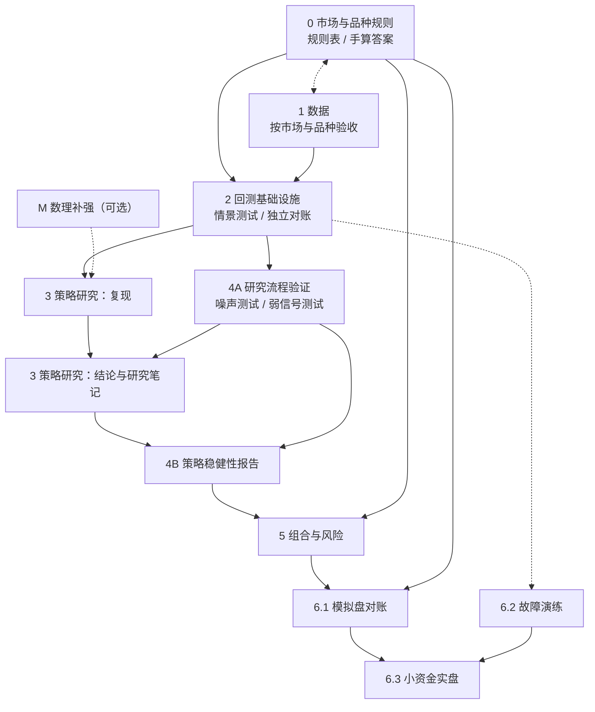

# 量化投资学习路线：阶段、阻塞关系与验收任务

适用对象：个人投资者，编程和数理基础扎实；品种覆盖股票、期货、期权；市场为 A 股，以及计划中的港股、美股。

> 本文是学习方法和资料清单，不构成投资建议。书籍版次、交易规则、监管和税务规定会变化，引用前以官方最新版本为准。文中的验收阈值是建议的经验值，不是行业标准，可按需调整。

## 目录

1. [核心结论](#1-核心结论)
2. [阶段阻塞关系](#2-阶段阻塞关系)
3. [当前进度（基于本项目）](#3-当前进度基于本项目)
4. [各阶段内容、参考资料与验收任务](#4-各阶段内容参考资料与验收任务)
5. [持续信息渠道](#5-持续信息渠道)
6. [建议的近期行动](#6-建议的近期行动)

---

## 1. 核心结论

- 按「研究流水线」推进，而不是按学科顺序（数学 → 金融 → 编程）学习。每个阶段都要有可运行、可检验的产出。
- 对有编程和数理基础的人来说，真正需要补的是三件事：
  1. **市场规则与交易成本**：决定回测和实盘之间差多少。
  2. **过拟合控制**：决定回测结果是否可信。
  3. **风险与仓位管理**：决定能否长期存活。
- 每个阶段配一个**有已知正确答案或可量化标准**的验收任务。验收任务尽量写成 pytest 测试或可重跑的研究脚本，便于回归。
- **最关键的阻塞点是阶段 4A（研究流程验证）**。用于筛选候选策略的流程须先在预设场景中达到误报率和检出率要求，才能用来定稿阶段 3 的研究结论。

| 阶段 | 目标 | 产出 | 建议时长 |
|---|---|---|---|
| 0 市场与品种规则 | 搞清楚每个市场能做什么、成本多少、有何限制 | 规则与成本表、情景手算答案、回测配置和实现缺口 | 3–4 周 / 每个市场 |
| 1 数据 | 干净、无幸存者偏差、时点正确的数据 | 带缓存和数据质量检查的数据层 | 3–4 周 / 每个市场 |
| 2 回测基础设施 | 结果可信的回测引擎 | 经交叉验证的引擎 | 已部分完成 |
| 3 策略研究 | 掌握主要策略家族及其收益来源 | 每个家族一份复现和研究笔记 | 4–6 个月 |
| 4A 研究流程验证 | 在预设场景中校准误报率和检出率 | 噪声实验、弱信号实验和通过报告 | 2–3 周 |
| 4B 策略稳健性报告 | 对具体策略做过拟合检验 | 每个候选策略一份稳健性报告 | 每个策略 1–2 周 |
| 5 组合与风险 | 把多个策略合成可承受的组合 | 仓位、杠杆、风控规则 | 1–2 个月 |
| 6 模拟盘 → 实盘 → 监控 | 验证回测与实盘的偏差 | 对账、故障演练、衰减监控 | 持续 |
| M 数理补强（可选） | 按需补齐理论 | 定价自检 | 按需 |

---

## 2. 阶段阻塞关系

### 2.1 依赖图

实线表示**硬阻塞**（前置阶段的验收未通过，后续阶段不能开始，或者其结论不能被采信）；虚线表示**软依赖**（前置阶段有助于后续阶段，但可以并行推进）。

### 2.2 阻塞关系明细

| 阶段 / 任务 | 硬阻塞于 | 软依赖 | 可与之并行 | 阻塞原因 |
|---|---|---|---|---|
| 0 市场与品种规则 | 无 | 1（看数据有助于理解规则） | 1、M | 起点 |
| 1 数据 | 无 | 0（知道复权、停牌规则才能做数据检查） | 0、M | 起点 |
| 2 回测基础设施 | 0 的规则表与手算答案、1 的数据（对应市场和品种） | — | M | 用 0 的手算答案验收撮合，用 1 的数据做交叉验证 |
| 3 策略研究：复现 | 2 | M（期权家族需要定价理论） | 4A | 复现需要可信的引擎 |
| 4A 研究流程验证 | 2 | — | 3 复现 | 噪声测试要用完整的研究流程跑，流程依赖引擎 |
| 3 策略研究：结论 | 3 复现、4A | — | — | 4A 未通过时，流程可能在噪声中「发现」策略，结论不可信 |
| 4B 策略稳健性报告 | 3 结论、4A | — | 3 的其他家族 | 需要具体策略作为输入；检验方法本身须先经 4A 验证 |
| 5 组合与风险 | 4B（至少 3 个策略通过）、0 | — | 6.2 | 组合的输入是通过稳健性检验的策略；保证金规则来自 0 |
| 6.1 模拟盘对账 | 5、0 | — | 6.2 | 上线的应该是组合和风控规则，而不是单个策略 |
| 6.2 故障演练 | 无硬阻塞 | 2（需要实盘系统的骨架） | 5、6.1 | 工程问题，可以较早开始 |
| 6.3 小资金实盘 | 6.1、6.2 | — | — | 对账和故障恢复都通过才能投入真钱 |
| M 数理补强 | 无 | — | 全部 | 按需查阅，不阻塞主线 |

### 2.3 多市场的推进方式

- 阶段 0、1 **按市场和拟研究的品种独立验收**。规则表、情景手算答案和对应数据通过后，进入阶段 2 的实现与对账。
- 阶段 2 共用一个引擎（与本项目 ADR-0001「一个引擎、一个账户」一致）。每接入一个新市场或品种，都要补跑适用的阶段 2 验收，包括阶段 0 的情景测试。
- 阶段 4A 的验收结论适用于已覆盖的数据特征、样本长度、搜索空间和筛选规则。切换市场或品种时先核对适用范围。若波动聚集、横截面相关性、候选数量或筛选流程等发生实质变化，补跑对应场景。
- 推荐的顺序是：A 股（已有基础）→ 美股（数据最好、文献最多，适合校验方法论）→ 港股。三个市场的阶段 0、1 可以并行准备。

---

## 3. 当前进度（基于本项目）

依据本项目已完成的 ticket 01–06 估计：

| 阶段 | 状态 | 说明 |
|---|---|---|
| 0 | A 股部分完成 | 已有股票基础撮合、IC 盯市和保证金占用、510500 put 模型价撮合。追保、保证金不足强平和 ETF 期权实物交割尚待补充。港股、美股未开始 |
| 1 | A 股部分完成 | 已有 baostock / 中金所 / AKShare 适配器和 Parquet 缓存。同口径外部序列对账、幸存者偏差检查和数据质量报告待补 |
| 2 | 部分完成 | 已有引擎、撮合、除权、展期、期权模型价测试。独立账本对账、统一口径的零成本持有和未来数据扰动测试待补 |
| 3 | 起步 | 已有双均线、纯滚 IC、滚 IC + put delta 中性三个策略 |
| 4A / 4B | 未开始 | — |
| 5、6 | 未开始 | — |
| M | 部分完成 | `test_pricing.py` 已覆盖 BS 定价和反推隐含波动率 |

**当前关键路径是用双均线完成首轮研究闭环。** 先验收 A 股股票的规则、数据和账本，再校准 4A，最后按冻结的方案完成双均线的 4B。IC 和 ETF put 补齐对应数据、撮合验收及 4A 场景覆盖后，再做衍生品的 4B。

---

## 4. 各阶段内容、参考资料与验收任务

### 阶段 0：市场与品种规则

**阻塞关系**：起点，无硬阻塞；硬阻塞阶段 2、5、6.1。

按市场和品种列出交易制度、费用、做空途径、杠杆、准入门槛和税务，记录规则来源、生效日期及适用账户。把费率、保证金率等可变参数写入回测配置，将撮合和交割行为写成带预期答案的情景。

**三个市场的关键差异**（以交易所和券商现行规定为准）：

| 项目 | A 股 | 港股 | 美股 |
|---|---|---|---|
| 交易与交收 | 股票 T+1；期货、期权 T+0 | T+0 交易，T+2 交收 | T+0 交易，2024-05 起 T+1 交收 |
| 涨跌幅限制 | 主板 ±10%，创业板/科创板 ±20% | 无涨跌停，只有市调机制（VCM） | 无涨跌停，有 LULD 机制 |
| 印花税 | 卖出单边 0.05%（2023-08 起） | 买卖双边各 0.1%（2023-11 起） | 无（有很小的 SEC fee 和 TAF） |
| 做空途径 | 融券基本停滞（2024 年起转融券暂停），主要靠股指期货和 ETF 期权 | 指定证券可卖空，另有期货、期权、牛熊证 | 融券普遍可做，期权流动性好 |
| 个人准入 | 股指期货、个股期权各要 50 万资产，并通过知识测试 | 一般无额外门槛 | 保证金账户日内交易有 PDT 规则（在改革中，以 FINRA 最新规定为准） |
| 程序化交易监管 | 《证券市场程序化交易管理规定（试行）》及沪深北交易所的实施细则（2025 年施行），要求报告 | 券商层面管理 | 券商层面管理 |

**参考资料**：

- John Hull，《期权、期货及其他衍生产品》（*Options, Futures, and Other Derivatives*）：衍生品基础
- Sheldon Natenberg，*Option Volatility and Pricing*：期权交易实务
- Larry Harris，*Trading and Exchanges*：市场微观结构，讲订单簿、流动性和成本的来源
- 一手规则：上交所、深交所、中金所、港交所（HKEX）的交易规则与合约细则；美股看 SEC 和 FINRA
- 跨境税务：W-8BEN（中美税收协定下股息预扣税为 10%）、CRS 下境外所得的申报，建议咨询专业人士

**验收任务是建立情景题库。** 每个市场写 8–10 个情景。每题分别记录**市场规则、原型预期行为和实现缺口**，手算成交、费用、现金和持仓的变化。阶段 0 验收规则表与手算答案，阶段 2 用这些答案核对引擎。

| 市场 | 情景 | 需预先给出的答案 |
|---|---|---|
| A 股 | 涨停价挂买单；当日买入当日卖出；按指定板块和证券规则申报买入 150 股 | 合法申报数量、可卖数量和拒单原因。涨停买单注明可成交量和队列假设 |
| A 股 | 买入 10 万元、持有、卖出的一个来回 | 佣金（含最低 5 元）、印花税、过户费，精确到分 |
| 期货 | IC 连续两天不利波动，情景假设保证金率为 14%；另设到期仍有持仓的情景 | 分别手算每日盯市、保证金占用、按指定规则应补的金额及到期交割现金流。原型只记录保证金占用，并将到期未展期持仓按结算价平掉 |
| 期权 | 510500 put 到期时实值 / 虚值 | 分别核对按交易所规则行权时的证券和资金变化，以及原型按内在价值卖出结算的现金流 |
| 港股 | 买 1 手腾讯，再买 1 手中芯国际 | 每手股数不同；双边印花税、交易征费、结算费 |
| 美股 | 买 100 股 SPY 再卖出；股息到账 | SEC fee / TAF；股息预扣税 |

**通过标准**：

- 每题能追溯到适用的交易所或券商规则。注明成交金额、费率和取整方式，使他人可以独立重算。
- 记录哪些情景可由现有引擎检验、哪些只在原型假设下成立、哪些需要补能力。510500 ETF 期权原则上实物交割，原型使用内在价值结算近似。 [上交所合约条款](https://www.sse.com.cn/assortment/options/contract/c/c_20230303_5717361.shtml) · [原型设计](design.md#6-品种规则)
- 尚未接入引擎的品种可先完成本阶段。依赖某项待补能力的研究或上线任务，应在对应能力通过验收后推进。

---

### 阶段 1：数据

**阻塞关系**：起点，无硬阻塞（软依赖阶段 0）；硬阻塞阶段 2。

**要做的事**：重点防住三类错误：

1. **幸存者偏差**：股票池必须包含已退市股票。
2. **前视偏差**：财务数据按公告日对齐，不按报告期；指数成分用历史时点的成分。
3. **复权错误**：例如本项目已发现 baostock 给 510500 的复权因子有误。

**数据源**：

| 市场 | 免费或低价 | 付费、更可靠 |
|---|---|---|
| A 股 | baostock、AKShare、Tushare Pro（积分制） | 聚宽、米筐、Wind（机构） |
| 港股 | AKShare、富途 OpenAPI 行情 | 券商 Level-2、Refinitiv |
| 美股 | yfinance（非官方，不稳定）、SEC EDGAR（财报原文） | Norgate（含退市股，适合个人）、Databento、CRSP（需通过高校 WRDS） |
| 因子与学术数据 | Kenneth French Data Library、AQR Datasets | — |

**参考资料**：

- López de Prado，*Advances in Financial Machine Learning*，第 2–5 章：数据结构、采样、标签方法
- Ernest Chan，*Quantitative Trading*（第 2 版）：讲数据陷阱的章节

**验收任务一是按同一口径与独立序列对账。**

- **510500 和 SPY**。用二级市场价格、分红和份额变动重建总收益，先对齐交易日、取价时点、再投资和币种。优先与同口径的市场价格总收益核对。缺少同口径参考序列时，用独立来源核对原始价格、除息与份额变动，再重算收益。可用基金 NAV 总收益做辅助检查，单列折溢价、取价和分红再投资口径造成的差异。SPY 发行方公布的业绩已扣除基金费用，比较时直接使用已披露口径。 [SPY 官方业绩口径](https://www.ssga.com/us/en/institutional/etfs/state-street-spdr-sp-500-etf-trust-spy)
- **中证 500 或沪深 300**。取得历史成分、调整股本和调样生效日后，按对应时期的编制规则重建指数。按价格指数或全收益指数分别对账，记录除数调整和公司行动的处理方式。 [中证 500 等指数编制方案](https://oss-ch.csindex.com.cn/static/html/csindex/public/uploads/indices/detail/files/zh_CN/000907_Index_Methodology_cn.pdf) · [沪深 300 编制方案](https://oss-ch.csindex.com.cn/static/html/csindex/public/uploads/indices/detail/files/zh_CN/000300_Index_Methodology_cn.pdf)

通过标准：

- 事先记录参考序列、适用日期和误差容限，同时检查逐期收益差与累计净值偏离。月收益相关系数可作辅助诊断。
- 逐项归因超限差异，优先核对除息、份额变动、调样和取价时点。参考数据或关键字段缺失时，报告可核对的范围，并将缺失部分标为待验收。

**验收任务二：幸存者偏差和前视偏差检查。**

- 统计 2015 年初的 A 股股票池里有多少只后来退市。
- 如果用到财务数据，抽查 20 条，确认每条的可用日期是公告日而不是报告期末。

通过标准：

- 退市股数量与交易所公开统计口径大致相符。数量为 0 说明存在幸存者偏差。
- 20 条财务数据全部按公告日对齐。

**验收任务三：数据质量报告。** 对每个品种自动检查：缺失交易日、单日涨跌超出涨跌停限制（排除新股首日、除权日）、价格为 0 或为负、成交量为 0 却有价格变动。

通过标准：报告中每一条异常都有解释或已修正，没有「未解释」条目。

---

### 阶段 2：回测基础设施

**阻塞关系**。依赖对应市场和品种的规则表、情景手算答案与数据，并阻塞阶段 3 复现和 4A。阶段 6.2 可以并行准备。

**要做的事**（针对本项目的下一步）：

1. 成本敏感性扫描：手续费和滑点从 0 扫到 3 倍。
2. 输出可供阶段 4 使用的逐日收益、成交、拒单和账户快照，并记录数据版本与运行配置。
3. 与独立实现交叉验证。
4. 事件驱动或分钟级扩展：只在策略确实需要时再做。

**可参考的框架**（参考设计，不一定替换自研引擎）：

| 框架 | 特点 |
|---|---|
| Microsoft Qlib | 面向 A 股的机器学习因子研究，数据处理和因子表达式值得参考 |
| vn.py | 国内期货、期权实盘接口（CTP），阶段 6 会用到 |
| QuantConnect LEAN | 多市场事件驱动引擎，开源，美股和期权数据完善 |
| vectorbt | 向量化回测，适合快速扫参数和交叉验证 |
| NautilusTrader | 高性能事件驱动，回测与实盘同一套代码 |

**验收任务一是用独立账本交叉验证。** 先用手算或独立脚本核对阶段 0 的情景，再用同一段行情和双均线规则分别跑本项目引擎与独立实现（可用 vectorbt 或 LEAN）。事先对齐信号和成交时点、初始资金、取整、成本和现金计息。第三方框架无法表达的规则，单独用手算情景验收。

通过标准：

- 同口径情景中，成交和拒单与预期一致。逐日对账至少核对成交日期、方向、数量、价格、费用、现金、持仓、净值，衍生品再核对盯市和保证金。
- 数量与离散状态完全一致，金额差异在事先定义的取整容限内。规则差异造成的偏离单独列明，并用对应的手算用例核对。

**验收任务二：已知答案测试。**

- **随机信号**。用固定种子构造独立的随机仓位和零条件期望的收益。在零成本、零现金利率的简化情景中，与预设零期望基准核对。另用固定成交路径核对加费后的净值差，避免把仓位变化混入费用影响。
- **零成本持有**。用首笔成交后持有到底的策略，与独立买入持有账本对账。对齐首次成交的时间和价格、整手余款、现金利息、公司行动和估值口径。先用无公司行动的小样本，再单独测分红和除权。
- **未来行情扰动**。固定策略、配置和随机种子，只修改截点之后才可用的行情。比较截至截点的信号、订单、成交和账户快照。若适配器会预生成复权序列或特征，也从原始输入重跑，以覆盖预处理环节。
- **成交时点**。分别测试股票信号在收盘形成、订单次日开盘尝试撮合，以及衍生品在原型中按当日收盘撮合。按收盘价选 put 再用同日收盘模型价成交属于执行近似，应在研究报告中标注。 [成交时点 ADR](adr/0003-derivatives-fill-at-close.md)

通过标准：

- 随机信号实验报告平均超额收益及其置信区间，按事前容限核对偏离。固定成交路径的费用影响和零成本持有账本逐日一致，金额采用与独立对账相同的取整容限。
- 修改未来行情后，截至截点的结果一致。成交时点符合各品种的预期，所有原型撮合近似均有记录。

---

### 阶段 3：策略研究

**阻塞关系**：

- 「复现」部分硬阻塞于 2，可与 4A 并行；软依赖 M。
- 「结论与研究笔记」部分硬阻塞于 3 复现和 4A；硬阻塞 4B。

**推进顺序**：趋势 / 动量 → 因子选股 → 期货基差与 carry → 期权波动率 → 统计套利。

**各策略家族的参考资料**：

| 家族 | 参考资料 |
|---|---|
| 趋势跟踪 / 时间序列动量 | Moskowitz, Ooi, Pedersen，"Time Series Momentum"，*JFE* 2012；Hurst, Ooi, Pedersen，"A Century of Evidence on Trend-Following Investing"（AQR）；Robert Carver，*Systematic Trading*、*Advanced Futures Trading Strategies* 及博客 qoppac.blogspot.com |
| 因子投资 | Fama & French（1993 三因子、2015 五因子）；Carhart（1997 动量）；Asness, Moskowitz, Pedersen，"Value and Momentum Everywhere"，*JF* 2013；Liu, Stambaugh, Yuan，"Size and Value in China"，*JFE* 2019；石川等，《因子投资：方法与实践》；Grinold & Kahn，*Active Portfolio Management*；Kakushadze，"101 Formulaic Alphas"（2016）；练手平台 WorldQuant BRAIN |
| 期货基差、carry 与展期 | Koijen, Moskowitz, Pedersen, Vrugt，"Carry"，*JFE* 2018 |
| 期权与波动率 | Euan Sinclair，*Volatility Trading*、*Positional Option Trading*；Colin Bennett，*Trading Volatility*；Jim Gatheral，*The Volatility Surface* |
| 统计套利 / 配对 | Gatev, Goetzmann, Rouwenhorst，"Pairs Trading"，*RFS* 2006；Avellaneda & Lee，"Statistical Arbitrage in the U.S. Equities Market"，2010；跨市场方向如 A/H 溢价、ETF 折溢价 |

注：本项目用 BS 模型价近似期权价格（ADR-0002），做期权真实交易时必须改用真实盘口和隐含波动率曲面。

**验收任务一：复现经典结果，再迁移到目标市场。** 每个家族至少做一个。

| 家族 | 复现目标 | 通过标准 |
|---|---|---|
| 因子（美股） | 用原始股价自建 HML（价值）、UMD（动量）月收益 | 与 Kenneth French 数据库对应因子的相关系数大于 0.95 |
| 因子（A 股） | 复现 Liu-Stambaugh-Yuan 的 CH-3 规模、价值因子 | 与作者公开的 CH-3 因子数据相关系数大于 0.9 |
| 时间序列动量 | 按 Moskowitz-Ooi-Pedersen（2012）的方法，在期货或 ETF 上构建 | 共同样本期内 Sharpe 和回撤形态与论文同量级，2008 年表现为正 |
| 期货 carry | 用 IC 贴水构建 carry 信号 | 能定量说明 2022-09-19 前后贴水收益的变化并给出解释 |
| 期权波动率 | 验证波动率风险溢价：VIX² 对比后续 30 日实现方差（美股），或 510500 隐含波动率对比实现波动率 | 长期均值为正；能指出溢价为负的时段（如 2020 年 3 月）并解释 |

**验收任务二：研究笔记**（须在 4A 通过之后定稿）。每个家族一页，回答三个问题，每个答案都要有数据支持：

1. 收益来源是什么：风险补偿、行为偏差，还是结构性约束？
2. 谁是交易对手方？
3. 什么情况下会失效？历史上能否找到失效区间？（例如规模因子在 2024 年初的微盘股踩踏）

通过标准：三个问题都有数据或图表支持，而不只是文字论述。

---

### 阶段 4：稳健性与过拟合控制

本阶段拆成两部分，因为它们的阻塞关系不同：

- **4A 研究流程验证**。检验指定数据场景和候选搜索范围内的研究流程。硬阻塞于 2，并阻塞阶段 3 结论定稿和 4B。
- **4B 策略稳健性报告**：检验具体策略。硬阻塞于 3 的结论和 4A；硬阻塞 5。

**参考资料**：

- Bailey & López de Prado，"The Deflated Sharpe Ratio"，2014
- Bailey, Borwein, López de Prado, Zhu，"The Probability of Backtest Overfitting"（PBO / CSCV 方法）
- Harvey, Liu, Zhu，"…and the Cross-Section of Expected Returns"，*RFS* 2016：t 值门槛应提高到 3 左右
- López de Prado，*Advances in Financial Machine Learning*，第 7、11–14 章：purged k-fold 交叉验证、回测的危险性
- Hou, Xue, Zhang，"Replicating Anomalies"，*RFS* 2020：大量已发表的异象在复现时失效

**4A 验收任务一是测量误报率。** 事先写明零假设、基准、样本长度、成本、候选搜索范围、切分方式和最终放行规则。可以从没有可预测超额收益的模拟场景起步，再按目标数据补充波动聚集或横截面相关性。每个场景运行 1000 轮独立实验，每轮重新生成完整数据集，并重跑特征构造、参数搜索、候选筛选和样本外检验。一轮中只要有一个候选被流程最终放行，就记为一次误报。

通过标准：

- 按场景报告误放行轮数、误报率及二项置信区间，与预先约定的上限比较。例如，把误报目标定为 5%、验收容限定为 2 个百分点时，要求误报率的单侧 95% 置信上界不超过 7%。这些数值可按研究目标预先调整。
- DSR 用于诊断候选 Sharpe 受多重搜索影响的程度，PBO 用于诊断样本内赢家跌至样本外排名中位数以下的概率。分别记录这两个指标，误报率以完整流程的放行结果计算。调整流程后，用新种子生成独立样本复验。 [DSR 原论文](https://davidhbailey.com/dhbpapers/deflated-sharpe.pdf) · [PBO 原论文](https://www.davidhbailey.com/dhbpapers/backtest-prob.pdf)

**4A 验收任务二是测量弱信号检出率。** 先定义信号方向、最小有意义效应、样本长度、独立重复次数和目标检出率。例如，在模拟收益里植入可在下单前观察到的预测变量，使它与次日收益的总体相关系数为 0.03。若放行规则看扣成本后的效应，植入强度也应按该口径校准。沿用纯噪声实验的搜索、筛选和检验规则。

通过标准是检出率的单侧置信下界达到事先设定的目标，样本外效应估计的偏差在事先设定的容限内。只把最终放行且识别出预先定义的信号或等价规则的轮次计为检出。达不到要求时，记录该效应在当前样本长度下证据不足，可补测多个效应强度以估计检出能力，或增加样本后复验。

**4B 验收任务是为每个候选策略出具稳健性报告。** 在首次查看留出结果前，锁定数据版本和日期、基准、收益及成本口径、候选规则、开发期滚动验证方案和最终放行条件。已经查看并用于研究决策的年份归入开发样本。留出期用于一次最终检验，若据此修改策略，下一轮需要新的独立样本。报告包括以下内容。

- 从首次搜索开始记录的累计尝试次数和候选配置
- Deflated Sharpe 和 PBO，注明候选范围、估计口径和适用条件
- 开发样本内 walk-forward 各段指标
- 参数邻域热力图
- 成本扫描（0 到 3 倍）
- 预先冻结的留出区间上的结果，包括相对基准的扣成本效应和估计不确定性
- 滚 IC＋put 分开报告上市前的假设合约、上市后用模型价回测、上市后用真实可交易报价回测三类结果。前两类用于验证机制与模型敏感性。可执行性依赖第三类报价及与实际委托时点一致的成交假设，包括买卖价差、可成交量和费用。缺少这些证据时，可执行性标为待验收

通过标准：

- 留出样本达到事前指定的扣成本效应下限及不确定性要求。样本内外 Sharpe 的降幅单列为诊断信息。样本不足以作出判断时，记录为证据不足。
- 按事前定义的参数邻域和容限，检查效应在邻域内是否持续。
- 按事前约定的成本压力场景检查结果，并报告盈亏平衡成本。

---

### 阶段 5：组合与风险

**阻塞关系**：硬阻塞于 4B（至少 3 个策略通过）和 0（保证金规则）；硬阻塞 6.1；可与 6.2 并行。

**参考资料**：

- Carver，*Systematic Trading* 中关于仓位和组合的部分
- Edward Thorp，"The Kelly Criterion in Blackjack, Sports Betting and the Stock Market"：实盘用半 Kelly 或更低
- Ledoit & Wolf 协方差收缩；López de Prado，"Building Diversified Portfolios that Outperform Out-of-Sample"（HRP，2016）
- Giuseppe Paleologo，*Advanced Portfolio Management*
- Antti Ilmanen，*Expected Returns*

**验收任务一：目标波动率达成检验。** 把至少 3 个低相关策略组合起来，设定目标年化波动率（如 10%）。

通过标准：

- 在超过 80% 的时间里，滚动 1 年实现波动率落在目标的 ±25% 以内。
- 单一策略的风险贡献不超过 50%。

**验收任务二：历史压力情景回放。** 用当前持仓规则回放：2015 年 6–8 月股灾、2016 年 1 月熔断、2020 年 3 月、2024 年 1–2 月微盘股踩踏；美股另加 2008 年和 2022 年。

通过标准：

- 每个情景的最大回撤都低于**事先**设定的上限。
- IC 和期权部分在「连续 3 天不利方向涨跌停」的假设下不穿仓，保证金占用不超过可用资金的预设比例。

**验收任务三：风控规则文档。** 事先写明：回撤到多少减仓、到多少停止交易、什么条件下恢复交易，并用历史数据回放。

通过标准：规则可以机械执行，不需要当场判断；回放结果与文档描述一致。

---

### 阶段 6：模拟盘 → 小资金实盘 → 监控

**阻塞关系**：

- 6.1 模拟盘对账：硬阻塞于 5、0。
- 6.2 故障演练：无硬阻塞（软依赖 2），可较早开始，与 5、6.1 并行。
- 6.3 小资金实盘：硬阻塞于 6.1 和 6.2。

**交易接口**：

| 市场 | 常用途径 |
|---|---|
| A 股股票 / ETF | 券商提供的 QMT / miniQMT、Ptrade（开通条件因券商而异），需满足程序化交易报告要求 |
| 国内期货 / 期权 | CTP 接口（期货 CTP、股票期权 SOPT），通过 vn.py 接入 |
| 港股、美股 | Interactive Brokers TWS API（Python 可用 ib_async）、富途 OpenAPI、长桥 OpenAPI、老虎 OpenAPI |

**参考资料**（执行与成本建模）：

- Almgren & Chriss，"Optimal Execution of Portfolio Transactions"，2000
- Robert Kissell，*The Science of Algorithmic Trading and Portfolio Management*
- Cartea, Jaimungal, Penalva，*Algorithmic and High-Frequency Trading*（做日频可只读成本模型部分）

**6.1 验收任务：模拟盘对账**（至少 20 个交易日）。每天收盘后自动对账：把实盘系统的信号、订单、成交，与用同期真实数据重放的回测结果逐条对比。

通过标准：

- 信号 100% 一致。
- 成交差异全部有归因（滑点、部分成交、拒单等）。
- 实际滑点均值不超过回测假设。

**6.2 验收任务：故障演练。** 主动制造故障：盘中杀掉进程、断网 5 分钟、行情延迟、券商接口返回错误、重复启动。

通过标准：

- 恢复后无重复下单、无漏单。
- 持仓和账户最终与券商一致。
- 每种故障都会触发告警。

**6.3 验收任务：小资金实盘 3 个月。** 资金规模以能承受全部亏损为限。

通过标准：

- 实盘收益与同期回测的差异能被成本和滑点解释。
- 衰减监控正常运行：滚动 IC 或 Sharpe 跌破阈值时自动告警。
- 月度复盘报告按时产出。

---

### 阶段 M：数理补强（可选，不阻塞主线）

**阻塞关系**：无硬阻塞；对阶段 3 的期权家族是软依赖。

| 主题 | 参考资料 |
|---|---|
| 金融时间序列 | Ruey Tsay，*Analysis of Financial Time Series* |
| 金融计量 | Campbell, Lo, MacKinlay，*The Econometrics of Financial Markets* |
| 资产定价理论 | John Cochrane，*Asset Pricing* |
| 随机分析 / 衍生品定价 | Steven Shreve，*Stochastic Calculus for Finance* I & II |
| 公开课 | MIT OCW 18.S096 *Topics in Mathematics with Applications in Finance* |

**验收任务：定价自检。** 不看书，独立推导并实现 Black-Scholes 定价和 Greeks、反推隐含波动率、二叉树美式期权定价，并与 Hull 书中例题对照。

通过标准：

- 与 Hull 例题的数值误差小于 1e-4。
- 二叉树步数增加时，欧式情形收敛到 BS 价格。

本项目 `tests/test_pricing.py` 已覆盖前两项，补上二叉树即完成。

---

## 5. 持续信息渠道

- 论文：SSRN 的 Financial Economics Network、arXiv q-fin
- 聚合与博客：Quantocracy、Alpha Architect、Robot Wealth、Ernie Chan 博客、Robert Carver 博客
- 代码与讲义：Quantopian 研究讲义存档（GitHub 上的 quantopian/research_public）
- 竞赛：Kaggle 上 Jane Street、Optiver 的市场预测竞赛

---

## 6. 建议的近期行动

按关键路径排序（详见第 2、3 节）：

1. **先用双均线验收 A 股股票的阶段 0、1**。完成所用证券的规则与情景手算，核对原始行情和公司行动，并产出数据质量报告。
2. **完成双均线的阶段 2**。交付独立账本对账结果，补齐随机信号、零成本持有、未来行情扰动和成交时点测试。
3. **完成双均线研究流程的阶段 4A 和 4B**。先记录完整筛选流程的误报率和检出率，再按事先冻结的规则评估留出结果。
4. **对比纯滚 IC 和滚 IC＋put**。补齐 IC、510500 的规则情景和数据对账，按品种验收引擎，并在 4A 补测衍生品场景后运行 4B。模型价和真实报价分开报告。
5. 美股阶段 0、1 可并行准备。各市场的经典复现可在对应品种通过阶段 2 后与 4A 并行，研究结论待 4A 通过后定稿。
